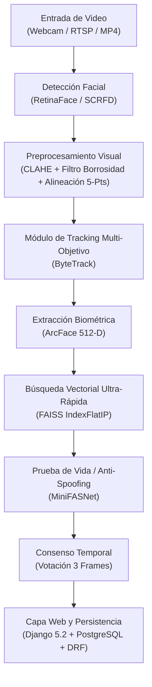

# Reporte Técnico: Descripción Integral del Proyecto, Librerías y Modelos de IA
**Proyecto:** CV College — Sistema Inteligente de Control de Asistencia Biométrica  
**Fecha de emisión:** 2026-09-02  
**Autor:** Antigravity (IA) & Valentina  
**Ubicación:** `docs/analisis/03_descripcion_proyecto_librerias_modelos.md`  

---

## 1. ¿De Qué Trata el Proyecto?

**CV College** es una plataforma tecnológica híbrida diseñada para automatizar y agilizar el registro de asistencia en instituciones educativas y universitarias utilizando **Visión por Computadora (Computer Vision)** y **Aprendizaje Profundo (Deep Learning)** en tiempo real.

### 1.1 El Problema que Resuelve
1. **Pérdida de tiempo en clase:** Tomar asistencia manual o por lista tradicional consume entre 5 y 15 minutos por sesión.
2. **Suplantación de identidad (Fraude):** Métodos como firmas o tarjetas magnéticas permiten que un alumno firme por otro.
3. **Escenarios no controlados:** Cámaras de aula que enfrentan sombras, alumnos distantes, iluminación cambiante, movimientos rápidos y ángulos no frontales.

### 1.2 La Solución Implementada
El sistema procesa transmisiones de video (webcam, cámaras IP / RTSP o archivos MP4 de aula) para registrar de forma instantánea y no invasiva a los estudiantes presentes:
* Detecta y rastrea múltiples rostros simultáneamente en el aula.
* Filtra caras borrosas, oscuras o mal encuadradas mediante algoritmos de calidad visual.
* Extrae vectores biométricos (embeddings) de alta fidelidad y los compara contra una base de datos vectorial en tiempo logarítmico.
* Aplica pruebas de vida activas/pasivas (*anti-spoofing*) para prevenir ataques de presentación (fotos impresas, pantallas de celulares/tablets).
* Consolida la asistencia mediante un algoritmo de consenso temporal (votación multiframe) y persiste los datos en un backend web con arquitectura de roles (Django).

---

## 2. Arquitectura General del Sistema



---

## 3. Modelos de Inteligencia Artificial y Deep Learning

Todos los modelos neuronales se ejecutan de manera local y offline optimizados a través de **ONNX Runtime**, eliminando dependencias de APIs en la nube y garantizando privacidad y latencia ultra-baja.

| Modelo | Función en el Pipeline | Tipo de Red Neuronal | Salida / Dimensionalidad |
|---|---|---|---|
| **RetinaFace** | Detección facial y landmarks | FPN + Context Modules (ResNet/MobileNet Backbone) | Bounding box $(x_1, y_1, x_2, y_2)$, Score confianza, 5 Landmarks faciales |
| **SCRFD** (Experimental) | Detección ultra-rápida en CPU | Sample and Computation Redistribution | Bounding box + 5 landmarks a alta tasa de FPS |
| **ArcFace** | Extracción de identidad biométrica | Deep Residual Network (ResNet) con Additive Angular Margin Loss | Vector de Embedding unitario de **512 floats** ($\mathbb{R}^{512}$) |
| **MiniFASNet** | Anti-spoofing / Detección de vida | CNN Ligera (Silent-Face Anti-Spoofing) | Probabilidad binaria (Real vs. Spoof / Pantalla / Foto) |

### 3.1 RetinaFace (Localización y Puntos de Referencia)
* **¿Qué hace?** Escanea el frame de video completo para encontrar dónde hay rostros humanos y extrae con precisión milimétrica 5 puntos de referencia (*facial landmarks*): ojo izquierdo, ojo derecho, punta de la nariz, comisura izquierda de la boca y comisura derecha.
* **¿Por qué se usa?** Es uno de los detectores densos más robustos del estado del arte ante oclusiones parciales, rostros pequeños en segundo plano y cambios drásticos de escala en el salón.

### 3.2 ArcFace (Representación Biométrica / Embeddings)
* **¿Qué hace?** Toma el rostro recortado y alineado, y lo proyecta en una hiperesfera de 512 dimensiones. 
* **Fundamento Matemático:** Entrenado con la función de pérdida *Additive Angular Margin Loss* ($\mathcal{L}_{\text{ArcFace}}$), que añade un margen angular $m$ forzando a que las fotos de la misma persona queden muy juntas angularmente y las de personas distintas queden muy separadas.
* **Métrica:** La comparación entre dos rostros se reduce al cálculo de la **Similitud Coseno**:
$$\text{Similitud}(A, B) = A \cdot B = \sum_{i=1}^{512} A_i B_i \quad (\text{dado que } \|A\|=\|B\|=1)$$

### 3.3 MiniFASNet (Anti-Spoofing / Gatekeeper)
* **¿Qué hace?** Analiza artefactos de textura, reflejos de pantallas LCD/OLED, bordes de papel y distorsiones de frecuencia para determinar si el rostro presentado a la cámara pertenece a una persona viva de carne y hueso o a un intento de suplantación.

---

## 4. Algoritmos Clave y Preprocesamiento Facial

El proyecto incluye técnicas determinísticas y probabilísticas en `core/utils_facial.py` que complementan a las redes neuronales:

### 4.1 CLAHE (Contrast Limited Adaptive Histogram Equalization)
* **Objetivo:** Resolver problemas de iluminación extrema (sombras marcadas en el aula, contraluces de ventanas o sobreexposición).
* **Cómo opera:** Convierte la imagen al espacio de color **CIE LAB**, separa el canal de luminancia ($L$), aplica ecualización adaptativa por bloques de $8\times8$ limitando la amplificación del contraste (`clipLimit=2.0`), y recombina los canales a BGR.

### 4.2 Filtro de Borrosidad (Varianza del Laplaciano)
* **Objetivo:** Evitar que frames movidos o fuera de foco degraden el reconocimiento.
* **Cómo opera:** Aplica el operador Laplaciano $\nabla^2 f = \frac{\partial^2 f}{\partial x^2} + \frac{\partial^2 f}{\partial y^2}$ sobre la escala de grises y calcula su varianza estadística. Si $\sigma^2 < \text{umbral}$ (ej. 60), el frame se descarta inmediatamente antes de gastar recursos de inferencia.

### 4.3 Alineación Geométrica Afín (Affine Face Alignment)
* **Objetivo:** Normalizar la orientación de la cabeza.
* **Cómo opera:** Calcula el ángulo $\theta = \arctan\left(\frac{y_{\text{der}} - y_{\text{izq}}}{x_{\text{der}} - x_{\text{izq}}}\right)$ entre los ojos y genera una matriz de transformación afín 2D para rotar el rostro hasta que la línea interocular quede completamente horizontal ($0^\circ$). Luego realiza un recorte proporcional a la distancia interocular.

### 4.4 ByteTrack (Tracking Multi-Objetivo)
* **Objetivo:** Asignar un identificador único persistente (`tracker_id`) a cada persona mientras se mueve por el aula.
* **Beneficio:** Evita tener que reconocer biométricamente a un alumno en los 30 frames de cada segundo; una vez reconocido y anclado por 3 votos, el tracking mantiene su identidad mientras esté visible en escena, elevando drásticamente los FPS.

### 4.5 FAISS (Búsqueda Vectorial por Coseno)
* **Objetivo:** Buscar el candidato más cercano en la base de datos de embeddings en tiempo $O(\log N)$ o mediante producto interno matricial directo optimizado (`IndexFlatIP`).

---

## 5. Inventario Completo de Librerías y Dependencias

A continuación se detalla el ecosistema de software organizado por su rol técnico:

### 5.1 Visión por Computadora e Inteligencia Artificial

| Librería | Versión habitual | Propósito en el Proyecto |
|---|---|---|
| **`uniface`** | 3.3.0 | Módulo principal de IA. Provee las interfaces `create_detector()`, `create_recognizer()` y `create_spoofer()`, gestionando la descarga y ejecución de los modelos ONNX. |
| **`onnxruntime`** | ≥ 1.16 | Motor de ejecución optimizado para inferencia de redes neuronales ONNX en CPU / GPU. |
| **`opencv-python`** (`cv2`) | ≥ 4.8 | Captura y decodificación de video, dibujo de interfaces visuales (bounding boxes, textos), transformaciones afines, CLAHE y procesamiento matricial de imágenes. |
| **`supervision`** (`sv`) | ≥ 0.16 | Proporciona la implementación de **ByteTrack** para el seguimiento y asociación temporal de detecciones de rostros entre fotogramas. |
| **`faiss-cpu`** | ≥ 1.7 | Indexación y búsqueda de similitud coseno vectorial de alta velocidad (`IndexFlatIP`). |

### 5.2 Procesamiento Numérico, Científico y Gráficos

| Librería | Propósito en el Proyecto |
|---|---|
| **`numpy`** | Manejo de matrices multidimensionales, cálculo de normas vectoriales, centroides promedios, productos punto y operaciones algebraicas. |
| **`scipy`** | Rutinas científicas auxiliares para transformaciones espaciales y distancias. |
| **`matplotlib`** | Generación de curvas ROC, gráficos de sensibilidad, matrices de confusión e histogramas en los scripts de `experiments/`. |

### 5.3 Backend Web, API y Persistencia de Datos

| Librería / Componente | Propósito en el Proyecto |
|---|---|
| **`Django`** (5.2) | Framework web principal. Gestiona la lógica de negocio, autenticación, control de acceso basado en roles (RBAC) y persistencia de asistencias y auditorías. |
| **`djangorestframework`** (DRF) | Creación de endpoints RESTful para la API de enrolamiento y consulta de asistencia biométrica. |
| **`psycopg2-binary`** | Conector oficial para la base de datos relacional **PostgreSQL** (`cv_college_db`). |
| **`pgvector`** | Extensión de PostgreSQL para búsqueda vectorial. El modelo `FaceEmbedding` guarda un vector de 512 d por usuario (`VectorField`) con índice HNSW y similitud coseno; es la fuente de verdad de los centroides. |
| **`pickle`** (Estándar de Python) | Solo como respaldo histórico: `database_embeddings.pkl` se usa para importar los centroides iniciales (`manage.py importar_centroides`). |

### 5.4 Testing y Calidad de Código

| Librería | Propósito en el Proyecto |
|---|---|
| **`pytest`** | Framework de pruebas automatizadas. Ejecuta tanto el banco unitario rápido (`pytest -m unit`) como las pruebas de integración con modelos neuronales reales (`pytest -m integration`). |

### 5.5 Frontend y Presentación

| Tecnología | Propósito en el Proyecto |
|---|---|
| **`Tailwind CSS`** (CDN) | Framework de estilos CSS utilitarios para el dashboard de profesores, directores y panel de monitoreo en vivo. |
| **Django Template Engine** | Renderizado del lado del servidor de las vistas web responsive. |

---

## 6. Resumen de Flujo de Datos

```
[Video MP4 / Cámara] 
       │
       ▼
 [RetinaFace] ──(Detecta rostro + 5 landmarks)
       │
       ▼
[utils_facial] ──(Valida nitidez Laplaciana + Ecualiza CLAHE + Alinea ángulo)
       │
       ▼
  [ArcFace] ──(Genera vector normalizado de 512 dimensiones)
       │
       ▼
   [FAISS] ──(Calcula producto punto contra centroides registrados)
       │
       ▼
[MiniFASNet] ──(Comprueba liveness para evitar fotos/pantallas)
       │
       ▼
 [ByteTrack] ──(Consensa 3 votos continuos por ID de seguimiento)
       │
       ▼
[Django ORM] ──(Registra en Asistencia / Genera log en asistencia.csv)
```

---

*Documento técnico de referencia disponible en: `docs/analisis/03_descripcion_proyecto_librerias_modelos.md`.*
