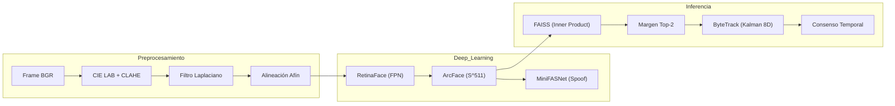
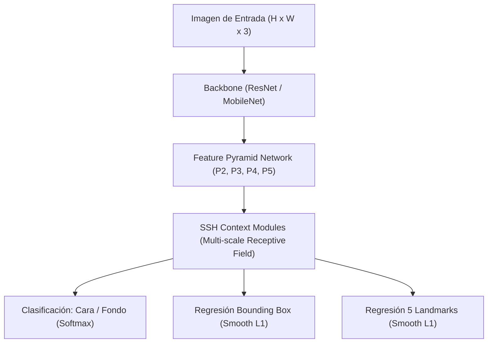

# Fundamentos Matemáticos y Estadísticos del Pipeline Biométrico

**Proyecto:** CV College — Sistema Inteligente de Control de Asistencia  
**Documento:** Tratado Técnico de Formulación Matemática y Estadística  
**Ubicación:** `docs/analisis/04_fundamentos_matematicos_pipeline.md`  
**Referencia Base:** Plan Maestro UNC (`docs/analisis/unc/00_plan_experimentos_unc.md`)  
**Fecha:** 2026-09-07  

---

## Introducción y Notación General

Este documento formaliza cada una de las componentes matemáticas y probabilísticas que sustentan el pipeline de visión por computadora y reconocimiento facial del proyecto **CV College**, desde el nivel de píxel hasta la inferencia en tiempo real y los protocolos de validación experimental.

### Convenciones de Notación
* $\mathbb{R}^n$: Espacio vectorial euclidiano de dimensión $n$.
* $\mathbb{S}^{n-1} = \{ x \in \mathbb{R}^n : \|x\|_2 = 1 \}$: Hiperesfera unitaria de dimensión $n-1$.
* $\|\cdot\|_2$: Norma euclidiana estándar $\|x\|_2 = \sqrt{\sum_{i=1}^n x_i^2}$.
* $\langle u, v \rangle = u^T v = \sum_{i=1}^n u_i v_i$: Producto interno estándar.
* $\theta = \arccos(\langle u, v \rangle)$: Distancia angular o geodésica sobre la hiperesfera para vectores unitarios.
* $I(x, y) \in [0, 255]^{H \times W \times C}$: Imagen discreta bidimensional multicanal.



---

## 1. Preprocesamiento de Imágenes y Visión Clásica

### 1.1 Transformación de Espacio de Color: sRGB a CIE $L^*a^*b^*$

El algoritmo opera las mejoras lumínicas en el espacio cromático perceptualmente uniforme **CIE $L^*a^*b^*$** (`cv2.COLOR_BGR2LAB`) para desacoplar la luminosidad de los datos de crominancia biológica del rostro.

#### Paso 1: Linealización Gamma del espacio sRGB
Para cada canal de color normalizado $C_{\text{srgb}} \in \{R, G, B\} \in [0, 1]$:
$$C_{\text{linear}} = \begin{cases} \dfrac{C_{\text{srgb}}}{12.92} & \text{si } C_{\text{srgb}} \le 0.04045 \\ \left( \dfrac{C_{\text{srgb}} + 0.055}{1.055} \right)^{2.4} & \text{si } C_{\text{srgb}} > 0.04045 \end{cases}$$

#### Paso 2: Proyección al espacio CIE $XYZ$
Mediante el producto tensorial con la matriz de calibración para el iluminante estándar $D_{65}$:
$$\begin{bmatrix} X \\ Y \\ Z \end{bmatrix} = \begin{bmatrix} 0.4124564 & 0.3575761 & 0.1804375 \\ 0.2126729 & 0.7151522 & 0.0721750 \\ 0.0193339 & 0.1191920 & 0.9503041 \end{bmatrix} \begin{bmatrix} R_{\text{linear}} \\ G_{\text{linear}} \\ B_{\text{linear}} \end{bmatrix}$$

#### Paso 3: Proyección No Lineal a CIE $L^*a^*b^*$
Con punto blanco de referencia $X_n = 0.95047$, $Y_n = 1.00000$, $Z_n = 1.08883$:
$$L^* = 116 \, f\left(\frac{Y}{Y_n}\right) - 16$$
$$a^* = 500 \left[ f\left(\frac{X}{X_n}\right) - f\left(\frac{Y}{Y_n}\right) \right]$$
$$b^* = 200 \left[ f\left(\frac{Y}{Y_n}\right) - f\left(\frac{Z}{Z_n}\right) \right]$$
Donde la función de compresión cúbica $f(t)$ está dada por:
$$f(t) = \begin{cases} t^{1/3} & \text{si } t > \left(\dfrac{6}{29}\right)^3 \\ \dfrac{1}{3}\left(\dfrac{29}{6}\right)^2 t + \dfrac{4}{29} & \text{en otro caso} \end{cases}$$

*Propiedad matemática:* En el canal $L^* \in [0, 100]$, una diferencia de valor $\Delta L^*$ se corresponde de forma cuasi-lineal con la diferencia percibida por el sistema visual humano (Just Noticeable Difference, JND). Al procesar únicamente $L^*$, se garantiza que el tono de piel del estudiante ($a^*, b^*$) permanezca invariable.

---

### 1.2 Ecualización Adaptativa Limitada por Contraste (CLAHE)

Implementada en `core/utils_facial.py` con `clipLimit=2.0` y `tileGridSize=(8, 8)`.

```
Distribución Local de Intensidades en Tile (M x N):
     Histograma Original                   Recorte y Redistribución
         |                                           |
    h(i) |     █                                h'(i)| ┌───────┐ <- beta (clip limit)
         |    ███                                    | █ █ █ █ █ <- base redistribuida
         |   █████                                   |███████████
         +────────────> i                            +────────────> i
```

#### Paso 1: División en sub-regiones y cálculo de histogramas locales
La matriz de luminancia $L$ se particiona en una rejilla regular de $T_x \times T_y = 8 \times 8 = 64$ bloques o *tiles*, cada uno de dimensiones $M \times N = \frac{W}{8} \times \frac{H}{8}$.
Para cada tile contextual, el histograma discreto de $B = 256$ niveles de gris se define como:
$$h(k) = \sum_{x=0}^{M-1} \sum_{y=0}^{N-1} \mathbb{I}(L(x, y) = k), \quad k \in [0, 255]$$

#### Paso 2: Mecanismo de Limitación de Contraste (Clipping)
La pendiente de la función de transformación local es directamente proporcional a la derivada de la función de distribución acumulada (CDF), es decir, a la altura de las barras del histograma. Para limitar la amplificación de ruido a un factor máximo $\beta$, se calcula el umbral de corte absoluto:
$$\beta = \text{clipLimit} \times \frac{M \times N}{B}$$
El volumen de píxeles excedentes que sobrepasan el límite $\beta$ es:
$$A_{\text{clip}} = \sum_{k=0}^{B-1} \max(0, h(k) - \beta)$$
Este excedente se reparte uniformemente entre todos los bins:
$$h_{\text{repartido}} = \frac{A_{\text{clip}}}{B}$$
$$h'(k) = \min(h(k), \beta) + h_{\text{repartido}}$$
*(Si de la suma resulta un remanente no entero, se distribuye píxel a píxel en los bins inferiores).*

#### Paso 3: Función de Transferencia Acumulativa
La función de ecualización para cada tile está dada por la CDF normalizada:
$$T(k) = \left\lfloor \frac{L_{\max} - L_{\min}}{M \times N} \sum_{j=0}^k h'(j) + 0.5 \right\rfloor$$

#### Paso 4: Interpolación Bilineal entre Tiles
Para erradicar discontinuidades de frontera entre los 64 tiles contiguos, el valor ecualizado de un píxel en la coordenada $(x, y)$ rodeado por los centroides de cuatro tiles $C_{11}, C_{12}, C_{21}, C_{22}$ se calcula mediante interpolación bilineal:
$$s = \frac{x - x_1}{x_2 - x_1}, \quad t = \frac{y - y_1}{y_2 - y_1}, \quad s, t \in [0, 1]$$
$$L_{\text{clahe}}(x, y) = (1-s)(1-t) T_{11}(k) + s(1-t) T_{12}(k) + (1-s)t T_{21}(k) + st T_{22}(k)$$

---

### 1.3 Filtro de Borrosidad: Varianza del Operador Laplaciano

Implementado en `core/utils_facial.py::es_imagen_borrosa` con umbral $\tau_{\text{blur}} = 60$ o $80$.

#### Fundamento Continuo
El operador diferencial Laplaciano $\Delta f$ es el operador diferencial invariante a rotación de segundo orden:
$$\Delta f(x, y) = \nabla^2 f(x, y) = \frac{\partial^2 f}{\partial x^2} + \frac{\partial^2 f}{\partial y^2}$$

En el dominio de la frecuencia mediante la Transformada de Fourier $\mathcal{F}\{f(x, y)\} = F(u, v)$:
$$\mathcal{F}\{\nabla^2 f(x, y)\} = -4\pi^2 (u^2 + v^2) F(u, v)$$
El operador actúa como un filtro pasa-altas con ganancia cuadrática en las frecuencias espaciales altas $(u, v)$. Si una imagen presenta desenfoque óptico o de movimiento (convolución con una función de dispersión de punto, PSF Gaussiana), las altas frecuencias se atenúan fuertemente.

#### Discretización Espacial
En una imagen en escala de grises $I \in \mathbb{R}^{H \times W}$, las segundas derivadas parciales se aproximan por diferencias finitas centrales:
$$\frac{\partial^2 I}{\partial x^2} \approx I(x+1, y) - 2I(x, y) + I(x-1, y)$$
$$\frac{\partial^2 I}{\partial y^2} \approx I(x, y+1) - 2I(x, y) + I(x, y-1)$$
Sumando ambas componentes se obtiene el kernel discreto de convolución $K_{\text{Laplace}}$:
$$K_{\text{Laplace}} = \begin{bmatrix} 0 & 1 & 0 \\ 1 & -4 & 1 \\ 0 & 1 & 0 \end{bmatrix}$$
El mapa de bordes resultante es:
$$G(x, y) = (I * K_{\text{Laplace}})(x, y)$$

#### Varianza Estadística
La métrica de nitidez corresponde al segundo momento central de la respuesta Laplaciana:
$$\mu_G = \frac{1}{H \cdot W} \sum_{x=0}^{W-1} \sum_{y=0}^{H-1} G(x, y)$$
$$\sigma_G^2 = \text{Var}(G) = \frac{1}{H \cdot W} \sum_{x=0}^{W-1} \sum_{y=0}^{H-1} \left( G(x, y) - \mu_G \right)^2$$
**Criterio de Aceptación:**
$$\text{es\_borrosa} \iff \sigma_G^2 < \tau_{\text{blur}}$$

---

### 1.4 Alineación Geométrica Facial: Transformación Afín de Similitud

Implementado en `core/utils_facial.py::alinear_rostro`. Normaliza la pose angular de la cabeza hacia el eje horizontal canónico ($0^\circ$).

```
                Alineación Facial Afín
     Puntos Originales              Puntos Transformados
        Ojo Izq (p1)                   Ojo Izq'      Ojo Der'
           \                            o─────────────o  <- Horizontal
            \ dy                       (Eje interocular a 0 grados)
             \
              o Ojo Der (p2)
              dx
```

#### Paso 1: Vector Interocular y Distancia Euclidiana
A partir de las coordenadas de los dos ojos $p_{\text{izq}} = (x_1, y_1)^T$ y $p_{\text{der}} = (x_2, y_2)^T$:
$$\vec{v} = \begin{bmatrix} \Delta x \\ \Delta y \end{bmatrix} = \begin{bmatrix} x_2 - x_1 \\ y_2 - y_1 \end{bmatrix}$$
$$d_{\text{ojos}} = \|\vec{v}\|_2 = \sqrt{(\Delta x)^2 + (\Delta y)^2}$$
Si $d_{\text{ojos}} < 10 \text{ px}$, el rostro se descarta por escala sub-mínima.

#### Paso 2: Cálculo del Ángulo de Inclinación y Centroide
$$\theta = \text{atan2}(\Delta y, \Delta x) = \arctan\left(\frac{y_2 - y_1}{x_2 - x_1}\right)$$
$$\text{ángulo en grados: } \alpha = \theta \times \frac{180^\circ}{\pi}$$
$$C_{\text{ojos}} = \begin{bmatrix} c_x \\ c_y \end{bmatrix} = \begin{bmatrix} \frac{x_1 + x_2}{2} \\ \frac{y_1 + y_2}{2} \end{bmatrix}$$

#### Paso 3: Matriz de Transformación Afín 2D
Para rotar el plano alrededor del centroide $C_{\text{ojos}}$ con factor de escala unitario $s = 1.0$:
$$M = \begin{bmatrix} \cos \theta & \sin \theta & (1 - \cos \theta) c_x - \sin \theta \, c_y \\ -\sin \theta & \cos \theta & \sin \theta \, c_x + (1 - \cos \theta) c_y \end{bmatrix} \in \mathbb{R}^{2 \times 3}$$

#### Paso 4: Recorte Proporcional Canónico e Interpolación Bicúbica
El área del rostro se encuadra en función de la distancia biométrica $d_{\text{ojos}}$:
$$W_{\text{crop}} = \lfloor 4.5 \times d_{\text{ojos}} \rfloor, \quad H_{\text{crop}} = \lfloor 5.5 \times d_{\text{ojos}} \rfloor$$
$$x_{\text{start}} = \max(0, \lfloor c_x - 0.5 W_{\text{crop}} \rfloor), \quad y_{\text{start}} = \max(0, \lfloor c_y - 0.4 H_{\text{crop}} \rfloor)$$
El recorte rotado se remuestrea a $(224, 224)$ mediante **interpolación bicúbica**:
$$I(x, y) = \sum_{i=0}^3 \sum_{j=0}^3 a_{ij} x^i y^j$$
utilizando la función núcleo cúbica de convolución (Catmull-Rom):
$$W(t) = \begin{cases} (a+2)|t|^3 - (a+3)|t|^2 + 1 & \text{si } |t| \le 1 \\ a|t|^3 - 5a|t|^2 + 8a|t| - 4a & \text{si } 1 < |t| < 2 \\ 0 & \text{en otro caso} \end{cases} \quad (a = -0.5)$$

---

## 2. Modelos Neuronales de Deep Learning

### 2.1 RetinaFace: Detección Densa y Regresión Multi-Tarea

RetinaFace es un detector facial de una sola etapa con arquitectura de pirámide de características (Feature Pyramid Network, FPN) que predice bounding boxes y 5 landmarks simultáneamente.



#### Paso 1: Generación y Asignación de Anclas (Anchors)
En cada nivel de la pirámide $P_l$ ($l \in \{2, 3, 4, 5\}$ con strides $S = [4, 8, 16, 32]$ píxeles), se generan anclas cuadradas con tamaños $\{16, 32, 64, 128, 256\}$.
Para una caja predicha $B_a$ y una caja de verdad fundamental $B_{gt}$, se evalúa la **Intersección sobre Unión (IoU)**:
$$\text{IoU}(B_a, B_{gt}) = \frac{\text{Área}(B_a \cap B_{gt})}{\text{Área}(B_a \cup B_{gt})}$$
* Asignación positiva: $\text{IoU} \ge 0.5$
* Asignación negativa (fondo): $\text{IoU} < 0.3$
* Zona ignorada: $0.3 \le \text{IoU} < 0.5$

#### Paso 2: Función de Pérdida Multi-Tarea
$$\mathcal{L}_{\text{RetinaFace}} = \mathcal{L}_{\text{cls}}(p_i, p_i^*) + \lambda_1 p_i^* \mathcal{L}_{\text{box}}(t_i, t_i^*) + \lambda_2 p_i^* \mathcal{L}_{\text{pts}}(l_i, l_i^*)$$
Donde:
* $i$: Índice del ancla.
* $p_i$: Probabilidad predicha de que el ancla contenga un rostro.
* $p_i^* \in \{0, 1\}$: Etiqueta binaria de verdad fundamental.
* $t_i$: Vector de parametrización del bounding box predicho.
* $l_i$: Vector de coordenadas normalizadas de los 5 landmarks faciales.
* $\lambda_1 = 0.25$, $\lambda_2 = 0.1$: Coeficientes de ponderación de gradiente.

#### Paso 3: Parametrización de Coordenadas y Pérdida Smooth $L_1$
Para la caja del ancla $(x_a, y_a, w_a, h_a)$ y la caja objetivo $(x, y, w, h)$:
$$t_x = \frac{x - x_a}{w_a}, \quad t_y = \frac{y - y_a}{h_a}, \quad t_w = \ln\left(\frac{w}{w_a}\right), \quad t_h = \ln\left(\frac{h}{h_a}\right)$$
La función de regresión robusta Huber / Smooth $L_1$ mitiga el impacto de gradientes explosivos:
$$\mathcal{L}_{\text{smooth}_{L1}}(e) = \begin{cases} 0.5 e^2 & \text{si } |e| < 1 \\ |e| - 0.5 & \text{en otro caso} \end{cases}$$

#### Paso 4: Non-Maximum Suppression (NMS)
Dado el conjunto de $K$ detecciones $\mathcal{D} = \{ (b_k, s_k) \}_{k=1}^K$ ordenadas descendentemente por su score de confianza $s_k$:
1. Seleccionar la caja de mayor score $M = \arg\max s_k$.
2. Eliminar de $\mathcal{D}$ cualquier otra caja $b_j$ que cumpla:
   $$\text{IoU}(M, b_j) > \tau_{\text{NMS}} \quad (\tau_{\text{NMS}} = 0.4)$$
3. Repetir iterativamente hasta agotar el conjunto de candidatos.

---

### 2.2 ArcFace: Pérdida con Margen Angular Aditivo (Additive Angular Margin)

ArcFace proyecta el rostro en la hiperesfera $\mathbb{S}^{511}$ para maximizar la separabilidad geodésica inter-clase y minimizar la varianza intra-clase.

```
       Proyección en la Hiperesfera S^(511)
                     ^
                    / \
                   /   \
                  /     \
    Clase i      /   m   \      Clase j
       o────────┼─────────┼────────o
     W_yi       |         |       W_j
         \      |         |      /
          \     |         |     /
           \    |         |    /
            \   |         |   /
             \  |         |  /
              \ |         | /
               \|         |/
                +─────────+
                  Origen 0
```

#### Paso 1: De Softmax Tradicional a Proyección Angular
En la formulación clásica de Softmax para la muestra $i$ perteneciente a la clase $y_i$:
$$\mathcal{L}_{\text{softmax}} = -\log \frac{e^{W_{y_i}^T x_i + b_{y_i}}}{\sum_{j=1}^C e^{W_j^T x_i + b_j}}$$
El producto interno se descompone trigonométricamente:
$$W_j^T x_i = \|W_j\|_2 \|x_i\|_2 \cos \theta_j$$

#### Paso 2: Normalización en la Hiperesfera
Se fija el sesgo $b_j = 0$, se normalizan los pesos $\|W_j\|_2 = 1$ mediante normalización $L_2$ y se normaliza el vector de características de salida $\|x_i\|_2 = 1$. Finalmente se reescala radialmente por una constante $s$:
$$x_i \leftarrow s \frac{x_i}{\|x_i\|_2} \implies \|x_i\|_2 = s$$
Por tanto:
$$W_j^T x_i = s \cos \theta_j$$
Donde $\theta_j \in [0, \pi]$ representa el ángulo entre el vector de embedding $x_i$ y el vector representativo de la clase $W_j$.

#### Paso 3: Introducción del Margen Angular Aditivo $m$
Para forzar una compacidad angular estricta, se suma un margen aditivo $m$ al ángulo correspondiente a la clase verdadera $\theta_{y_i}$:
$$\mathcal{L}_{\text{ArcFace}} = -\frac{1}{N} \sum_{i=1}^N \log \frac{e^{s \cos(\theta_{y_i} + m)}}{e^{s \cos(\theta_{y_i} + m)} + \sum_{j \neq y_i}^C e^{s \cos \theta_j}}$$
**Parámetros estándar del modelo:**
* Radio hiperesférico: $s = 64$
* Margen angular aditivo: $m = 0.5 \text{ radianes} \approx 28.6^\circ$

#### Paso 4: Propiedades Geométricas e Invarianza de Similitud
Para cualquier par de embeddings normalizados $u, v \in \mathbb{S}^{511}$ (donde $\|u\|_2 = \|v\|_2 = 1$):
$$\text{Similitud Coseno: } \text{sim}(u, v) = u^T v = \sum_{k=1}^{512} u_k v_k = \cos \theta_{uv}$$
La distancia euclidiana al cuadrado se relaciona biyectivamente con la similitud coseno:
$$d_{\text{eucl}}^2(u, v) = \|u - v\|_2^2 = \|u\|_2^2 + \|v\|_2^2 - 2 u^T v = 2 - 2 \cos \theta_{uv} = 2(1 - \text{sim}(u, v))$$
Por ende, maximizar la similitud coseno en FAISS minimiza directamente la distancia euclidiana y la distancia geodésica sobre la superficie de la hiperesfera:
$$d_{\text{geodésica}}(u, v) = \arccos(\text{sim}(u, v))$$

---

### 2.3 MiniFASNet: Detección de Ataques de Presentación (Anti-Spoofing)

MiniFASNet previene la suplantación mediante fotos impresas, pantallas electrónicas o máscaras analizando la distribución espacial y textural.

#### Fundamento Físico y Matemático
Una imagen capturada de una pantalla digital o una fotografía impresa presenta distorsiones de frecuencia no presentes en tejido vivo:
1. **Patrones de Moiré:** Producto de la interferencia espacial periódica entre la matriz de píxeles del display emisivo y el sensor CMOS de la cámara.
2. **Reflectancia Especular:** Discontinuidades en el gradiente de iluminación debidas a las propiedades de reflexión de Fresnel sobre vidrio/papel.
3. **Pérdida de Alta Frecuencia:** La doble captura (primero por la cámara original y luego por la cámara del aula) actúa como un doble filtro pasa-bajos.

#### Formulación del Clasificador
La red procesa el recorte del rostro $R \in \mathbb{R}^{80 \times 80 \times 3}$ y predice el logit $z \in \mathbb{R}$:
$$P(\text{real} \mid R) = \sigma(z) = \frac{1}{1 + e^{-z}}$$
**Función de Pérdida Binaria de Entrenamiento:**
$$\mathcal{L}_{\text{spoof}} = - y \log(\sigma(z)) - (1 - y) \log(1 - \sigma(z))$$
**Regla de Decisión en Producción (`scripts/asistencia_unificada_optimizada.py`):**
$$\text{es\_auténtico} \iff P(\text{real}) \ge \tau_{\text{liveness}} \quad (\tau_{\text{liveness}} = 0.90)$$

---

## 3. Flujo Matemático del Registro Biométrico

### 3.1 Muestreo Temporal Dinámico

En `scripts/registro_video.py`, el paso de muestreo de fotogramas $\Delta f$ se adapta a la duración del video del estudiante:
$$\Delta f = \max\left(1, \min\left(8, \left\lfloor \frac{N_{\text{total\_frames}}}{100} \right\rfloor \right)\right)$$
Esto garantiza que tanto para videos breves de $3$ segundos (~100 frames) como largos de $12$ segundos (~360 frames), se obtenga una cobertura temporal uniforme a lo largo de todo el video.

---

### 3.2 Filtro de Diversidad de Poses en la Hiperesfera

Para evitar la redundancia informativa de fotogramas estáticos contiguos, se descarta todo frame cuyo embedding sea colineal con los ya almacenados.

```
       Diversidad Angular en la Esfera Unitaria
                        u3 (Aceptado: theta > 18.2 deg)
                       /
                      /  theta > 18.2 deg
                     /
      u1            /
        o          o  u2 (Rechazado: sim > 0.95 -> theta < 18.2 deg)
         \        /
          \      /
           \    /
            \  /
             \/
             Origen
```

Sea $\mathcal{V} = \{ v_1, v_2, \dots, v_n \} \subset \mathbb{S}^{511}$ el conjunto de vectores ya capturados. Un nuevo vector candidato $v_{\text{nuevo}} \in \mathbb{S}^{511}$ se evalúa mediante:
$$s_{\max} = \max_{v_i \in \mathcal{V}} \langle v_{\text{nuevo}}, v_i \rangle = \max_{v_i \in \mathcal{V}} (v_{\text{nuevo}}^T v_i)$$

**Criterio de Inclusión:**
$$v_{\text{nuevo}} \in \mathcal{V} \iff s_{\max} \le \tau_{\text{pose}} \quad (\tau_{\text{pose}} = 0.95)$$

#### Equivalencia Angular
La cota máxima de similitud de $0.95$ equivale a exigir una divergencia angular mínima:
$$\theta_{\min} = \arccos(0.95) \approx 0.31756 \text{ rad} \approx 18.19^\circ$$
Cualquier variación de pose, giro de cabeza o expresión facial que no desvíe el vector al menos $18.2^\circ$ respecto a todos los anteriores se considera redundante y se rechaza.

---

### 3.3 Centroide Esférico de Fréchet / Karcher Mean

Para consolidar los $K$ vectores biométricos capturados de una persona $\{ v_k \}_{k=1}^K$ ($K \le 50$) en un vector representativo único de base de datos.

#### Centroide Euclidiano
En el espacio euclidiano $\mathbb{R}^{512}$:
$$\bar{v} = \frac{1}{K} \sum_{k=1}^K v_k$$

#### Proyección Radial Esférica
Debido a que ArcFace opera en el manifold de la hiperesfera $\mathbb{S}^{511}$, el centroide debe normalizarse mediante su norma euclidiana:
$$c = \frac{\bar{v}}{\|\bar{v}\|_2} = \frac{\sum_{k=1}^K v_k}{\left\| \sum_{k=1}^K v_k \right\|_2} \in \mathbb{S}^{511}$$

#### Justificación mediante la Distribución de von Mises-Fisher (vMF)
En estadística direccional, una variable aleatoria vectorial $x \in \mathbb{S}^{p-1}$ distribuida según la ley de von Mises-Fisher con dirección media $\mu \in \mathbb{S}^{p-1}$ ($\|\mu\|=1$) y concentración $\kappa \ge 0$ tiene función de densidad:
$$f(x; \mu, \kappa) = C_p(\kappa) \exp(\kappa \mu^T x)$$
El estimador de máxima verosimilitud (MLE) de la dirección media $\mu$ para una muestra i.i.d. coincide de forma exacta con la proyección del vector resultante:
$$\hat{\mu}_{\text{MLE}} = \frac{\sum_{k=1}^K v_k}{\left\| \sum_{k=1}^K v_k \right\|_2} = c$$

#### Longitud del Vector Resultante y Varianza Angular Intra-Clase
La norma euclidiana del promedio simple $\|\bar{v}\|_2$ mide directamente la dispersión intra-clase del estudiante:
$$R = \|\bar{v}\|_2 = \frac{1}{K} \left\| \sum_{k=1}^K v_k \right\|_2 \in [0, 1]$$
* Si $R \to 1$: Todas las fotos del estudiante tienen una pose y apariencia idénticas (baja diversidad angular).
* Si $R \approx 0.85 - 0.95$: Existe una rica variabilidad angular capturada (óptimo).
* La varianza angular esférica se define como:
  $$S_0 = 1 - R$$

---

### 3.4 Matriz Gram de Similitudes Post-Registro (Inter-Clase)

Dada la matriz de base de datos biométrica $C \in \mathbb{R}^{N \times 512}$ cuyas filas son los $N$ centroides normalizados:
$$C = \begin{bmatrix} c_1^T \\ c_2^T \\ \vdots \\ c_N^T \end{bmatrix}, \quad \|c_i\|_2 = 1, \quad \forall i \in \{1, \dots, N\}$$

La matriz de similitudes cruzadas (Matriz Gram) se obtiene mediante el producto tensorial:
$$S = C C^T \in \mathbb{R}^{N \times N}$$
Donde cada componente es:
$$S_{ij} = c_i^T c_j = \cos(\theta_{ij})$$

**Propiedades de la Matriz:**
1. Diagonal identidad: $S_{ii} = \|c_i\|_2^2 = 1.0$.
2. Simetría: $S_{ij} = S_{ji}$.
3. Semidefinida positiva: $S \succeq 0$.

**Condición de Seguridad y No Colisión:**
Para garantizar que no haya confusión de identidades en el aula:
$$\max_{i \neq j} S_{ij} < \tau_{\text{alerta}} \quad (\tau_{\text{alerta}} = 0.30)$$
Si $S_{ij} \ge 0.35$, el sistema emite una advertencia de riesgo de colisión biométrica entre los estudiantes $i$ y $j$.

---

## 4. Inferencia en Tiempo Real y Asistencia en Clase

### 4.1 Seguimiento Multi-Objetivo (ByteTrack)

ByteTrack mantiene la consistencia temporal de identidades asociando detecciones a trayectorias mediante un Filtro de Kalman lineal continuo de 8 dimensiones.

#### Espacio de Estados
El estado de la caja de un rostro en el instante $k$ se modela como:
$$\mathbf{x}_k = [x_c, y_c, a, h, \dot{x}_c, \dot{y}_c, \dot{a}, \dot{h}]^T \in \mathbb{R}^8$$
Donde:
* $(x_c, y_c)$: Centroide espacial del bounding box.
* $a = \frac{w}{h}$: Relación de aspecto (aspect ratio).
* $h$: Altura de la caja.
* $(\dot{x}_c, \dot{y}_c, \dot{a}, \dot{h})$: Velocidades instantáneas respectivas.

#### Ecuaciones de Propagación Temporal (Predicción)
Asumiendo un modelo dinámico de velocidad constante con intervalo temporal $\Delta t$:
$$\hat{\mathbf{x}}_{k \mid k-1} = \mathbf{F} \hat{\mathbf{x}}_{k-1 \mid k-1}$$
$$\mathbf{P}_{k \mid k-1} = \mathbf{F} \mathbf{P}_{k-1 \mid k-1} \mathbf{F}^T + \mathbf{Q}$$
Donde la matriz de transición de estado $\mathbf{F} \in \mathbb{R}^{8 \times 8}$ es:
$$\mathbf{F} = \begin{bmatrix} \mathbf{I}_{4 \times 4} & \Delta t \cdot \mathbf{I}_{4 \times 4} \\ \mathbf{0}_{4 \times 4} & \mathbf{I}_{4 \times 4} \end{bmatrix}$$
y $\mathbf{Q} \in \mathbb{R}^{8 \times 8}$ representa la covarianza del ruido de proceso.

#### Ecuaciones de Corrección Sensorial (Actualización)
A partir de la detección sensorial $\mathbf{z}_k = [x_c, y_c, a, h]^T \in \mathbb{R}^4$:
$$\text{Innovación: } \mathbf{y}_k = \mathbf{z}_k - \mathbf{H} \hat{\mathbf{x}}_{k \mid k-1}, \quad \mathbf{H} = [\mathbf{I}_{4 \times 4} \mid \mathbf{0}_{4 \times 4}] \in \mathbb{R}^{4 \times 8}$$
$$\text{Covarianza de la Innovación: } \mathbf{S}_k = \mathbf{H} \mathbf{P}_{k \mid k-1} \mathbf{H}^T + \mathbf{R}$$
$$\text{Ganancia de Kalman Óptima: } \mathbf{K}_k = \mathbf{P}_{k \mid k-1} \mathbf{H}^T \mathbf{S}_k^{-1}$$
$$\text{Actualización de Estado: } \hat{\mathbf{x}}_{k \mid k} = \hat{\mathbf{x}}_{k \mid k-1} + \mathbf{K}_k \mathbf{y}_k$$
$$\text{Actualización de Covarianza: } \mathbf{P}_{k \mid k} = (\mathbf{I}_{8 \times 8} - \mathbf{K}_k \mathbf{H}) \mathbf{P}_{k \mid k-1}$$

#### Algoritmo de Asociación Bipartita en Dos Etapas de ByteTrack
Sea $\mathcal{D}$ el conjunto de detecciones en el frame actual divididas por un umbral de score $\tau_{\text{det}} = 0.5$:
$$\mathcal{D}_{\text{high}} = \{ d \in \mathcal{D} : \text{score}(d) \ge \tau_{\text{det}} \}, \quad \mathcal{D}_{\text{low}} = \{ d \in \mathcal{D} : \tau_{\text{low}} \le \text{score}(d) < \tau_{\text{det}} \}$$

1. **Etapa 1:** Asociar las trayectorias activas $\mathcal{T}$ con $\mathcal{D}_{\text{high}}$ construyendo la matriz de costo:
   $$C_{ij}^{(1)} = 1 - \text{IoU}(\text{bbox}(\mathcal{T}_i), \text{bbox}(d_j))$$
   Resolver el problema de asignación lineal óptima bipartita mediante el algoritmo de Munkres (Húngaro):
   $$\min \sum_{i} \sum_{j} C_{ij}^{(1)} X_{ij} \quad \text{s.a.} \quad \sum_j X_{ij} \le 1, \sum_i X_{ij} \le 1, X_{ij} \in \{0, 1\}$$
2. **Etapa 2:** Para las trayectorias que no se emparejaron en la Etapa 1 ($\mathcal{T}_{\text{restantes}}$), intentar asociarlas con las detecciones débiles $\mathcal{D}_{\text{low}}$ calculando $C_{ij}^{(2)}$. Esto permite rescatar rostros parcialmente ocluidos o ligeramente borrosos por movimiento sin crear trayectorias espurias.

---

### 4.2 Búsqueda Vectorial Eficiente con FAISS (`IndexFlatIP`)

Para cada rostro detectado y alineado en el frame, ArcFace genera un vector de embedding de consulta $q \in \mathbb{S}^{511}$ ($\|q\|_2 = 1$).

FAISS ejecuta una multiplicación matriz-vector masivamente paralela aprovechando instrucciones vectoriales AVX2:
$$\mathbf{s} = C \cdot q = \begin{bmatrix} c_1^T q \\ c_2^T q \\ \vdots \\ c_N^T q \end{bmatrix} = \begin{bmatrix} \cos \theta_1 \\ \cos \theta_2 \\ \vdots \\ \cos \theta_N \end{bmatrix} \in \mathbb{R}^N$$
* Complejidad temporal: $O(N \cdot d)$ con $d = 512$ floats. Para $N = 100$ estudiantes, la inferencia toma $< 0.05 \text{ ms}$ en CPU.
* El candidato más cercano (Top-1) corresponde al argumento máximo:
  $$j^* = \arg\max_{j \in \{1, \dots, N\}} s_j, \quad s_{(1)} = \max_j s_j$$

---

### 4.3 Verificación de Margen de Ambigüedad Top-2

Para erradicar asignaciones dudosas cuando dos estudiantes tienen facciones semejantes o iluminación deficiente:

```
               Distribución de Similitudes Top-1 y Top-2
        s(2)                         s(1)
         |                            |
  ───────┼────────────────────────────┼──────────> Similitud
         <────── Margen Delta s ─────>
         
  Aceptación:  s(1) > umbral_similitud   Y   Delta s >= Margen_Min
```

Se obtienen los dos valores más altos del vector $\mathbf{s}$:
$$s_{(1)} = \max_{j} s_j, \quad j_{(1)} = \arg\max_j s_j$$
$$s_{(2)} = \max_{j \neq j_{(1)}} s_j$$
Se define el margen de discriminación:
$$\Delta s = s_{(1)} - s_{(2)}$$

**Criterio de Decisión Concurrente:**
$$\text{Decisión} = \begin{cases} \text{Estudiante } j_{(1)} & \text{si } s_{(1)} \ge \tau_{\text{sim}} \;\land\; \Delta s \ge \delta_{\min} \\ \text{Desconocido} & \text{en otro caso} \end{cases}$$
* Justificación en Teoría de Decisión: Equivale a un test de razón de verosimilitud generalizado (GLRT). Si el cociente de probabilidades condicionales entre las dos identidades más plausibles no supera un umbral estricto, la hipótesis nula (incertidumbre) se mantiene.

---

### 4.4 Consenso Temporal: Modelo Probabilístico de Votación

Para asociar definitivamente una identidad a un `track_id` se requiere un consenso acumulativo de $V_{\text{req}} = 3$ votos positivos (`scripts/asistencia_unificada_optimizada.py`).

Sea $\alpha = P(\text{Falso Positivo en 1 frame})$ la probabilidad de que una cara desconocida o ruido aleatorio supere el umbral $\tau_{\text{sim}}$ por fluctuación instantánea.
Asumiendo independencia condicional entre frames sucesivos:
$$P(\text{Falsa Acreditación en } 3 \text{ frames}) = \alpha^3$$
* Para un modelo con tasa de falsa alarma por frame de $\alpha = 0.02$ ($2\%$):
  $$P(\text{Fraude Confirmado}) = (0.02)^3 = 8 \times 10^{-6} = 0.0008\%$$
El mecanismo de consenso reduce el error en más de tres órdenes de magnitud sin afectar la tasa de verdaderos positivos (dado que para un alumno genuino con $p = 0.95$, la probabilidad de registrar asistencia en 4 fotogramas es $P(\ge 3) \approx 0.986$).

---

## 5. Modelado Matemático de Robustez ante Accesorios (Fase 3 UNC)

En el plan experimental de la Universidad Nacional de Cajamarca (`docs/analisis/unc/00_plan_experimentos_unc.md`), 5 de los 9 estudiantes cuentan con variantes (lentes, gorras, o ambas).

### 5.1 Desplazamiento Angular por Oclusión
Un accesorio oculta parte de los rasgos faciales canónicos, provocando una deformación del vector de embedding extraído por ArcFace:
$$v_{\text{accesorio}} = v_{\text{base}} + \delta v, \quad \text{con } \|\delta v\|_2 > 0$$
El ángulo de desviación geodésica inducido en $\mathbb{S}^{511}$ es:
$$\Delta \theta_{\text{acc}} = \arccos(v_{\text{base}}^T v_{\text{accesorio}})$$
* En personas con lentes: $\Delta \theta \approx 15^\circ - 25^\circ$.
* En personas con gorra (oculta frente y cejas): $\Delta \theta \approx 20^\circ - 32^\circ$.
* En personas con doble variante (gorra + lentes, ej. caso `jesus`): $\Delta \theta \ge 35^\circ$, lo que precipita la similitud coseno por debajo del umbral base de $0.35$.

---

### 5.2 Fórmulas de Análisis Experimental de Variantes

#### Métrica 1: Caída Porcentual de Similitud por Accesorio
$$\Delta \text{sim}_{\text{caída}}(\%) = \frac{\text{sim}_A - \text{sim}_B}{\text{sim}_A} \times 100$$
Donde:
* $\text{sim}_A$: Similitud promedio en Condición Base (registro sin accesorio, evaluación sin accesorio).
* $\text{sim}_B$: Similitud en Condición de Estrés (registro sin accesorio, evaluación con accesorio).

#### Métrica 2: Tasa de Recuperación por Multi-Registro
$$\text{Recuperación}(\%) = \frac{\text{sim}_C - \text{sim}_B}{\text{sim}_A - \text{sim}_B} \times 100$$
Donde:
* $\text{sim}_C$: Similitud obtenida tras registrar con centroide unificado multi-video (v1 + v2 combinados).

#### Fusión Ponderada en Registro Multi-Video
En `scripts/registro_multi_video.py`, los conjuntos de vectores extraídos del video sin accesorio $\mathcal{V}_1 = \{ v_i^{(1)} \}_{i=1}^{M_1}$ y con accesorio $\mathcal{V}_2 = \{ v_j^{(2)} \}_{j=1}^{M_2}$ se combinan en un único centroide compuesto:
$$c_{\text{multi}} = \frac{\sum_{i=1}^{M_1} v_i^{(1)} + \sum_{j=1}^{M_2} v_j^{(2)}}{\left\| \sum_{i=1}^{M_1} v_i^{(1)} + \sum_{j=1}^{M_2} v_j^{(2)} \right\|_2}$$
Este centroide se localiza en la bisectriz geodésica entre ambos modos de apariencia, asegurando que la distancia máxima a cualquiera de las variantes sea menor al radio de decisión $\theta_{\text{umbral}}$.

---

## 6. Evaluación Experimental y Teoría de Decisión Estadística

Corresponde a las fases 4 y 6 del protocolo experimental UNC (`experiments/unc/fase4_curva_roc.py`).

### 6.1 Modelado Bimodal de Similitudes

El conjunto de todas las comparaciones de similitud coseno $s \in [-1, 1]$ se modela bajo dos hipótesis estadísticas:
* $\mathcal{H}_0$: Comparación Genuina (misma persona, intra-clase).
* $\mathcal{H}_1$: Comparación Impostora (personas distintas, inter-clase).

```
         Distribución Bimodal de Similitudes Coseno
   Densidad
      ^
      |         H1: Impostores              H0: Genuinos
      |             (Inter)                    (Intra)
      |            ┌───────┐                  ┌───────┐
      |           /         \                /         \
      |          /           \              /           \
      |         /             \            /             \
      |        /               \  Falsos  /               \
      |       /                 \ Rechaz /                 \
      |      /        Falsas     \ (FN) /                   \
      |     /        Aceptac (FP) \    /                     \
      +────┴──────────────┼────────┴──┼───────────────────────┴───> Similitud (s)
      0.0                0.2         0.4         0.6         0.8
                                      ^
                                      |
                                Umbral optimo tau*
```

Las densidades condicionales pueden modelarse empíricamente mediante distribuciones Normales truncadas:
$$p(s \mid \mathcal{H}_0) \sim \mathcal{N}(\mu_{\text{intra}}, \sigma_{\text{intra}}^2)$$
$$p(s \mid \mathcal{H}_1) \sim \mathcal{N}(\mu_{\text{inter}}, \sigma_{\text{inter}}^2)$$

#### Índice de Separabilidad / Decidabilidad ($d'$)
Mide la distancia estadística entre las dos distribuciones sin depender del umbral elegido:
$$d' = \frac{|\mu_{\text{intra}} - \mu_{\text{inter}}|}{\sqrt{\frac{1}{2}(\sigma_{\text{intra}}^2 + \sigma_{\text{inter}}^2)}}$$
* $d' < 2.0$: Alta superposición, sistema biométrico deficiente.
* $d' > 3.5$: Separación limpia, rendimiento sobresaliente.

---

### 6.2 Tasas de Error Biométrico

Dado un umbral de decisión $\tau \in [0, 1]$:

#### Tasa de Falsa Aceptación (False Match Rate / FPR)
La probabilidad de que una comparación impostora supere el umbral:
$$\text{FMR}(\tau) = \text{FPR}(\tau) = P(s \ge \tau \mid \mathcal{H}_1) = \int_{\tau}^{1} p(s \mid \mathcal{H}_1) \, ds \approx \frac{\text{FP}(\tau)}{\text{FP}(\tau) + \text{TN}(\tau)}$$

#### Tasa de Falso Rechazo (False Non-Match Rate / FNR)
La probabilidad de que una comparación genuina no alcance el umbral:
$$\text{FNMR}(\tau) = \text{FNR}(\tau) = P(s < \tau \mid \mathcal{H}_0) = \int_{-1}^{\tau} p(s \mid \mathcal{H}_0) \, ds \approx \frac{\text{FN}(\tau)}{\text{TP}(\tau) + \text{FN}(\tau)}$$

#### Sensibilidad (True Positive Rate / Recall)
$$\text{TPR}(\tau) = 1 - \text{FNR}(\tau) = \int_{\tau}^{1} p(s \mid \mathcal{H}_0) \, ds \approx \frac{\text{TP}(\tau)}{\text{TP}(\tau) + \text{FN}(\tau)}$$

#### Precisión (Positive Predictive Value)
$$\text{Precisión}(\tau) = \frac{\text{TP}(\tau)}{\text{TP}(\tau) + \text{FP}(\tau)}$$

#### $F_1$-Score y Media Armónica Ponderada
$$F_1(\tau) = 2 \cdot \frac{\text{Precisión}(\tau) \cdot \text{Recall}(\tau)}{\text{Precisión}(\tau) + \text{Recall}(\tau)} = \frac{2 \, \text{TP}(\tau)}{2 \, \text{TP}(\tau) + \text{FP}(\tau) + \text{FN}(\tau)}$$
Para enfatizar la precisión sobre el recall cuando la política del aula no tolera falsos positivos:
$$F_\beta(\tau) = (1 + \beta^2) \frac{\text{Precisión}(\tau) \cdot \text{Recall}(\tau)}{\beta^2 \text{Precisión}(\tau) + \text{Recall}(\tau)} \quad (\text{con } \beta = 0.5)$$

---

### 6.3 Curva ROC y Área Bajo la Curva (AUC-ROC)

La curva ROC (Receiver Operating Characteristic) es el trazado paramétrico:
$$\text{ROC} = \{ (\text{FPR}(\tau), \text{TPR}(\tau)) : \tau \in [0, 1] \}$$

#### Cálculo Numérico del AUC (Regla Trapezoidal)
Ordenando los puntos discretos generados $(\text{FPR}_k, \text{TPR}_k)$ para $K$ umbrales crecientes $\tau_1 < \tau_2 < \dots < \tau_K$:
$$\text{AUC} = \sum_{k=1}^{K-1} \frac{\text{TPR}_k + \text{TPR}_{k+1}}{2} \cdot (\text{FPR}_k - \text{FPR}_{k+1})$$
*Propiedad Probabilística:* El AUC equivale exactamente a la probabilidad de que una muestra genuina elegida al azar tenga una similitud mayor que una muestra impostora elegida al azar:
$$\text{AUC} = P(s_{\text{genuino}} > s_{\text{impostor}})$$

---

### 6.4 Criterios de Selección del Umbral Óptimo $\tau^*$

En la Fase 4 del proyecto se comparan tres criterios formales:

#### Criterio 1: Estadístico $J$ de Youden (Balance Máximo de Información)
Maximiza la diferencia entre la tasa de verdaderos positivos y la tasa de falsos positivos:
$$J(\tau) = \text{TPR}(\tau) - \text{FPR}(\tau) = \text{Sensibilidad}(\tau) + \text{Especificidad}(\tau) - 1$$
$$\tau_{\text{Youden}}^* = \arg\max_{\tau \in [0, 1]} J(\tau)$$

#### Criterio 2: Tasa de Igual Error (Equal Error Rate, EER)
Punto de equilibrio donde el sistema comete la misma proporción de falsas aceptaciones que de falsos rechazos:
$$\tau_{\text{EER}}^* \implies |\text{FPR}(\tau) - \text{FNR}(\tau)| \to 0$$
$$\text{EER} = \text{FPR}(\tau_{\text{EER}}^*)$$

#### Criterio 3: Maximización del $F_1$-Score Empírico
En aulas de clase con alta presencia de alumnos no registrados (impostores naturales, ~20 estudiantes desconocidos en el salón UNC):
$$\tau_{F_1}^* = \arg\max_{\tau \in [0, 1]} F_1(\tau)$$
*Rango óptimo empírico proyectado:* $\tau^* \in [0.38, 0.45]$.

---

## 7. Resumen de Fórmulas y Mapa de Implementación en Código

| Componente | Ecuación Principal | Parámetros / Constantes | Archivo de Código |
|---|---|---|---|
| **CLAHE** | $h'(k) = \min(h(k), \beta) + \frac{A_{\text{clip}}}{B}$ | `clipLimit=2.0`, `tileGridSize=(8, 8)` | `core/utils_facial.py` |
| **Borrosidad** | $\sigma_G^2 = \text{Var}(I * K_{\text{Laplace}})$ | $\tau_{\text{blur}} = 60 \text{ o } 80$ | `core/utils_facial.py` |
| **Alineación** | $\theta = \text{atan2}(\Delta y, \Delta x)$, $M \in \mathbb{R}^{2 \times 3}$ | $W_{\text{crop}} = 4.5 d$, $H_{\text{crop}} = 5.5 d$ | `core/utils_facial.py` |
| **RetinaFace** | $\mathcal{L} = \mathcal{L}_{\text{cls}} + \lambda_1 \mathcal{L}_{\text{box}} + \lambda_2 \mathcal{L}_{\text{pts}}$ | $\tau_{\text{NMS}} = 0.4$, $\tau_{\text{det}} = 0.5$ | `uniface` (ONNX) |
| **ArcFace** | $\mathcal{L}_{\text{ArcFace}} = -\log \frac{e^{s \cos(\theta_y + m)}}{e^{s \cos(\theta_y + m)} + \sum e^{s \cos \theta_j}}$ | $s = 64$, $m = 0.5$, $\mathbb{R}^{512}$ | `uniface` (ONNX) |
| **Diversidad** | $\max_i \langle v_{\text{nuevo}}, v_i \rangle < \tau_{\text{pose}}$ | $\tau_{\text{pose}} = 0.95$ ($\theta > 18.2^\circ$) | `scripts/registro_video.py` |
| **Centroide** | $c = \frac{\sum v_k}{\|\sum v_k\|_2} \in \mathbb{S}^{511}$ | $K \le 50$, $R = \|\bar{v}\|_2$ | `scripts/registro_video.py` |
| **Tracking** | $\hat{\mathbf{x}}_k = \mathbf{F}\hat{\mathbf{x}}_{k-1} + \mathbf{K}(\mathbf{z} - \mathbf{H}\hat{\mathbf{x}})$ | $\mathbf{x} \in \mathbb{R}^8$, IoU matching | `supervision` (ByteTrack) |
| **FAISS** | $\mathbf{s} = C \cdot q = \cos \mathbf{\theta}$ | `IndexFlatIP(512)` | `scripts/asistencia_unificada_optimizada.py` |
| **Margen Top-2**| $\Delta s = s_{(1)} - s_{(2)} \ge \delta_{\min}$ | $\delta_{\min} \approx 0.08$ | `scripts/asistencia_unificada_optimizada.py` |
| **Consenso** | $P(\text{FP}) = \alpha^3$ | $V_{\text{req}} = 3$ votos | `scripts/asistencia_unificada_optimizada.py` |
| **Curva ROC** | $J(\tau) = \text{TPR}(\tau) - \text{FPR}(\tau)$ | AUC por regla trapezoidal | `experiments/unc/fase4_curva_roc.py` |

---

*Documento técnico de referencia exhaustiva para el equipo de desarrollo, auditorías de machine learning e investigación académica en visión por computadora.*
