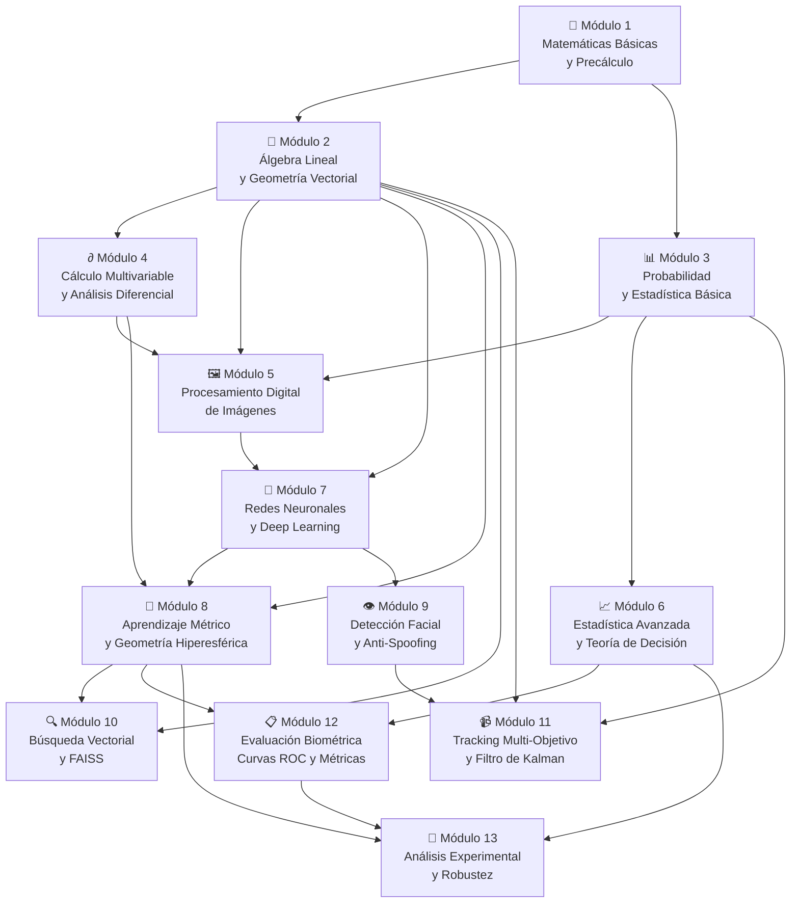

# Temario Completo de Matemáticas, Estadística, Machine Learning y Deep Learning — CV College

**Proyecto:** CV College — Sistema Inteligente de Control de Asistencia Biométrica Facial  
**Propósito:** Guía exhaustiva de estudio para dominar y explicar TODAS las matemáticas del proyecto  
**Fuentes:** [`04_fundamentos_matematicos_pipeline.md`](file:///home/valentina2/Desktop/Folds/VisionProjects/face-recognition-college/docs/analisis/04_fundamentos_matematicos_pipeline.md), [`03_descripcion_proyecto_librerias_modelos.md`](file:///home/valentina2/Desktop/Folds/VisionProjects/face-recognition-college/docs/analisis/03_descripcion_proyecto_librerias_modelos.md), [`00_plan_experimentos_unc.md`](file:///home/valentina2/Desktop/Folds/VisionProjects/face-recognition-college/docs/analisis/unc/00_plan_experimentos_unc.md), y análisis exhaustivo de todo el código fuente.  
**Fecha:** 2026-09-11

---

## Mapa General de Dependencias entre Módulos

> [!TIP]
> **Cómo usar este temario:** Cada módulo va de lo más básico a lo más avanzado. Los temas marcados con 🟢 son fundamentales, con 🟡 son intermedios, y con 🔴 son avanzados. La columna **"Dónde se usa"** te dice exactamente en qué archivo del proyecto aparece cada concepto.

---

## Módulo 1 — Matemáticas Básicas y Precálculo

> **Objetivo:** Dominar las herramientas aritméticas y algebraicas elementales que aparecen en absolutamente todas las funciones del pipeline.

### 1.1 Aritmética y Operaciones Elementales

| # | Tema | Dónde se usa en el proyecto | Nivel |
|---|---|---|---|
| 1.1.1 | Operaciones con números reales: suma, resta, multiplicación, división | Todo el pipeline | 🟢 |
| 1.1.2 | Funciones piso $\lfloor x \rfloor$ y techo $\lceil x \rceil$ (redondeo entero) | Recorte facial en [`utils_facial.py`](file:///home/valentina2/Desktop/Folds/VisionProjects/face-recognition-college/core/utils_facial.py): $W_{\text{crop}} = \lfloor 4.5 \times d_{\text{ojos}} \rfloor$ | 🟢 |
| 1.1.3 | Funciones $\min(a, b)$ y $\max(a, b)$; acotamiento (clamping) | Muestreo temporal: $\Delta f = \max(1, \min(8, \lfloor N/100 \rfloor))$ en [`registro_unificado.py`](file:///home/valentina2/Desktop/Folds/VisionProjects/face-recognition-college/scripts/registro_unificado.py) | 🟢 |
| 1.1.4 | Porcentajes y razones proporcionales | Caída de similitud: $\Delta\text{sim}(\%) = \frac{\text{sim}_A - \text{sim}_B}{\text{sim}_A} \times 100$ en Fase 3 UNC | 🟢 |
| 1.1.5 | Notación sigma $\sum$ para sumatorias finitas | Histogramas CLAHE: $h(k) = \sum_{x,y} \mathbb{I}(L(x,y) = k)$ | 🟢 |
| 1.1.6 | Logaritmo natural $\ln(x)$ y exponencial $e^x$ | Parametrización de cajas: $t_w = \ln(w/w_a)$; función Softmax $e^{s\cos\theta}$ | 🟢 |
| 1.1.7 | Potenciación fraccionaria: $x^{1/3}$, $x^{2.4}$ | Linealización gamma sRGB y función cúbica de CIE LAB | 🟢 |

### 1.2 Trigonometría

| # | Tema | Dónde se usa en el proyecto | Nivel |
|---|---|---|---|
| 1.2.1 | Funciones trigonométricas básicas: $\sin\theta$, $\cos\theta$, $\tan\theta$ | Matriz de rotación afín 2D en alineación facial | 🟢 |
| 1.2.2 | Identidad pitagórica: $\sin^2\theta + \cos^2\theta = 1$ | Relación entre similitud coseno y distancia euclidiana en $\mathbb{S}^{511}$ | 🟢 |
| 1.2.3 | Función inversa $\arctan(y/x)$ y $\text{atan2}(y, x)$ de dos argumentos | Cálculo del ángulo interocular: $\theta = \text{atan2}(\Delta y, \Delta x)$ en [`utils_facial.py`](file:///home/valentina2/Desktop/Folds/VisionProjects/face-recognition-college/core/utils_facial.py) | 🟢 |
| 1.2.4 | Función inversa $\arccos(x)$ y su dominio $[-1, 1] \to [0, \pi]$ | Distancia geodésica: $d_g = \arccos(\langle u, v \rangle)$; diversidad angular $\arccos(0.95) \approx 18.19°$ | 🟡 |
| 1.2.5 | Conversión radianes ↔ grados: $\alpha = \theta \times \frac{180°}{\pi}$ | Alineación facial: convertir el ángulo de inclinación a grados para `cv2.getRotationMatrix2D` | 🟢 |
| 1.2.6 | Identidad del coseno de suma: $\cos(\theta + m)$ | Pérdida ArcFace: margen angular aditivo $\cos(\theta_{y_i} + m)$ con $m = 0.5$ rad | 🟡 |

### 1.3 Funciones y Funciones Definidas por Partes (Piecewise)

| # | Tema | Dónde se usa en el proyecto | Nivel |
|---|---|---|---|
| 1.3.1 | Concepto de función: dominio, codominio, imagen | Toda función de transformación del pipeline | 🟢 |
| 1.3.2 | Funciones por partes (piecewise functions) | Linealización gamma sRGB (dos ramas); Smooth $L_1$ loss (dos ramas); función cúbica de CIE LAB (dos ramas); spline de Catmull-Rom (tres ramas) | 🟢 |
| 1.3.3 | Función indicadora $\mathbb{I}(\text{condición})$ | Histogramas: $h(k) = \sum \mathbb{I}(L(x,y) = k)$ | 🟢 |
| 1.3.4 | Función sigmoide logística: $\sigma(z) = \frac{1}{1 + e^{-z}}$ | MiniFASNet anti-spoofing: $P(\text{real}) = \sigma(z)$ | 🟡 |
| 1.3.5 | Función Softmax generalizada: $P(j) = \frac{e^{z_j}}{\sum_k e^{z_k}}$ | Clasificación en RetinaFace y formulación base de ArcFace | 🟡 |

---

## Módulo 2 — Álgebra Lineal y Geometría Vectorial

> **Objetivo:** Dominar los fundamentos de espacios vectoriales, productos internos, normas, matrices y transformaciones que son el lenguaje universal de todo el pipeline.

### 2.1 Vectores y Espacios Vectoriales

| # | Tema | Dónde se usa en el proyecto | Nivel |
|---|---|---|---|
| 2.1.1 | Definición de vector en $\mathbb{R}^n$; vectores columna y fila | Embeddings ArcFace $v \in \mathbb{R}^{512}$, coordenadas de imagen $(x, y) \in \mathbb{R}^2$ | 🟢 |
| 2.1.2 | Suma de vectores y multiplicación por escalar | Centroide: $\bar{v} = \frac{1}{K}\sum v_k$ (combinación lineal convexa) | 🟢 |
| 2.1.3 | Independencia lineal y bases del espacio | La base canónica de $\mathbb{R}^{512}$ sobre la que se representan los embeddings | 🟢 |
| 2.1.4 | Dimensionalidad: $\mathbb{R}^2$ vs $\mathbb{R}^4$ vs $\mathbb{R}^8$ vs $\mathbb{R}^{512}$ | Coordenadas 2D (imagen), observación de tracking ($\mathbb{R}^4$), estado de Kalman ($\mathbb{R}^8$), espacio de embedding ($\mathbb{R}^{512}$) | 🟢 |
| 2.1.5 | Isomorfismo de aplanamiento: $\mathbb{R}^{1 \times 512} \cong \mathbb{R}^{512}$ | `.flatten()` en [`registro_unificado.py`](file:///home/valentina2/Desktop/Folds/VisionProjects/face-recognition-college/scripts/registro_unificado.py) para convertir matrices de embedding a vectores planos | 🟡 |

### 2.2 Producto Interno y Similitud Coseno

| # | Tema | Dónde se usa en el proyecto | Nivel |
|---|---|---|---|
| 2.2.1 | Producto interno (producto punto) estándar: $\langle u, v \rangle = u^T v = \sum_{k=1}^n u_k v_k$ | **Operación central del proyecto**: comparación de identidades via `np.dot()` y FAISS `IndexFlatIP` | 🟢 |
| 2.2.2 | Interpretación geométrica: $u^T v = \|u\| \|v\| \cos\theta$ | Descomposición trigonométrica en la formulación de ArcFace: $W_j^T x_i = s \cos\theta_j$ | 🟢 |
| 2.2.3 | Similitud coseno para vectores normalizados: $\text{sim}(u, v) = u^T v = \cos\theta$ | Cada comparación de identidad en todo el sistema de asistencia | 🟢 |
| 2.2.4 | Desigualdad de Cauchy-Schwarz: $|\langle u, v \rangle| \le \|u\|_2 \|v\|_2$ | Garantiza que $\text{sim} \in [-1, 1]$ para vectores unitarios, lo que da sentido a los umbrales $\tau \in [0, 1]$ | 🟡 |
| 2.2.5 | Ortogonalidad: $\langle u, v \rangle = 0 \iff \theta = 90°$ | Dos personas totalmente distintas tienen similaridad cercana a 0 en el espacio de ArcFace | 🟡 |

### 2.3 Normas Vectoriales

| # | Tema | Dónde se usa en el proyecto | Nivel |
|---|---|---|---|
| 2.3.1 | Norma euclidiana ($L_2$): $\|x\|_2 = \sqrt{\sum x_i^2}$ | `np.linalg.norm()` para normalizar centroides; distancia interocular $d_{\text{ojos}} = \sqrt{\Delta x^2 + \Delta y^2}$ | 🟢 |
| 2.3.2 | Normalización $L_2$: $\hat{v} = \frac{v}{\|v\|_2}$ (vector unitario) | Proyección radial del centroide: $c = \bar{v} / \|\bar{v}\|_2$ en [`registro_unificado.py`](file:///home/valentina2/Desktop/Folds/VisionProjects/face-recognition-college/scripts/registro_unificado.py) | 🟢 |
| 2.3.3 | Distancia euclidiana: $d(u, v) = \|u - v\|_2$ | Relación biyectiva con similitud coseno: $d^2 = 2(1 - \text{sim})$ | 🟢 |
| 2.3.4 | Norma $L_1$ (Manhattan): $\|x\|_1 = \sum |x_i|$ | Referencia conceptual para Smooth $L_1$ loss en RetinaFace | 🟡 |

### 2.4 La Hiperesfera Unitaria $\mathbb{S}^{n-1}$

| # | Tema | Dónde se usa en el proyecto | Nivel |
|---|---|---|---|
| 2.4.1 | Definición formal: $\mathbb{S}^{n-1} = \{x \in \mathbb{R}^n : \|x\|_2 = 1\}$ | ArcFace opera en $\mathbb{S}^{511} \subset \mathbb{R}^{512}$ | 🟡 |
| 2.4.2 | Ejemplos concretos: $\mathbb{S}^0$ (par de puntos), $\mathbb{S}^1$ (circunferencia), $\mathbb{S}^2$ (esfera 3D) | Visualización intuitiva antes de generalizar a 512 dimensiones | 🟡 |
| 2.4.3 | Distancia geodésica (de arco) sobre la hiperesfera: $d_g(u, v) = \arccos(\langle u, v \rangle)$ | Separabilidad inter-clase e intra-clase medida en radianes/grados | 🟡 |
| 2.4.4 | Relación entre distancia euclidiana al cuadrado y similitud coseno en la esfera: $\|u - v\|^2 = 2 - 2\cos\theta$ | Prueba de que maximizar similitud coseno en FAISS minimiza distancia euclidiana | 🔴 |

### 2.5 Matrices y Operaciones Matriciales

| # | Tema | Dónde se usa en el proyecto | Nivel |
|---|---|---|---|
| 2.5.1 | Definición de matriz $A \in \mathbb{R}^{m \times n}$; matrices identidad $\mathbf{I}$ y cero $\mathbf{0}$ | Matrices de Kalman: $\mathbf{F}_{8\times8}$, $\mathbf{H}_{4\times8}$, $\mathbf{I}_{4\times4}$ | 🟢 |
| 2.5.2 | Multiplicación matriz-vector: $y = Ax$ | FAISS: $\mathbf{s} = C \cdot q$ donde $C \in \mathbb{R}^{N \times 512}$ y $q \in \mathbb{R}^{512}$ | 🟢 |
| 2.5.3 | Multiplicación matriz-matriz: $C = AB$ | Propagación de covarianza: $\mathbf{P}_{k|k-1} = \mathbf{F}\mathbf{P}\mathbf{F}^T + \mathbf{Q}$ | 🟡 |
| 2.5.4 | Transpuesta de una matriz: $A^T$ | Kalman: $\mathbf{F}^T$, $\mathbf{H}^T$; Gram: $S = CC^T$ | 🟢 |
| 2.5.5 | Inversa de una matriz: $A^{-1}$ | Ganancia de Kalman: $\mathbf{K} = \mathbf{P}\mathbf{H}^T\mathbf{S}^{-1}$ | 🟡 |
| 2.5.6 | Matrices simétricas: $A = A^T$ | Matriz Gram $S = CC^T$: $S_{ij} = S_{ji}$ | 🟡 |
| 2.5.7 | Matrices semidefinidas positivas: $x^T A x \ge 0, \forall x$ | Propiedad de $S = CC^T \succeq 0$; matrices de covarianza $\mathbf{P}, \mathbf{Q}, \mathbf{R}$ | 🔴 |

### 2.6 Matriz Gram de Similitudes

| # | Tema | Dónde se usa en el proyecto | Nivel |
|---|---|---|---|
| 2.6.1 | Definición: $S = CC^T$ con $C \in \mathbb{R}^{N \times 512}$ (filas = centroides normalizados) | Verificación post-registro: `sim_matrix = vecs @ vecs.T` con 9 estudiantes → $S \in \mathbb{R}^{9 \times 9}$ | 🟡 |
| 2.6.2 | Propiedades: diagonal unitaria ($S_{ii} = 1$), simetría, semidefinición positiva | Validación de la base de datos biométrica | 🟡 |
| 2.6.3 | Condición de no-colisión: $\max_{i \neq j} S_{ij} < \tau_{\text{alerta}}$ ($\tau = 0.30$) | Alerta de confusión de identidades si dos centroides están demasiado cerca angularmente | 🟡 |

### 2.7 Transformaciones Afines en 2D

| # | Tema | Dónde se usa en el proyecto | Nivel |
|---|---|---|---|
| 2.7.1 | Coordenadas homogéneas: punto $(x, y) \to (x, y, 1)^T$ | Formulación de la transformación afín como producto $M \cdot [x, y, 1]^T$ | 🟡 |
| 2.7.2 | Matriz de rotación 2D: $R(\theta) = \begin{bmatrix} \cos\theta & \sin\theta \\ -\sin\theta & \cos\theta \end{bmatrix}$ | Rotación del rostro para alinear eje interocular a 0° | 🟡 |
| 2.7.3 | Rotación alrededor de un punto arbitrario $(c_x, c_y)$ con escala $s$ | `cv2.getRotationMatrix2D(center, angle, scale)` → $M \in \mathbb{R}^{2 \times 3}$ en [`utils_facial.py`](file:///home/valentina2/Desktop/Folds/VisionProjects/face-recognition-college/core/utils_facial.py) | 🟡 |
| 2.7.4 | Derivación de la matriz afín completa con traslación integrada | $M = \begin{bmatrix} \cos\theta & \sin\theta & (1-\cos\theta)c_x - \sin\theta c_y \\ -\sin\theta & \cos\theta & \sin\theta c_x + (1-\cos\theta)c_y \end{bmatrix}$ | 🔴 |

---

## Módulo 3 — Probabilidad y Estadística Básica

> **Objetivo:** Construir la base probabilística y estadística que sustenta histogramas, distribuciones, momentos centrales, y la teoría de detección/clasificación.

### 3.1 Probabilidad Elemental

| # | Tema | Dónde se usa en el proyecto | Nivel |
|---|---|---|---|
| 3.1.1 | Espacio muestral, eventos y axiomas de Kolmogorov | Marco formal de todo el análisis probabilístico del pipeline | 🟢 |
| 3.1.2 | Probabilidad condicional: $P(A \mid B) = \frac{P(A \cap B)}{P(B)}$ | Clasificación: $P(\text{real} \mid R)$ en MiniFASNet; $P(s \ge \tau \mid \mathcal{H}_1)$ en ROC | 🟢 |
| 3.1.3 | Independencia de eventos: $P(A \cap B) = P(A) \cdot P(B)$ | Consenso temporal: $P(\text{Falsa Asistencia en 3 frames}) = \alpha^3$ (independencia entre frames) | 🟢 |
| 3.1.4 | Regla de Bayes: $P(A \mid B) = \frac{P(B \mid A) P(A)}{P(B)}$ | Interpretación bayesiana de la decisión de identidad biométrica | 🟡 |

### 3.2 Variables Aleatorias y Distribuciones

| # | Tema | Dónde se usa en el proyecto | Nivel |
|---|---|---|---|
| 3.2.1 | Variables aleatorias discretas y continuas | Conteo de píxeles por bin (discreta); similitud coseno (continua) | 🟢 |
| 3.2.2 | Función de probabilidad (PMF) y de densidad (PDF) | Histograma de luminancia $h(k)$ (PMF); distribución bimodal de similitudes (PDF) | 🟢 |
| 3.2.3 | Función de distribución acumulada (CDF) | CLAHE: función de transferencia $T(k)$ basada en la CDF normalizada | 🟢 |
| 3.2.4 | Distribución de Bernoulli: $X \sim \text{Bernoulli}(p)$ | Cada frame es un ensayo: ¿reconocimiento correcto o no? con probabilidad $p$ | 🟢 |
| 3.2.5 | Distribución Binomial: $X \sim \text{Bin}(n, p)$ | Consenso de 3 votos: probabilidad de $\ge 3$ éxitos en $n$ frames para un alumno genuino | 🟡 |
| 3.2.6 | Distribución Normal (Gaussiana): $X \sim \mathcal{N}(\mu, \sigma^2)$ | Modelado de distribuciones de similitudes intra-clase e inter-clase: $p(s \mid \mathcal{H}_0) \sim \mathcal{N}(\mu_{\text{intra}}, \sigma_{\text{intra}}^2)$ | 🟡 |

### 3.3 Momentos Estadísticos

| # | Tema | Dónde se usa en el proyecto | Nivel |
|---|---|---|---|
| 3.3.1 | Media aritmética (primer momento): $\mu = \frac{1}{N}\sum x_i$ | Brillo promedio: `np.mean(gray)` en [`registro_unificado.py`](file:///home/valentina2/Desktop/Folds/VisionProjects/face-recognition-college/scripts/registro_unificado.py); media de respuesta Laplaciana $\mu_G$ | 🟢 |
| 3.3.2 | Media multivariable: $\bar{v} = \frac{1}{K}\sum_{k=1}^K v_k \in \mathbb{R}^{512}$ | Centroide biométrico: promedio de embeddings de una persona | 🟢 |
| 3.3.3 | Varianza (segundo momento central): $\sigma^2 = \frac{1}{N}\sum (x_i - \mu)^2$ | **Detección de borrosidad:** varianza del Laplaciano $\sigma_G^2 = \text{Var}(G)$ en [`utils_facial.py`](file:///home/valentina2/Desktop/Folds/VisionProjects/face-recognition-college/core/utils_facial.py) | 🟢 |
| 3.3.4 | Desviación estándar: $\sigma = \sqrt{\sigma^2}$ | Componente del índice de decidabilidad $d'$ | 🟢 |
| 3.3.5 | Media armónica: $H = \frac{2ab}{a + b}$ | $F_1$-Score como media armónica de Precisión y Recall | 🟡 |
| 3.3.6 | Media armónica ponderada: $F_\beta$ | $F_{0.5}$-Score para priorizar precisión sobre recall en políticas de cero tolerancia a FP | 🟡 |

### 3.4 Histogramas y Distribuciones Empíricas

| # | Tema | Dónde se usa en el proyecto | Nivel |
|---|---|---|---|
| 3.4.1 | Definición de histograma: conteo por intervalos (bins) | $h(k) = \sum \mathbb{I}(L(x,y) = k)$ para 256 niveles de gris en cada tile de CLAHE | 🟢 |
| 3.4.2 | Normalización de histograma como estimación de PDF empírica | Función de frecuencia relativa: $\hat{p}(k) = h(k) / (M \times N)$ | 🟡 |
| 3.4.3 | Histograma bimodal: mezcla de dos distribuciones | Distribución de similitudes genuinas vs. impostoras en Fase 4 ROC | 🟡 |

---

## Módulo 4 — Cálculo Multivariable y Análisis Diferencial

> **Objetivo:** Entender los operadores diferenciales y la geometría diferencial que sustentan la detección de borrosidad, el procesamiento de imágenes y la geometría del espacio de embeddings.

### 4.1 Derivadas Parciales y Gradientes

| # | Tema | Dónde se usa en el proyecto | Nivel |
|---|---|---|---|
| 4.1.1 | Campos escalares 2D: $f(x, y)$ como función de intensidad de imagen | Cada imagen en escala de grises $I(x, y) \in [0, 255]$ | 🟢 |
| 4.1.2 | Derivadas parciales: $\frac{\partial f}{\partial x}$ y $\frac{\partial f}{\partial y}$ | Gradientes de intensidad que detectan bordes en las imágenes | 🟡 |
| 4.1.3 | Vector gradiente: $\nabla f = \left[\frac{\partial f}{\partial x}, \frac{\partial f}{\partial y}\right]^T$ | Dirección de máxima variación de intensidad, esencial para bordes | 🟡 |
| 4.1.4 | Derivadas de segundo orden: $\frac{\partial^2 f}{\partial x^2}$, $\frac{\partial^2 f}{\partial y^2}$ | Componentes del operador Laplaciano para detección de borrosidad | 🟡 |

### 4.2 Operador Laplaciano

| # | Tema | Dónde se usa en el proyecto | Nivel |
|---|---|---|---|
| 4.2.1 | Definición continua: $\nabla^2 f = \frac{\partial^2 f}{\partial x^2} + \frac{\partial^2 f}{\partial y^2}$ | Operador de segundo orden para medir la presencia de detalles finos (alta frecuencia) | 🟡 |
| 4.2.2 | Invarianza rotacional del operador $\nabla^2$ | Garantiza que la detección de borrosidad no dependa de la orientación del rostro | 🟡 |
| 4.2.3 | Discretización por diferencias finitas centrales | Aproximación: $\frac{\partial^2 I}{\partial x^2} \approx I(x+1,y) - 2I(x,y) + I(x-1,y)$ | 🟡 |
| 4.2.4 | Kernel Laplaciano discreto $3 \times 3$ | $K = \begin{bmatrix} 0 & 1 & 0 \\ 1 & -4 & 1 \\ 0 & 1 & 0 \end{bmatrix}$, implementado con `cv2.Laplacian(gray, cv2.CV_64F)` | 🟡 |

### 4.3 Convolución Espacial

| # | Tema | Dónde se usa en el proyecto | Nivel |
|---|---|---|---|
| 4.3.1 | Definición de convolución discreta 2D: $(I * K)(x, y) = \sum_i \sum_j I(x-i, y-j) K(i, j)$ | Aplicación del kernel Laplaciano; kernels de detección de bordes; convoluciones en CNNs | 🟡 |
| 4.3.2 | Interpretación como "ventana deslizante" con pesos | Base operacional de todas las redes convolucionales (RetinaFace, ArcFace, MiniFASNet) | 🟡 |
| 4.3.3 | Relación entre convolución y desenfoque óptico | PSF Gaussiana: el blur óptico es una convolución que atenúa altas frecuencias | 🟡 |

### 4.4 Transformada de Fourier en 2D

| # | Tema | Dónde se usa en el proyecto | Nivel |
|---|---|---|---|
| 4.4.1 | Concepto de frecuencia espacial en imágenes (altas = detalles, bajas = regiones suaves) | Justificación del Laplaciano como "pasa-altas" para detectar nitidez | 🟡 |
| 4.4.2 | Transformada de Fourier 2D: $F(u, v) = \mathcal{F}\{f(x, y)\}$ | Fundamento teórico de por qué el Laplaciano detecta borrosidad | 🔴 |
| 4.4.3 | Teorema de la derivada en Fourier: $\mathcal{F}\{\nabla^2 f\} = -4\pi^2(u^2 + v^2)F(u,v)$ | Prueba de que el Laplaciano amplifica cuadráticamente las altas frecuencias | 🔴 |

### 4.5 Geometría Diferencial sobre la Hiperesfera

| # | Tema | Dónde se usa en el proyecto | Nivel |
|---|---|---|---|
| 4.5.1 | Concepto de variedad (manifold) Riemanniana | ArcFace no opera en $\mathbb{R}^{512}$ plano sino en la variedad curva $\mathbb{S}^{511}$ | 🔴 |
| 4.5.2 | Métrica Riemanniana inducida en $\mathbb{S}^{n-1}$ | Define cómo medir distancias y ángulos sobre la superficie de la hiperesfera | 🔴 |
| 4.5.3 | Distancia geodésica como longitud mínima de camino sobre la esfera | $d_g(u, v) = \arccos(\text{sim}(u, v))$ — la "distancia real" entre identidades | 🔴 |
| 4.5.4 | Media de Fréchet / Karcher como minimizador de distancia geodésica cuadrada | Justificación rigurosa de por qué el centroide normalizado $c = \bar{v}/\|\bar{v}\|$ es el mejor resumen de poses | 🔴 |

### 4.6 Interpolación

| # | Tema | Dónde se usa en el proyecto | Nivel |
|---|---|---|---|
| 4.6.1 | Interpolación bilineal: ponderación proporcional 2D con 4 vecinos | CLAHE: suavizado entre tiles contiguos; redimensionamiento básico de imágenes | 🟡 |
| 4.6.2 | Interpolación bicúbica: spline de 16 vecinos ($4 \times 4$) | `cv2.INTER_CUBIC` en el recorte facial alineado → mejor calidad que bilineal | 🟡 |
| 4.6.3 | Kernel de Catmull-Rom y parámetro $a = -0.5$ | Función núcleo cúbica que define los pesos de interpolación en el remuestreo a $(224, 224)$ | 🔴 |

---

## Módulo 5 — Procesamiento Digital de Imágenes

> **Objetivo:** Dominar todas las técnicas de visión "clásica" (no neuronal) que preparan la imagen antes de las redes neuronales.

### 5.1 Representación Digital de Imágenes

| # | Tema | Dónde se usa en el proyecto | Nivel |
|---|---|---|---|
| 5.1.1 | Imagen como matriz/tensor: $I \in [0, 255]^{H \times W \times C}$ | Todo frame de video se lee como tensor BGR de 3 canales | 🟢 |
| 5.1.2 | Canales de color: BGR (OpenCV), RGB | `cv2.imread()` lee en BGR; el pipeline convierte según necesite | 🟢 |
| 5.1.3 | Escala de grises como combinación lineal ponderada: $Y = 0.299R + 0.587G + 0.114B$ | `cv2.cvtColor(img, cv2.COLOR_BGR2GRAY)` para Laplaciano y brillo | 🟢 |

### 5.2 Espacios de Color

| # | Tema | Dónde se usa en el proyecto | Nivel |
|---|---|---|---|
| 5.2.1 | Espacio sRGB y no-linealidad gamma | Paso 1 de la conversión a CIE LAB: linealización $C_{\text{srgb}} \to C_{\text{linear}}$ | 🟡 |
| 5.2.2 | Espacio CIE $XYZ$ e iluminante de referencia $D_{65}$ | Paso 2: multiplicación por la matriz de calibración $3 \times 3$ | 🟡 |
| 5.2.3 | Espacio CIE $L^*a^*b^*$: separación luminancia / crominancia | Paso 3: CLAHE opera SOLO sobre $L^*$ para no alterar el color de piel | 🟡 |
| 5.2.4 | Propiedad de uniformidad perceptual y JND (Just Noticeable Difference) | $\Delta L^* \propto$ diferencia percibida por el ojo humano → base para ecualización adaptativa | 🟡 |

### 5.3 CLAHE (Contrast Limited Adaptive Histogram Equalization)

| # | Tema | Dónde se usa en el proyecto | Nivel |
|---|---|---|---|
| 5.3.1 | Ecualización global de histograma y sus limitaciones | Punto de partida teórico: ecualización estándar sobre-amplifica ruido | 🟡 |
| 5.3.2 | Partición en tiles contextuales ($8 \times 8 = 64$ bloques) | Cada tile de $M \times N$ px tiene su propio histograma local | 🟡 |
| 5.3.3 | Cálculo de histogramas locales de 256 bins | $h(k) = \sum_{x,y} \mathbb{I}(L(x,y) = k)$ para cada tile | 🟡 |
| 5.3.4 | Mecanismo de clip limit: umbral $\beta = \text{clipLimit} \times \frac{M \times N}{256}$ | Limita la pendiente máxima de amplificación → controla el ruido amplificado | 🟡 |
| 5.3.5 | Redistribución uniforme de masa excedente: $h'(k) = \min(h(k), \beta) + \frac{A_{\text{clip}}}{256}$ | Los píxeles "recortados" del pico se reparten equitativamente entre todos los bins | 🟡 |
| 5.3.6 | Función de transferencia acumulativa (CDF normalizada): $T(k) = \lfloor \frac{L_{\max} - L_{\min}}{M \times N} \sum_{j=0}^k h'(j) + 0.5 \rfloor$ | Mapea cada nivel de gris original a uno ecualizado | 🟡 |
| 5.3.7 | Interpolación bilineal entre centroides de 4 tiles adyacentes | Elimina discontinuidades visibles en los bordes de los bloques | 🔴 |

### 5.4 Filtro de Borrosidad (Varianza del Laplaciano)

| # | Tema | Dónde se usa en el proyecto | Nivel |
|---|---|---|---|
| 5.4.1 | Convolución con kernel Laplaciano $3 \times 3$ sobre imagen en grises | `cv2.Laplacian(gray, cv2.CV_64F)` → mapa de bordes $G(x,y)$ | 🟡 |
| 5.4.2 | Cálculo de la varianza del mapa de bordes: $\sigma_G^2 = \text{Var}(G)$ | `.var()` de NumPy — métrica escalar de nitidez | 🟡 |
| 5.4.3 | Criterio de decisión binario: $\sigma_G^2 < \tau_{\text{blur}} \implies$ borrosa | Umbral $\tau = 60$ u $80$; se descarta el frame antes de gastar recursos de inferencia | 🟡 |

### 5.5 Alineación Geométrica Facial

| # | Tema | Dónde se usa en el proyecto | Nivel |
|---|---|---|---|
| 5.5.1 | Vector interocular y distancia euclidiana entre ojos | $d_{\text{ojos}} = \sqrt{(\Delta x)^2 + (\Delta y)^2}$; descarte si $< 10$ px | 🟡 |
| 5.5.2 | Ángulo de inclinación de la cabeza: $\theta = \text{atan2}(\Delta y, \Delta x)$ | Cuantifica la rotación del rostro respecto a la horizontal | 🟡 |
| 5.5.3 | Centroide interocular como centro de rotación | $C = \left(\frac{x_1+x_2}{2}, \frac{y_1+y_2}{2}\right)$ | 🟡 |
| 5.5.4 | Aplicación de la transformación afín 2D | `cv2.warpAffine(img, M, (w, h), flags=cv2.INTER_CUBIC)` | 🟡 |
| 5.5.5 | Recorte proporcional biométrico | $W = 4.5d$, $H = 5.5d$, con desplazamiento vertical de $0.4H$ | 🟡 |
| 5.5.6 | Remuestreo a $(224, 224)$ con interpolación bicúbica | Tamaño canónico de entrada para la red ArcFace | 🟡 |

---

## Módulo 6 — Estadística Avanzada y Teoría de Decisión

> **Objetivo:** Dominar el marco teórico que fundamenta la decisión de "¿es esta persona o no?" y la evaluación rigurosa del sistema.

### 6.1 Contraste de Hipótesis Estadísticas

| # | Tema | Dónde se usa en el proyecto | Nivel |
|---|---|---|---|
| 6.1.1 | Hipótesis nula $\mathcal{H}_0$ vs. hipótesis alternativa $\mathcal{H}_1$ | $\mathcal{H}_0$: la comparación es genuina (misma persona); $\mathcal{H}_1$: la comparación es impostora | 🟡 |
| 6.1.2 | Error Tipo I (falsa aceptación) y Error Tipo II (falso rechazo) | FP = aceptar un impostor; FN = rechazar un alumno legítimo | 🟡 |
| 6.1.3 | Nivel de significancia y potencia de un test | Relación con FPR y TPR en el contexto biométrico | 🟡 |
| 6.1.4 | Distribuciones bajo cada hipótesis | $p(s \mid \mathcal{H}_0) \sim \mathcal{N}(\mu_{\text{intra}}, \sigma_{\text{intra}}^2)$ y $p(s \mid \mathcal{H}_1) \sim \mathcal{N}(\mu_{\text{inter}}, \sigma_{\text{inter}}^2)$ | 🟡 |

### 6.2 Razón de Verosimilitud y Decisión Bayesiana

| # | Tema | Dónde se usa en el proyecto | Nivel |
|---|---|---|---|
| 6.2.1 | Test de razón de verosimilitud (Likelihood Ratio Test, LRT) | Fundamento teórico de la decisión por umbral de similitud | 🔴 |
| 6.2.2 | Test de razón de verosimilitud generalizado (GLRT) y margen Top-2 | Si el cociente de probabilidades entre las 2 identidades más probables no supera un margen, se rechaza | 🔴 |
| 6.2.3 | Criterio de decisión concurrente del proyecto | $\text{Aceptar} \iff s_{(1)} \ge \tau_{\text{sim}} \land \Delta s \ge \delta_{\min}$ | 🟡 |

### 6.3 Estadística Direccional (von Mises-Fisher)

| # | Tema | Dónde se usa en el proyecto | Nivel |
|---|---|---|---|
| 6.3.1 | Distribución de von Mises-Fisher (vMF) en $\mathbb{S}^{p-1}$ | $f(x; \mu, \kappa) = C_p(\kappa) \exp(\kappa \mu^T x)$ — modelo de cómo varían los embeddings de una misma persona | 🔴 |
| 6.3.2 | Parámetros: dirección media $\mu$ y concentración $\kappa$ | $\mu$ = dirección del centroide; $\kappa$ alto = poca variación (persona estática) | 🔴 |
| 6.3.3 | MLE de $\mu$ bajo vMF = centroide normalizado | Prueba de que $\hat{\mu}_{\text{MLE}} = \frac{\sum v_k}{\|\sum v_k\|}$ es estadísticamente óptimo | 🔴 |
| 6.3.4 | Longitud del vector resultante $R = \|\bar{v}\|_2$ como medida de concentración | $R \to 1$: baja diversidad; $R \approx 0.85$-$0.95$: buena diversidad de poses | 🔴 |
| 6.3.5 | Varianza angular esférica: $S_0 = 1 - R$ | Métrica de dispersión intra-clase sobre la hiperesfera | 🔴 |

### 6.4 Modelo Probabilístico de Consenso Temporal

| # | Tema | Dónde se usa en el proyecto | Nivel |
|---|---|---|---|
| 6.4.1 | Proceso de Bernoulli secuencial | Cada frame es un ensayo independiente con probabilidad $p$ de reconocimiento correcto | 🟡 |
| 6.4.2 | Supresión exponencial de falsos positivos: $P(\text{Falsa asist.}) = \alpha^V$ | Con $\alpha = 0.02$ y $V = 3$ votos: $P = (0.02)^3 = 8 \times 10^{-6}$ | 🟡 |
| 6.4.3 | Tasa de verdaderos positivos bajo consenso: $P(\ge 3 \mid p = 0.95) \approx 0.986$ | El consenso casi no afecta la sensibilidad para alumnos genuinos | 🟡 |

---

## Módulo 7 — Redes Neuronales y Deep Learning

> **Objetivo:** Entender la arquitectura, entrenamiento y fundamentos matemáticos de las redes neuronales profundas que forman el corazón del pipeline.

### 7.1 Fundamentos de Redes Neuronales

| # | Tema | Dónde se usa en el proyecto | Nivel |
|---|---|---|---|
| 7.1.1 | Neurona artificial: $y = \sigma(w^T x + b)$ (combinación lineal + activación) | Unidad básica de todas las redes del proyecto | 🟢 |
| 7.1.2 | Funciones de activación: ReLU $(\max(0, x))$, Sigmoide, Softmax | ReLU en capas internas de RetinaFace/ArcFace; Sigmoide en MiniFASNet; Softmax en clasificación | 🟢 |
| 7.1.3 | Propagación hacia adelante (forward pass) | Flujo de datos a través de las capas de la red para obtener la predicción | 🟡 |
| 7.1.4 | Retropropagación del error (backpropagation) y regla de la cadena | Entrenamiento de los modelos (RetinaFace, ArcFace, MiniFASNet) — no se reentrena en el proyecto pero es fundamental entenderlo | 🟡 |
| 7.1.5 | Descenso de gradiente estocástico (SGD) y variantes (Adam, etc.) | Optimizador usado durante el entrenamiento original de los modelos | 🟡 |

### 7.1B Regresión Lineal — Base de Todo Modelo Predictivo

> **¿Por qué estudiar esto?** Una neurona artificial ES una regresión lineal + función de activación. La regresión de bounding boxes en RetinaFace ES regresión lineal multivariable. Sin entender regresión, no puedes entender nada de lo que sigue.

| # | Tema | Dónde se usa en el proyecto | Nivel |
|---|---|---|---|
| 7.1B.1 | **Regresión lineal simple:** modelo $\hat{y} = wx + b$ (un peso, un sesgo) | Base conceptual de la neurona artificial $y = \sigma(w^T x + b)$ | 🟢 |
| 7.1B.2 | **Regresión lineal multivariable:** $\hat{y} = w_1 x_1 + w_2 x_2 + \dots + w_n x_n + b = \mathbf{w}^T \mathbf{x} + b$ | Cada neurona de RetinaFace/ArcFace computa esto con $n$ entradas antes de aplicar activación | 🟢 |
| 7.1B.3 | Representación matricial: $\hat{\mathbf{y}} = X\mathbf{w} + \mathbf{b}$ | Una capa lineal completa de la red neuronal es una multiplicación de matrices | 🟢 |
| 7.1B.4 | **Regresión logística:** $P(y=1 \mid x) = \sigma(\mathbf{w}^T \mathbf{x} + b) = \frac{1}{1 + e^{-(\mathbf{w}^T \mathbf{x} + b)}}$ | **Exactamente lo que hace MiniFASNet:** la capa de salida es una regresión logística que predice $P(\text{real})$ | 🟡 |
| 7.1B.5 | Frontera de decisión lineal: el hiperplano $\mathbf{w}^T \mathbf{x} + b = 0$ separa las clases | MiniFASNet separa "rostro real" vs "ataque" con una frontera en el espacio de features aprendido | 🟡 |

### 7.1C Funciones de Costo / Pérdida — Lo Que los Modelos Minimizan

> **¿Por qué estudiar esto?** El entrenamiento de TODA red neuronal consiste en minimizar una función de costo. El proyecto usa **5 funciones de costo distintas** — entender cada una es entender por qué cada modelo hace lo que hace.

| # | Tema | Dónde se usa en el proyecto | Nivel |
|---|---|---|---|
| 7.1C.1 | **Concepto de función de costo/pérdida:** $\mathcal{L}(\theta)$ mide qué tan mal predice el modelo con parámetros $\theta$ | TODA red del proyecto fue entrenada minimizando una $\mathcal{L}$; el objetivo del entrenamiento es encontrar $\theta^* = \arg\min \mathcal{L}(\theta)$ | 🟢 |
| 7.1C.2 | **Error Cuadrático Medio (MSE):** $\mathcal{L}_{\text{MSE}} = \frac{1}{N}\sum_{i=1}^N (y_i - \hat{y}_i)^2$ | Base conceptual de la regresión; NO se usa directamente pero es prerequisito para entender Smooth $L_1$ | 🟢 |
| 7.1C.3 | **Smooth $L_1$ (Huber Loss):** $\begin{cases} 0.5e^2 & \|e\| < 1 \\ \|e\| - 0.5 & \text{otro caso} \end{cases}$ | Regresión de coordenadas de bounding boxes y 5 landmarks en **RetinaFace**: cuadrática cerca de 0 (como MSE) pero lineal en outliers (evita gradientes explosivos) | 🟡 |
| 7.1C.4 | **Entropía Cruzada (Cross-Entropy):** $\mathcal{L}_{\text{CE}} = -\sum_j y_j \log(\hat{y}_j)$ | Clasificación cara vs. fondo en **RetinaFace** (¿esta ancla contiene un rostro o no?) | 🟡 |
| 7.1C.5 | **Entropía Cruzada Binaria (BCE):** $\mathcal{L}_{\text{BCE}} = -y\log(\sigma(z)) - (1-y)\log(1-\sigma(z))$ | **MiniFASNet**: clasificación binaria "rostro real" ($y=1$) vs "ataque" ($y=0$) | 🟡 |
| 7.1C.6 | **Pérdida Multi-Tarea:** $\mathcal{L} = \mathcal{L}_{\text{cls}} + \lambda_1 \mathcal{L}_{\text{box}} + \lambda_2 \mathcal{L}_{\text{pts}}$ | **RetinaFace** optimiza 3 objetivos simultáneamente con pesos $\lambda_1 = 0.25$, $\lambda_2 = 0.1$ | 🟡 |
| 7.1C.7 | **Pérdida ArcFace (Additive Angular Margin Loss):** la más compleja del proyecto | Se detalla en el Módulo 8 — combina Softmax normalizada + margen angular aditivo $m = 0.5$ rad | 🔴 |
| 7.1C.8 | **Superficie de pérdida en el espacio de parámetros:** $\mathcal{L}$ como función de todos los pesos $\theta \in \mathbb{R}^{D}$ | Visualizar la pérdida como una "montaña" en alta dimensión; el entrenamiento busca el "valle" más bajo | 🟡 |

### 7.1D Gradiente, Descenso de Gradiente y Optimización

> **¿Por qué estudiar esto?** El descenso de gradiente es EL algoritmo que entrenó los 3 modelos del proyecto (RetinaFace, ArcFace, MiniFASNet). Sin él, los modelos serían matrices de números aleatorios inútiles.

| # | Tema | Dónde se usa en el proyecto | Nivel |
|---|---|---|---|
| 7.1D.1 | **Gradiente como vector de derivadas parciales:** $\nabla_\theta \mathcal{L} = \left[\frac{\partial \mathcal{L}}{\partial \theta_1}, \frac{\partial \mathcal{L}}{\partial \theta_2}, \dots, \frac{\partial \mathcal{L}}{\partial \theta_D}\right]^T$ | Apunta en la dirección de máximo crecimiento de la pérdida en el espacio de parámetros | 🟡 |
| 7.1D.2 | **Descenso de gradiente (Gradient Descent):** $\theta_{t+1} = \theta_t - \eta \nabla_\theta \mathcal{L}$ | Algoritmo fundamental: actualizar los pesos en la dirección **opuesta** al gradiente (hacia el "valle") | 🟡 |
| 7.1D.3 | **Tasa de aprendizaje $\eta$ (learning rate):** hiperparámetro que controla el tamaño del paso | $\eta$ muy grande → oscila y diverge; $\eta$ muy pequeña → converge lentísimo. Típicamente $\eta \in [10^{-4}, 10^{-2}]$ | 🟡 |
| 7.1D.4 | **Batch Gradient Descent:** calcula el gradiente sobre TODO el dataset | Exacto pero lento para millones de imágenes faciales de entrenamiento | 🟡 |
| 7.1D.5 | **Stochastic Gradient Descent (SGD):** calcula el gradiente sobre UNA muestra aleatoria | Ruidoso pero rápido; cada actualización es una estimación del gradiente real | 🟡 |
| 7.1D.6 | **Mini-Batch Gradient Descent:** gradiente sobre un lote de $B$ muestras (ej. $B = 64$, $128$, $256$) | Compromiso entre exactitud y velocidad; la forma estándar en que se entrenan RetinaFace, ArcFace y MiniFASNet | 🟡 |
| 7.1D.7 | **Momentum:** $v_t = \beta v_{t-1} + \nabla_\theta \mathcal{L}$; $\theta_{t+1} = \theta_t - \eta v_t$ | Acumula velocidad en la dirección consistente del gradiente; evita quedar atrapado en mínimos locales planos | 🟡 |
| 7.1D.8 | **Optimizador Adam (Adaptive Moment Estimation):** combina momentum + tasa adaptativa por parámetro | El optimizador más usado en deep learning moderno; probablemente usado para entrenar ArcFace y RetinaFace | 🔴 |
| 7.1D.9 | **Regla de la cadena (Chain Rule) y Backpropagation:** $\frac{\partial \mathcal{L}}{\partial w^{(l)}} = \frac{\partial \mathcal{L}}{\partial a^{(L)}} \cdot \frac{\partial a^{(L)}}{\partial a^{(L-1)}} \cdots \frac{\partial a^{(l+1)}}{\partial a^{(l)}} \cdot \frac{\partial a^{(l)}}{\partial w^{(l)}}$ | Propagar el error desde la salida hasta las primeras capas, calculando el gradiente capa por capa — así se entrenaron las redes del proyecto | 🟡 |
| 7.1D.10 | **Problema de gradientes que se desvanecen/explotan (Vanishing/Exploding Gradients)** | En redes profundas, el gradiente puede tender a 0 o a $\infty$ al multiplicar muchas derivadas. Las conexiones residuales de ResNet (backbone de RetinaFace/ArcFace) resuelven esto | 🔴 |

### 7.1E Sobreajuste, Generalización y Regularización

> **¿Por qué estudiar esto?** ArcFace fue entrenado con ~500,000 personas pero reconoce personas que NUNCA vio (los 9 estudiantes de la UNC). Eso es *generalización*, y la regularización es lo que la hace posible.

| # | Tema | Dónde se usa en el proyecto | Nivel |
|---|---|---|---|
| 7.1E.1 | **Sobreajuste (Overfitting):** el modelo memoriza los datos de entrenamiento pero falla con datos nuevos | Si ArcFace solo memorizara las ~500K caras de entrenamiento, no reconocería a los estudiantes de la UNC | 🟢 |
| 7.1E.2 | **Subajuste (Underfitting):** el modelo es demasiado simple para capturar los patrones | Una regresión lineal no podría aprender a distinguir rostros — se necesitan redes profundas | 🟢 |
| 7.1E.3 | **Datos de entrenamiento vs. validación vs. test** | Los modelos del proyecto fueron entrenados con datasets masivos (MS1MV2, WIDER FACE) y se evalúan con datos locales de la UNC | 🟢 |
| 7.1E.4 | **Regularización $L_2$ (Weight Decay):** $\mathcal{L}_{\text{total}} = \mathcal{L}_{\text{original}} + \frac{\lambda}{2}\sum \theta_i^2$ | Penaliza pesos grandes; evita que la red "memorice" patrones de ruido. Distinto de la normalización $L_2$ de embeddings | 🟡 |
| 7.1E.5 | **Regularización $L_1$ (Lasso):** $\mathcal{L}_{\text{total}} = \mathcal{L}_{\text{original}} + \lambda \sum |\theta_i|$ | Fuerza que algunos pesos sean exactamente 0 → redes más compactas (sparsity) | 🟡 |
| 7.1E.6 | **Dropout:** durante el entrenamiento, se "apagan" neuronas aleatoriamente con probabilidad $p$ | Fuerza a la red a no depender de ninguna neurona individual → mejor generalización | 🟡 |
| 7.1E.7 | **Data Augmentation (Aumento de Datos):** transformaciones aleatorias de las imágenes de entrenamiento | Rotaciones, recortes, cambios de brillo, flips horizontales — simula variabilidad que luego se ve en el salón real | 🟡 |
| 7.1E.8 | **Normalización $L_2$ de embeddings vs. regularización $L_2$ de pesos: ¡no confundir!** | En el proyecto: la normalización $L_2$ ($v/\|v\|$) proyecta los embeddings a la hiperesfera (Módulo 8). La regularización $L_2$ penaliza pesos grandes durante entrenamiento. Son cosas distintas | 🟡 |

---

### 7.2 Redes Neuronales Convolucionales (CNNs)

| # | Tema | Dónde se usa en el proyecto | Nivel |
|---|---|---|---|
| 7.2.1 | Operación de convolución 2D con filtros/kernels aprendidos | Base operacional de RetinaFace, ArcFace y MiniFASNet | 🟡 |
| 7.2.2 | Stride, padding, y dimensiones de salida | Control de resolución espacial en las capas | 🟡 |
| 7.2.3 | Pooling (max-pooling, average-pooling) | Reducción de dimensionalidad espacial en las redes | 🟡 |
| 7.2.4 | Mapas de características (feature maps) | Representaciones intermedias que codifican patrones visuales a distintas escalas | 🟡 |
| 7.2.5 | Redes residuales (ResNet): conexiones skip $y = F(x) + x$ | Backbone de RetinaFace y ArcFace; permite entrenar redes con cientos de capas | 🟡 |
| 7.2.6 | Batch Normalization | Normalización de activaciones por mini-lote para estabilizar y acelerar el entrenamiento | 🟡 |

### 7.3 Feature Pyramid Networks (FPN)

| # | Tema | Dónde se usa en el proyecto | Nivel |
|---|---|---|---|
| 7.3.1 | Problema de la detección multi-escala: rostros grandes y pequeños en la misma imagen | En un salón de clase, hay alumnos cerca (rostro grande) y lejos (rostro pequeño ~40 px) | 🟡 |
| 7.3.2 | Pirámide de características: niveles $P_2, P_3, P_4, P_5$ con strides $[4, 8, 16, 32]$ | Cada nivel detecta rostros de un rango de tamaños distinto | 🔴 |
| 7.3.3 | Fusión top-down y conexiones laterales | Combina semántica profunda (capas altas) con resolución espacial alta (capas bajas) | 🔴 |
| 7.3.4 | SSH Context Modules (receptive field multi-escala) | Módulos contextuales que amplían el campo receptivo en RetinaFace | 🔴 |

### 7.4 Inferencia ONNX Runtime

| # | Tema | Dónde se usa en el proyecto | Nivel |
|---|---|---|---|
| 7.4.1 | Formato ONNX (Open Neural Network Exchange) | Los tres modelos (RetinaFace, ArcFace, MiniFASNet) se ejecutan como grafos ONNX preentrenados | 🟡 |
| 7.4.2 | Inferencia sin reentrenamiento | El proyecto NO entrena modelos — carga pesos preentrenados y ejecuta solo forward pass | 🟡 |
| 7.4.3 | Optimizaciones de hardware: SIMD, AVX2 | `onnxruntime` aprovecha instrucciones vectoriales de CPU para acelerar la inferencia | 🟡 |

---

## Módulo 8 — Aprendizaje Métrico y Geometría Hiperesférica (ArcFace)

> **Objetivo:** Dominar el corazón matemático del reconocimiento facial — la proyección de rostros en una hiperesfera de 512 dimensiones y la comparación angular de identidades.

### 8.1 Aprendizaje Métrico (Metric Learning)

| # | Tema | Dónde se usa en el proyecto | Nivel |
|---|---|---|---|
| 8.1.1 | Diferencia entre clasificación cerrada (closed-set) y abierta (open-set) | El sistema debe reconocer personas NUNCA vistas durante el entrenamiento de la red | 🟡 |
| 8.1.2 | Embeddings: representaciones vectoriales aprendidas | ArcFace proyecta cada rostro a un vector de 512 dimensiones que codifica la identidad | 🟡 |
| 8.1.3 | Función de distancia/similitud como comparador de identidades | La similitud coseno reemplaza al clasificador Softmax en tiempo de inferencia | 🟡 |

### 8.2 De Softmax a Angular Margin Loss

| # | Tema | Dónde se usa en el proyecto | Nivel |
|---|---|---|---|
| 8.2.1 | Pérdida Softmax tradicional: $\mathcal{L} = -\log \frac{e^{W_{y_i}^T x_i + b_{y_i}}}{\sum_j e^{W_j^T x_i + b_j}}$ | Punto de partida; no produce embeddings con buena separación angular | 🟡 |
| 8.2.2 | Descomposición del producto interno: $W^T x = \|W\| \|x\| \cos\theta$ | Reinterpretación angular del logit de clasificación | 🟡 |
| 8.2.3 | Normalización de pesos ($\|W_j\| = 1$) y features ($\|x_i\| = 1$), eliminación de sesgo ($b = 0$) | Se opera puramente en ángulos sobre la hiperesfera: $W^T x = \cos\theta$ | 🔴 |
| 8.2.4 | Factor de escalamiento radial $s$: $x_i \leftarrow s \cdot \frac{x_i}{\|x_i\|}$ | Constante $s = 64$ que amplifica los logits para hacer la Softmax más "decidida" | 🔴 |
| 8.2.5 | **Margen angular aditivo $m$**: $\cos(\theta_{y_i} + m)$ en la clase correcta | $m = 0.5$ rad $\approx 28.6°$: penalización que fuerza compactación intra-clase | 🔴 |
| 8.2.6 | Pérdida ArcFace completa: $\mathcal{L} = -\frac{1}{N}\sum \log \frac{e^{s\cos(\theta_{y_i}+m)}}{e^{s\cos(\theta_{y_i}+m)} + \sum_{j \neq y_i} e^{s\cos\theta_j}}$ | La función objetivo que produce los embeddings de 512D usados por todo el sistema | 🔴 |

### 8.3 Propiedades Geométricas del Espacio de ArcFace

| # | Tema | Dónde se usa en el proyecto | Nivel |
|---|---|---|---|
| 8.3.1 | Compactación intra-clase: fotos de la misma persona quedan cercanas angularmente | Los embeddings de un alumno desde distintos ángulos deben estar a $< 18°$ entre sí | 🟡 |
| 8.3.2 | Maximización de separación inter-clase: personas distintas quedan lejanas | Personas distintas deben tener similitud coseno $< 0.30$ idealmente | 🟡 |
| 8.3.3 | Invarianza a escala: la normalización $L_2$ elimina la magnitud | Solo importa la *dirección* del vector, no su magnitud | 🟡 |
| 8.3.4 | Equivalencia sim coseno ↔ distancia euclidiana ↔ distancia geodésica | $d^2 = 2(1 - \text{sim})$ y $d_g = \arccos(\text{sim})$ — tres formas de medir lo mismo | 🔴 |

### 8.4 Centroide Biométrico Esférico

| # | Tema | Dónde se usa en el proyecto | Nivel |
|---|---|---|---|
| 8.4.1 | Promedio euclidiano de $K$ embeddings: $\bar{v} = \frac{1}{K}\sum v_k$ | Primer paso del cálculo del centroide en [`registro_unificado.py`](file:///home/valentina2/Desktop/Folds/VisionProjects/face-recognition-college/scripts/registro_unificado.py) | 🟡 |
| 8.4.2 | Proyección radial esférica: $c = \bar{v} / \|\bar{v}\|_2$ | Reproyectar el promedio a la hiperesfera ($\|c\| = 1$) | 🟡 |
| 8.4.3 | Justificación como MLE de vMF | El centroide normalizado es el estimador de máxima verosimilitud bajo la distribución de von Mises-Fisher | 🔴 |
| 8.4.4 | Longitud resultante $R = \|\bar{v}\|_2$ como medida de dispersión | $R \to 1$: poses idénticas (malo); $R \approx 0.85$-$0.95$: buena diversidad (ideal) | 🔴 |

### 8.5 Filtro de Diversidad de Poses

| # | Tema | Dónde se usa en el proyecto | Nivel |
|---|---|---|---|
| 8.5.1 | Redundancia informativa: frames consecutivos son casi idénticos | Sin filtro, los 50 frames capturados serían esencialmente el mismo vector | 🟡 |
| 8.5.2 | Criterio de similitud máxima: $s_{\max} = \max_{v_i} \langle v_{\text{nuevo}}, v_i \rangle$ | Si el frame nuevo es $> 0.95$ similar a alguno anterior, se descarta | 🟡 |
| 8.5.3 | Equivalencia angular: $\tau = 0.95 \implies \theta_{\min} = \arccos(0.95) \approx 18.19°$ | Se exige al menos 18.2° de diferencia angular para aceptar un nuevo frame | 🟡 |

### 8.6 Fusión Multi-Video para Robustez ante Accesorios

| # | Tema | Dónde se usa en el proyecto | Nivel |
|---|---|---|---|
| 8.6.1 | Centroide compuesto de múltiples conjuntos de vectores | $c_{\text{multi}} = \frac{\sum v_i^{(1)} + \sum v_j^{(2)}}{\|\sum v_i^{(1)} + \sum v_j^{(2)}\|}$ combinando video sin/con accesorio | 🟡 |
| 8.6.2 | Bisectriz geodésica entre modos de apariencia | El centroide se ubica en el "punto medio" entre la apariencia con y sin accesorio | 🔴 |
| 8.6.3 | Desplazamiento angular por oclusión: $\Delta\theta = \arccos(\langle v_{\text{base}}, v_{\text{acc}} \rangle)$ | Lentes: $\sim 15°$-$25°$; gorra: $\sim 20°$-$32°$; doble: $\ge 35°$ | 🟡 |

---

## Módulo 9 — Detección Facial y Anti-Spoofing

> **Objetivo:** Entender las arquitecturas de detección facial multi-tarea (RetinaFace) y la clasificación binaria de ataques de presentación (MiniFASNet).

### 9.1 Detección de Objetos: Fundamentos

| # | Tema | Dónde se usa en el proyecto | Nivel |
|---|---|---|---|
| 9.1.1 | Bounding boxes: representación $(x_1, y_1, x_2, y_2)$ y $(x_c, y_c, w, h)$ | Detecciones de RetinaFace; estados del tracker de ByteTrack | 🟢 |
| 9.1.2 | Score de confianza: $s \in [0, 1]$ | Probabilidad de que la detección sea un rostro real | 🟢 |
| 9.1.3 | Intersección sobre Unión (IoU / Coeficiente de Jaccard) | $\text{IoU} = \frac{|A \cap B|}{|A \cup B|}$ — métrica de solapamiento entre dos cajas | 🟢 |

### 9.2 RetinaFace — Detección Multi-Tarea

| # | Tema | Dónde se usa en el proyecto | Nivel |
|---|---|---|---|
| 9.2.1 | Anclas (anchors): cajas predefinidas en cada posición de la pirámide | Tamaños $\{16, 32, 64, 128, 256\}$ px en strides $\{4, 8, 16, 32\}$ | 🟡 |
| 9.2.2 | Asignación de anclas por IoU: positivas ($\ge 0.5$), negativas ($< 0.3$), ignoradas | Cómo se decide qué anclas predicen qué rostros durante entrenamiento | 🟡 |
| 9.2.3 | Pérdida de clasificación (entropía cruzada binaria): cara vs. fondo | $\mathcal{L}_{\text{cls}}(p_i, p_i^*)$ | 🟡 |
| 9.2.4 | Parametrización de coordenadas del bounding box | $t_x = (x - x_a)/w_a$, $t_y = (y - y_a)/h_a$, $t_w = \ln(w/w_a)$, $t_h = \ln(h/h_a)$ | 🟡 |
| 9.2.5 | Pérdida de regresión Smooth $L_1$ (Huber): $\begin{cases} 0.5e^2 & |e| < 1 \\ |e| - 0.5 & \text{otro} \end{cases}$ | Para bounding boxes y 5 landmarks; cuadrática cerca del 0, lineal en outliers | 🟡 |
| 9.2.6 | Pérdida multi-tarea: $\mathcal{L} = \mathcal{L}_{\text{cls}} + \lambda_1 \mathcal{L}_{\text{box}} + \lambda_2 \mathcal{L}_{\text{pts}}$ | Coeficientes $\lambda_1 = 0.25$, $\lambda_2 = 0.1$ balancean las tres tareas | 🟡 |
| 9.2.7 | Non-Maximum Suppression (NMS) | Eliminación iterativa de detecciones redundantes con $\text{IoU} > \tau_{\text{NMS}} = 0.4$ | 🟡 |

### 9.3 MiniFASNet — Anti-Spoofing

| # | Tema | Dónde se usa en el proyecto | Nivel |
|---|---|---|---|
| 9.3.1 | Problema de ataques de presentación: fotos, pantallas, máscaras | Un estudiante podría mostrar la foto de otro en un celular | 🟢 |
| 9.3.2 | Artefactos físicos detectados: patrones de Moiré | Interferencia entre la rejilla de píxeles del display y el sensor CMOS de la cámara | 🟡 |
| 9.3.3 | Reflectancia de Fresnel sobre superficies dieléctricas | Reflexiones especulares en vidrio de pantalla o papel satinado | 🟡 |
| 9.3.4 | Doble filtro pasa-bajos en ataques fotográficos | La doble captura (foto → pantalla → cámara) atenúa las altas frecuencias doblemente | 🟡 |
| 9.3.5 | Clasificación binaria con sigmoide: $P(\text{real}) = \sigma(z)$ | Salida del modelo: un escalar $z$ que pasa por sigmoide | 🟡 |
| 9.3.6 | Pérdida de entropía cruzada binaria (BCE) | $\mathcal{L} = -y\log(\sigma(z)) - (1-y)\log(1-\sigma(z))$ | 🟡 |
| 9.3.7 | Umbral de decisión de liveness: $P(\text{real}) \ge 0.90$ | Criterio estricto para aceptar que un rostro es de una persona viva | 🟡 |

---

## Módulo 10 — Búsqueda Vectorial y FAISS

> **Objetivo:** Entender cómo se busca eficientemente el "vecino más cercano" en un espacio de 512 dimensiones entre todos los alumnos registrados.

### 10.1 Búsqueda de Vecinos Más Cercanos (k-NN)

| # | Tema | Dónde se usa en el proyecto | Nivel |
|---|---|---|---|
| 10.1.1 | Problema de k-NN en alta dimensión | Dado un rostro nuevo (query), encontrar el alumno registrado más similar | 🟡 |
| 10.1.2 | Búsqueda exacta por fuerza bruta | FAISS `IndexFlatIP` calcula el producto interno contra TODOS los centroides | 🟡 |
| 10.1.3 | Complejidad: $O(N \times d)$ con $N$ alumnos y $d = 512$ dimensiones | Para $N = 100$: $< 0.05$ ms en CPU; para miles se necesitarían índices aproximados | 🟡 |

### 10.2 FAISS IndexFlatIP

| # | Tema | Dónde se usa en el proyecto | Nivel |
|---|---|---|---|
| 10.2.1 | Inner Product (IP) como métrica de similitud para vectores normalizados | $s_i = c_i^T q = \cos\theta_i$ — equivalente a similitud coseno cuando $\|c_i\| = \|q\| = 1$ | 🟡 |
| 10.2.2 | Multiplicación matriz-vector masivamente paralela: $\mathbf{s} = C \cdot q$ | $C \in \mathbb{R}^{N \times 512}$, $q \in \mathbb{R}^{512}$, $\mathbf{s} \in \mathbb{R}^N$ | 🟡 |
| 10.2.3 | Aceleración por instrucciones SIMD (AVX2/AVX-512) | Paralelismo a nivel de instrucción para productos punto | 🔴 |
| 10.2.4 | Top-$k$ retrieval: obtener los $k$ candidatos más similares | Se usa $k = 1$ para identificación y $k = 2$ para verificación de margen Top-2 | 🟡 |

### 10.3 Verificación de Margen Top-2

| # | Tema | Dónde se usa en el proyecto | Nivel |
|---|---|---|---|
| 10.3.1 | Valores Top-1 y Top-2: $s_{(1)} = \max_j s_j$, $s_{(2)} = \max_{j \neq j_{(1)}} s_j$ | Los dos candidatos más probables en la base de datos | 🟡 |
| 10.3.2 | Margen de discriminación: $\Delta s = s_{(1)} - s_{(2)}$ | Si $\Delta s$ es pequeño, la decisión es ambigua (dos personas se parecen) | 🟡 |
| 10.3.3 | Criterio concurrente: aceptar $\iff s_{(1)} \ge \tau_{\text{sim}} \land \Delta s \ge \delta_{\min}$ | Doble condición para erradicar asignaciones dudosas; $\delta_{\min} \approx 0.08$ | 🟡 |

---

## Módulo 11 — Tracking Multi-Objetivo y Filtro de Kalman (ByteTrack)

> **Objetivo:** Dominar el sistema dinámico que mantiene la identidad de cada persona a través del tiempo mientras se mueve en el aula.

### 11.1 Seguimiento Multi-Objetivo (MOT)

| # | Tema | Dónde se usa en el proyecto | Nivel |
|---|---|---|---|
| 11.1.1 | Problema de asociación temporal: vincular detecciones de un frame al siguiente | Sin tracking, habría que reconocer biométricamente a cada persona en cada frame (30 FPS × $N$ personas) | 🟢 |
| 11.1.2 | Concepto de trayectoria (track) con ID persistente | Cada persona visible recibe un `tracker_id` único que persiste mientras sea visible | 🟢 |
| 11.1.3 | Ciclo de vida de un track: creación, actualización, pérdida temporal, eliminación | El track sobrevive a oclusiones breves (persona se voltea) | 🟡 |

### 11.2 Filtro de Kalman Lineal (8 dimensiones)

| # | Tema | Dónde se usa en el proyecto | Nivel |
|---|---|---|---|
| 11.2.1 | Vector de estado: $\mathbf{x} = [x_c, y_c, a, h, \dot{x}_c, \dot{y}_c, \dot{a}, \dot{h}]^T \in \mathbb{R}^8$ | Posición del centroide, aspect ratio, altura y sus velocidades | 🟡 |
| 11.2.2 | Modelo cinemático de velocidad constante | Supone que la persona se mueve con velocidad constante entre frames consecutivos | 🟡 |
| 11.2.3 | Matriz de transición $\mathbf{F} \in \mathbb{R}^{8 \times 8}$: $\begin{bmatrix} \mathbf{I}_4 & \Delta t \mathbf{I}_4 \\ \mathbf{0}_4 & \mathbf{I}_4 \end{bmatrix}$ | Propaga posición usando velocidad: $x_c' = x_c + \Delta t \cdot \dot{x}_c$ | 🟡 |
| 11.2.4 | **Predicción** (propagación temporal) | $\hat{\mathbf{x}}_{k|k-1} = \mathbf{F}\hat{\mathbf{x}}_{k-1|k-1}$; $\mathbf{P}_{k|k-1} = \mathbf{F}\mathbf{P}_{k-1|k-1}\mathbf{F}^T + \mathbf{Q}$ | 🟡 |
| 11.2.5 | Matriz de observación $\mathbf{H} = [\mathbf{I}_4 \mid \mathbf{0}_4] \in \mathbb{R}^{4 \times 8}$ | Solo se observa posición, no velocidad (las velocidades se estiman internamente) | 🟡 |
| 11.2.6 | **Innovación** (residuo): $\mathbf{y}_k = \mathbf{z}_k - \mathbf{H}\hat{\mathbf{x}}_{k|k-1}$ | Diferencia entre lo que se detectó y lo que se predijo | 🟡 |
| 11.2.7 | Covarianza de la innovación: $\mathbf{S}_k = \mathbf{H}\mathbf{P}_{k|k-1}\mathbf{H}^T + \mathbf{R}$ | Incertidumbre combinada de la predicción y la medición | 🔴 |
| 11.2.8 | **Ganancia de Kalman**: $\mathbf{K}_k = \mathbf{P}_{k|k-1}\mathbf{H}^T\mathbf{S}_k^{-1}$ | Factor óptimo que minimiza el error cuadrático medio (MMSE) | 🔴 |
| 11.2.9 | **Actualización de estado**: $\hat{\mathbf{x}}_{k|k} = \hat{\mathbf{x}}_{k|k-1} + \mathbf{K}_k\mathbf{y}_k$ | Corrige la predicción con la medición real | 🟡 |
| 11.2.10 | **Actualización de covarianza**: $\mathbf{P}_{k|k} = (\mathbf{I} - \mathbf{K}\mathbf{H})\mathbf{P}_{k|k-1}$ | La incertidumbre disminuye al incorporar la observación | 🔴 |
| 11.2.11 | Matrices de ruido: $\mathbf{Q}$ (proceso, $8 \times 8$) y $\mathbf{R}$ (medición, $4 \times 4$) | Modelan la incertidumbre del movimiento y de las detecciones de RetinaFace | 🔴 |

### 11.3 Asociación Bipartita (Algoritmo Húngaro)

| # | Tema | Dónde se usa en el proyecto | Nivel |
|---|---|---|---|
| 11.3.1 | Problema de asignación lineal (Linear Assignment Problem, LAP) | Vincular $M$ tracks a $N$ detecciones minimizando el costo total | 🟡 |
| 11.3.2 | Matriz de costo basada en IoU: $C_{ij} = 1 - \text{IoU}(\text{track}_i, \text{det}_j)$ | Menor IoU = mayor costo = menor probabilidad de ser la misma persona | 🟡 |
| 11.3.3 | Algoritmo de Munkres (Húngaro): solución óptima en $O(V^3)$ | Resuelve la asignación óptima en tiempo polinomial | 🔴 |
| 11.3.4 | Formulación como programación lineal: $\min \sum C_{ij} X_{ij}$ sujeto a restricciones de asignación | Cada track se asigna a máximo una detección y viceversa | 🔴 |

### 11.4 ByteTrack: Asociación en Dos Etapas

| # | Tema | Dónde se usa en el proyecto | Nivel |
|---|---|---|---|
| 11.4.1 | División de detecciones por score: $\mathcal{D}_{\text{high}}$ ($s \ge 0.5$) y $\mathcal{D}_{\text{low}}$ | Separar detecciones confiables de detecciones débiles | 🟡 |
| 11.4.2 | Etapa 1: asociar tracks activos con detecciones fuertes | Asignación húngara con matriz $C^{(1)}$ de costos IoU | 🟡 |
| 11.4.3 | Etapa 2: rescatar tracks no asignados con detecciones débiles | Recupera rostros parcialmente ocluidos o con movimiento leve (borrosos) sin crear tracks espurios | 🟡 |

---

## Módulo 12 — Evaluación Biométrica: Curvas ROC, Métricas y Selección de Umbral

> **Objetivo:** Dominar el marco completo de evaluación del rendimiento del sistema biométrico, desde la matriz de confusión hasta la curva ROC y los criterios óptimos de selección de umbral.

### 12.1 Matriz de Confusión Biométrica

| # | Tema | Dónde se usa en el proyecto | Nivel |
|---|---|---|---|
| 12.1.1 | Verdaderos Positivos (TP): alumno registrado reconocido correctamente | El sistema dice "eres Carlos" y realmente es Carlos | 🟢 |
| 12.1.2 | Falsos Positivos (FP / Falsa Aceptación): impostor aceptado | El sistema dice "eres Carlos" pero es un desconocido → suplantación | 🟢 |
| 12.1.3 | Falsos Negativos (FN / Falso Rechazo): alumno legítimo no reconocido | Carlos está en el aula pero el sistema no lo reconoce → falta injusta | 🟢 |
| 12.1.4 | Verdaderos Negativos (TN): desconocido correctamente rechazado | El sistema dice "desconocido" y efectivamente no está registrado | 🟢 |

### 12.2 Tasas y Métricas Derivadas

| # | Tema | Dónde se usa en el proyecto | Nivel |
|---|---|---|---|
| 12.2.1 | **TPR / Sensibilidad / Recall**: $\text{TPR} = \frac{\text{TP}}{\text{TP} + \text{FN}}$ | ¿Qué fracción de alumnos presentes detecta el sistema? Meta: $\ge 0.85$ | 🟢 |
| 12.2.2 | **FPR / Tasa de Falsa Aceptación (FMR)**: $\text{FPR} = \frac{\text{FP}}{\text{FP} + \text{TN}}$ | ¿Qué fracción de impostores engañan al sistema? Meta: $\le 0.02$ | 🟢 |
| 12.2.3 | **FNR / Tasa de Falso Rechazo (FNMR)**: $\text{FNR} = 1 - \text{TPR}$ | Complemento del recall | 🟢 |
| 12.2.4 | **Precisión (PPV)**: $\text{Precisión} = \frac{\text{TP}}{\text{TP} + \text{FP}}$ | ¿De todos los que el sistema acepta, cuántos son correctos? Meta: $\ge 0.95$ | 🟢 |
| 12.2.5 | **$F_1$-Score**: $F_1 = 2 \cdot \frac{\text{Precisión} \cdot \text{Recall}}{\text{Precisión} + \text{Recall}} = \frac{2\text{TP}}{2\text{TP} + \text{FP} + \text{FN}}$ | Resumen en una sola métrica. Meta: $\ge 0.90$ | 🟡 |
| 12.2.6 | **$F_\beta$-Score generalizado**: $(1+\beta^2)\frac{P \cdot R}{\beta^2 P + R}$ con $\beta = 0.5$ | Énfasis en precisión ($\beta < 1$) para política de cero tolerancia a FP | 🟡 |
| 12.2.7 | Especificidad: $\text{Espec} = 1 - \text{FPR} = \frac{\text{TN}}{\text{TN} + \text{FP}}$ | Complemento de la tasa de falsa aceptación | 🟡 |

### 12.3 Modelado Bimodal de Similitudes

| # | Tema | Dónde se usa en el proyecto | Nivel |
|---|---|---|---|
| 12.3.1 | Distribución de similitudes genuinas (intra-clase, $\mathcal{H}_0$) | Típicamente centrada en $\mu_{\text{intra}} \approx 0.45$-$0.55$ | 🟡 |
| 12.3.2 | Distribución de similitudes impostoras (inter-clase, $\mathcal{H}_1$) | Típicamente centrada en $\mu_{\text{inter}} \approx 0.10$-$0.20$ | 🟡 |
| 12.3.3 | Zona de solapamiento y su relación con los errores | Mayor solapamiento → más difícil elegir un umbral sin errores | 🟡 |

### 12.4 Índice de Decidabilidad $d'$

| # | Tema | Dónde se usa en el proyecto | Nivel |
|---|---|---|---|
| 12.4.1 | Definición: $d' = \frac{|\mu_{\text{intra}} - \mu_{\text{inter}}|}{\sqrt{\frac{1}{2}(\sigma_{\text{intra}}^2 + \sigma_{\text{inter}}^2)}}$ | Distancia estandarizada entre las dos distribuciones, independiente del umbral | 🟡 |
| 12.4.2 | Interpretación: $d' < 2$ (deficiente), $d' > 3.5$ (sobresaliente) | Indicador de la calidad intrínseca del sistema biométrico | 🟡 |

### 12.5 Curva ROC (Receiver Operating Characteristic)

| # | Tema | Dónde se usa en el proyecto | Nivel |
|---|---|---|---|
| 12.5.1 | Definición paramétrica: $\text{ROC} = \{(\text{FPR}(\tau), \text{TPR}(\tau)) : \tau \in [0, 1]\}$ | Se barre el umbral $\tau$ y se grafica (FPR, TPR) para cada valor | 🟡 |
| 12.5.2 | Clasificador perfecto: punto $(0, 1)$ | FPR = 0 y TPR = 1 simultáneamente | 🟡 |
| 12.5.3 | Clasificador aleatorio: diagonal $y = x$ | AUC = 0.5 — no mejor que lanzar una moneda | 🟡 |

### 12.6 Área Bajo la Curva (AUC-ROC)

| # | Tema | Dónde se usa en el proyecto | Nivel |
|---|---|---|---|
| 12.6.1 | Cálculo numérico por regla trapezoidal | $\text{AUC} = \sum_{k=1}^{K-1} \frac{\text{TPR}_k + \text{TPR}_{k+1}}{2} \cdot (\text{FPR}_k - \text{FPR}_{k+1})$ | 🟡 |
| 12.6.2 | Interpretación probabilística | $\text{AUC} = P(s_{\text{genuino}} > s_{\text{impostor}})$ para un par aleatorio | 🟡 |
| 12.6.3 | Meta del proyecto: AUC $> 0.95$ | Indica un sistema de reconocimiento excelente | 🟡 |

### 12.7 Curva Precisión-Recall (P-R)

| # | Tema | Dónde se usa en el proyecto | Nivel |
|---|---|---|---|
| 12.7.1 | Definición: $\text{P-R} = \{(\text{Recall}(\tau), \text{Precisión}(\tau))\}$ | Complemento de ROC, más informativa con clases desbalanceadas | 🟡 |
| 12.7.2 | Tradeoff: subir umbral → más precisión pero menos recall | El usuario decide cuántos FN tolera a cambio de eliminar FP | 🟡 |

### 12.8 Criterios de Selección del Umbral Óptimo $\tau^*$

| # | Tema | Dónde se usa en el proyecto | Nivel |
|---|---|---|---|
| 12.8.1 | **Estadístico $J$ de Youden**: $J(\tau) = \text{TPR}(\tau) - \text{FPR}(\tau)$ | Balance máximo de información: $\tau^* = \arg\max J(\tau)$ | 🟡 |
| 12.8.2 | **Equal Error Rate (EER)**: $\text{FPR}(\tau) = \text{FNR}(\tau)$ | Punto de equilibrio entre falsas aceptaciones y falsos rechazos | 🟡 |
| 12.8.3 | **Maximización de $F_1$**: $\tau^* = \arg\max F_1(\tau)$ | Óptimo cuando hay ~20 impostores en el salón; rango empírico: $\tau^* \in [0.38, 0.45]$ | 🟡 |

---

## Módulo 13 — Análisis Experimental y Robustez

> **Objetivo:** Entender el diseño experimental completo del plan UNC y las métricas de evaluación de robustez ante perturbaciones reales.

### 13.1 Diseño Experimental

| # | Tema | Dónde se usa en el proyecto | Nivel |
|---|---|---|---|
| 13.1.1 | Variables de control: accesorio (gorra/lentes/ambos), iluminación, distancia a cámara | Plan experimental UNC con 9 estudiantes reales | 🟢 |
| 13.1.2 | Condiciones experimentales A (baseline), B (estrés), C (multi-registro) | Las 3 condiciones del Fase 3 UNC para evaluar robustez a accesorios | 🟢 |
| 13.1.3 | Protocolo Leave-One-Out para generar pares negativos | Quitar una persona de la DB y evaluar qué similitud obtiene contra las restantes → estima FPR | 🟡 |
| 13.1.4 | Potencia estadística del diseño | ~600 evaluaciones de impostores genuinos (20 desconocidos × ~30 frames) | 🟡 |

### 13.2 Métricas de Impacto de Accesorios

| # | Tema | Dónde se usa en el proyecto | Nivel |
|---|---|---|---|
| 13.2.1 | Caída porcentual de similitud | $\Delta\text{sim}(\%) = \frac{\text{sim}_A - \text{sim}_B}{\text{sim}_A} \times 100$ — mide cuánto daño causa el accesorio | 🟡 |
| 13.2.2 | Tasa de recuperación por multi-registro | $\text{Recuperación}(\%) = \frac{\text{sim}_C - \text{sim}_B}{\text{sim}_A - \text{sim}_B} \times 100$ — mide cuánto se recupera con fusión multi-video | 🟡 |
| 13.2.3 | Desplazamiento angular geodésico por oclusión | $\Delta\theta = \arccos(\langle v_{\text{base}}, v_{\text{acc}} \rangle)$ — cuántos grados se desvía el embedding | 🟡 |

### 13.3 Métricas Globales de Rendimiento del Sistema

| # | Tema | Dónde se usa en el proyecto | Nivel |
|---|---|---|---|
| 13.3.1 | Precisión global del sistema en el salón real | Meta: $\ge 0.95$ — de cada 100 reconocimientos, al menos 95 son correctos | 🟢 |
| 13.3.2 | Recall global | Meta: $\ge 0.85$ — se detecta al menos el 85% de los alumnos presentes | 🟢 |
| 13.3.3 | $F_1$ global | Meta: $\ge 0.90$ | 🟢 |
| 13.3.4 | FPS (Frames Per Second) del pipeline completo | $\text{FPS} = 1 / \Delta t$ — mide la velocidad de procesamiento en tiempo real | 🟢 |

---

## Tabla Resumen: Todos los Umbrales y Constantes Matemáticas del Proyecto

> [!IMPORTANT]
> Esta tabla recopila **todas** las constantes numéricas con significado matemático que aparecen en el código y la documentación del proyecto.

| Constante | Valor | Significado Matemático | Archivo |
|---|---|---|---|
| `clipLimit` | $2.0$ | Factor de amplificación máxima del contraste en CLAHE | [`utils_facial.py`](file:///home/valentina2/Desktop/Folds/VisionProjects/face-recognition-college/core/utils_facial.py) |
| `tileGridSize` | $(8, 8)$ | Partición en $64$ bloques espaciales para CLAHE | [`utils_facial.py`](file:///home/valentina2/Desktop/Folds/VisionProjects/face-recognition-college/core/utils_facial.py) |
| `umbral_blur` | $60$ u $80$ | Varianza Laplaciana mínima para aceptar un frame | [`utils_facial.py`](file:///home/valentina2/Desktop/Folds/VisionProjects/face-recognition-college/core/utils_facial.py) |
| `umbral_brillo` | $20$ | Intensidad media mínima en escala de grises | [`registro_unificado.py`](file:///home/valentina2/Desktop/Folds/VisionProjects/face-recognition-college/scripts/registro_unificado.py) |
| `dist_ojos_min` | $10$ px | Distancia interocular mínima para procesar un rostro | [`utils_facial.py`](file:///home/valentina2/Desktop/Folds/VisionProjects/face-recognition-college/core/utils_facial.py) |
| Factor ancho recorte | $4.5 \times d_{\text{ojos}}$ | Proporción biométrica del ancho del crop | [`utils_facial.py`](file:///home/valentina2/Desktop/Folds/VisionProjects/face-recognition-college/core/utils_facial.py) |
| Factor alto recorte | $5.5 \times d_{\text{ojos}}$ | Proporción biométrica del alto del crop | [`utils_facial.py`](file:///home/valentina2/Desktop/Folds/VisionProjects/face-recognition-college/core/utils_facial.py) |
| `target_size` | $(224, 224)$ | Resolución canónica de entrada | [`utils_facial.py`](file:///home/valentina2/Desktop/Folds/VisionProjects/face-recognition-college/core/utils_facial.py) |
| Dimensión embedding | $512$ | Componentes del vector ArcFace en $\mathbb{R}^{512}$ | `uniface` / ArcFace ONNX |
| Radio hiperesférico $s$ | $64$ | Factor de escalamiento radial en ArcFace | ArcFace (entrenamiento) |
| Margen angular $m$ | $0.5$ rad | Penalización angular aditiva en ArcFace | ArcFace (entrenamiento) |
| `umbral_similitud` | $0.35$ | Similitud coseno mínima para aceptar identidad | [`asistencia_unificada_optimizada.py`](file:///home/valentina2/Desktop/Folds/VisionProjects/face-recognition-college/scripts/asistencia_unificada_optimizada.py) |
| `umbral_liveness` | $0.90$ | Probabilidad mínima de tejido vivo real | [`registro_unificado.py`](file:///home/valentina2/Desktop/Folds/VisionProjects/face-recognition-college/scripts/registro_unificado.py) |
| `tamano_minimo_rostro` | $40$ px | Ancho mínimo del bounding box para procesar | [`asistencia_unificada_optimizada.py`](file:///home/valentina2/Desktop/Folds/VisionProjects/face-recognition-college/scripts/asistencia_unificada_optimizada.py) |
| `votos_requeridos` | $3$ | Frames de consenso temporal necesarios | [`asistencia_unificada_optimizada.py`](file:///home/valentina2/Desktop/Folds/VisionProjects/face-recognition-college/scripts/asistencia_unificada_optimizada.py) |
| `max_muestras` | $15$ (o $50$) | Fotos máximas por alumno en registro | [`registro_unificado.py`](file:///home/valentina2/Desktop/Folds/VisionProjects/face-recognition-college/scripts/registro_unificado.py) / [`registro_video.py`](file:///home/valentina2/Desktop/Folds/VisionProjects/face-recognition-college/scripts/registro_video.py) |
| `τ_pose` | $0.95$ | Similitud máxima para filtro de diversidad ($\theta_{\min} \approx 18.19°$) | [`registro_unificado.py`](file:///home/valentina2/Desktop/Folds/VisionProjects/face-recognition-college/scripts/registro_unificado.py) |
| `τ_NMS` | $0.4$ | Umbral de IoU para Non-Maximum Suppression | RetinaFace |
| `τ_det` | $0.5$ | Score mínimo de detección (ByteTrack Etapa 1) | ByteTrack |
| `τ_alerta` | $0.30$ | Similitud inter-clase máxima sin alerta de colisión | Fase 2 UNC |
| `δ_min` | $\approx 0.08$ | Margen Top-2 mínimo para aceptar identificación | Fase 5 UNC |
| $\tau^*$ (óptimo) | $\in [0.38, 0.45]$ | Rango del umbral óptimo empírico proyectado | Fase 4 UNC |
| Margen borde frame | $15$ px | Zona de exclusión en bordes de imagen | [`asistencia_unificada_optimizada.py`](file:///home/valentina2/Desktop/Folds/VisionProjects/face-recognition-college/scripts/asistencia_unificada_optimizada.py) |

---

## Mapa de Implementación: Fórmula → Código

> [!TIP]
> Esta tabla final conecta cada componente matemático con el archivo de código exacto donde está implementado, facilitando el estudio cruzado entre teoría y práctica.

| Componente Matemático | Ecuación Principal | Archivo de Código |
|---|---|---|
| Linealización Gamma sRGB | $C_{\text{linear}} = \left(\frac{C+0.055}{1.055}\right)^{2.4}$ | [`utils_facial.py`](file:///home/valentina2/Desktop/Folds/VisionProjects/face-recognition-college/core/utils_facial.py) (vía `cv2.cvtColor`) |
| CLAHE | $h'(k) = \min(h(k), \beta) + \frac{A_{\text{clip}}}{B}$ | [`utils_facial.py`](file:///home/valentina2/Desktop/Folds/VisionProjects/face-recognition-college/core/utils_facial.py) |
| Varianza Laplaciana | $\sigma_G^2 = \text{Var}(I * K_{\text{Laplace}})$ | [`utils_facial.py`](file:///home/valentina2/Desktop/Folds/VisionProjects/face-recognition-college/core/utils_facial.py) |
| Alineación Afín | $\theta = \text{atan2}(\Delta y, \Delta x)$; $M \in \mathbb{R}^{2 \times 3}$ | [`utils_facial.py`](file:///home/valentina2/Desktop/Folds/VisionProjects/face-recognition-college/core/utils_facial.py) |
| RetinaFace Multi-Tarea | $\mathcal{L} = \mathcal{L}_{\text{cls}} + \lambda_1 \mathcal{L}_{\text{box}} + \lambda_2 \mathcal{L}_{\text{pts}}$ | `uniface` (ONNX) |
| ArcFace Angular Margin | $\mathcal{L} = -\log \frac{e^{s\cos(\theta_y + m)}}{\dots}$ | `uniface` (ONNX) |
| Anti-Spoofing MiniFASNet | $P(\text{real}) = \sigma(z) \ge 0.90$ | `uniface` (ONNX) |
| Filtro Diversidad Poses | $\max_i \langle v_{\text{nuevo}}, v_i \rangle < 0.95$ | [`registro_unificado.py`](file:///home/valentina2/Desktop/Folds/VisionProjects/face-recognition-college/scripts/registro_unificado.py), [`registro_video.py`](file:///home/valentina2/Desktop/Folds/VisionProjects/face-recognition-college/scripts/registro_video.py) |
| Centroide Esférico | $c = \frac{\sum v_k}{\|\sum v_k\|_2} \in \mathbb{S}^{511}$ | [`registro_unificado.py`](file:///home/valentina2/Desktop/Folds/VisionProjects/face-recognition-college/scripts/registro_unificado.py), [`generar_db.py`](file:///home/valentina2/Desktop/Folds/VisionProjects/face-recognition-college/scripts/generar_db.py) |
| Matriz Gram | $S = CC^T$; $\max_{i\neq j} S_{ij} < 0.30$ | Fase 2 UNC |
| FAISS Búsqueda Vectorial | $\mathbf{s} = C \cdot q = \cos\boldsymbol{\theta}$ | [`asistencia_unificada_optimizada.py`](file:///home/valentina2/Desktop/Folds/VisionProjects/face-recognition-college/scripts/asistencia_unificada_optimizada.py) |
| Margen Top-2 | $\Delta s = s_{(1)} - s_{(2)} \ge \delta_{\min}$ | [`asistencia_unificada_optimizada.py`](file:///home/valentina2/Desktop/Folds/VisionProjects/face-recognition-college/scripts/asistencia_unificada_optimizada.py) |
| Filtro de Kalman 8D | $\hat{\mathbf{x}}_k = \mathbf{F}\hat{\mathbf{x}}_{k-1} + \mathbf{K}(\mathbf{z} - \mathbf{H}\hat{\mathbf{x}})$ | `supervision` (ByteTrack) |
| Asociación Húngara | $\min \sum C_{ij} X_{ij}$ s.a. restricciones bipartitas | `supervision` (ByteTrack) |
| Consenso Temporal | $P(\text{FP}) = \alpha^3 = 8 \times 10^{-6}$ | [`asistencia_unificada_optimizada.py`](file:///home/valentina2/Desktop/Folds/VisionProjects/face-recognition-college/scripts/asistencia_unificada_optimizada.py) |
| Curva ROC y AUC | $J(\tau) = \text{TPR} - \text{FPR}$; regla trapezoidal | `experiments/unc/fase4_curva_roc.py` |
| Fusión Multi-Video | $c_{\text{multi}} = \frac{\sum v^{(1)} + \sum v^{(2)}}{\|\sum v^{(1)} + \sum v^{(2)}\|}$ | `scripts/registro_multi_video.py` |
| Robustez a Accesorios | $\Delta\theta = \arccos(\langle v_{\text{base}}, v_{\text{acc}}\rangle)$ | Fase 3 UNC |

---

## Conteo Total de Temas

| Módulo | Nombre | Temas | Nivel Predominante |
|---|---|---|---|
| 1 | Matemáticas Básicas y Precálculo | 18 | 🟢 Básico |
| 2 | Álgebra Lineal y Geometría Vectorial | 32 | 🟢-🟡 Básico-Intermedio |
| 3 | Probabilidad y Estadística Básica | 19 | 🟢-🟡 Básico-Intermedio |
| 4 | Cálculo Multivariable y Análisis Diferencial | 21 | 🟡-🔴 Intermedio-Avanzado |
| 5 | Procesamiento Digital de Imágenes | 23 | 🟡 Intermedio |
| 6 | Estadística Avanzada y Teoría de Decisión | 15 | 🟡-🔴 Intermedio-Avanzado |
| 7 | Machine Learning Clásico, Optimización y Deep Learning | 49 | 🟢-🟡-🔴 Básico a Avanzado |
| 8 | Aprendizaje Métrico y Geometría Hiperesférica (ArcFace) | 23 | 🟡-🔴 Intermedio-Avanzado |
| 9 | Detección Facial y Anti-Spoofing | 17 | 🟡 Intermedio |
| 10 | Búsqueda Vectorial y FAISS | 10 | 🟡 Intermedio |
| 11 | Tracking Multi-Objetivo y Filtro de Kalman (ByteTrack) | 21 | 🟡-🔴 Intermedio-Avanzado |
| 12 | Evaluación Biométrica: Curvas ROC, Métricas y Selección de Umbral | 27 | 🟡 Intermedio |
| 13 | Análisis Experimental y Robustez | 11 | 🟢-🟡 Básico-Intermedio |
| **TOTAL** | | **286 temas** | |

---

*Temario técnico exhaustivo generado a partir del análisis completo de [`04_fundamentos_matematicos_pipeline.md`](file:///home/valentina2/Desktop/Folds/VisionProjects/face-recognition-college/docs/analisis/04_fundamentos_matematicos_pipeline.md), [`03_descripcion_proyecto_librerias_modelos.md`](file:///home/valentina2/Desktop/Folds/VisionProjects/face-recognition-college/docs/analisis/03_descripcion_proyecto_librerias_modelos.md), [`00_plan_experimentos_unc.md`](file:///home/valentina2/Desktop/Folds/VisionProjects/face-recognition-college/docs/analisis/unc/00_plan_experimentos_unc.md), y análisis exhaustivo de todos los archivos de código del proyecto.*
