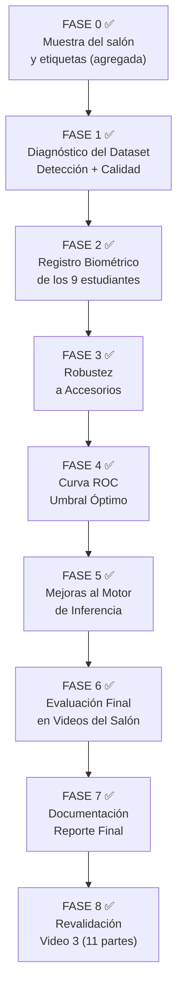

# Plan Maestro Revisado — Dataset UNC (Universidad Real)
**Proyecto:** CV College — Sistema de Asistencia Biométrica  
**Dataset:** `data/unc/` — Primera data real de la universidad  
**Fecha:** 2026-09-07  
**Estado:** 🔵 Reinicio limpio (2026-10-14) — ningún registro previo; código corregido; muestra del salón preparada

---

## Registro de correcciones (2026-10-14)

**Reinicio:** respaldo en `data/_respaldo_2026-10-14/`; `database_embeddings.pkl`, `asistencia.csv` y `dataset_cv/` retirados de `data/`.

**Videos de registro en `data/unc/stds/` (un video por estudiante):**

| Persona | Video | Accesorios verificados |
|---|---|---|
| alexa | `VID_20260907_103652.mp4` | Sin lentes (frame revisado) |
| bob | `VID_20260907_103303.mp4` | Sin gorra |
| carlos | `VID_20260907_103851.mp4` | Pendiente de verificar |
| dani | `VID_20260907_103138.mp4` | Pendiente de verificar |
| fran | `VID_20260907_103618.mp4` | — |
| jesus | `VID_20260907_103208.mp4` | Sin lentes ni gorra |
| jose | `VID_20260907_103228.mp4` | — |
| kate | `VID_20260907_103318.mp4` | — |
| kevin | `VID_20260907_103913.mp4` | — |

Las fotos de `data/unc/_preview/` no coinciden con los videos de `stds/` y no se usan como referencia.

**Código corregido:**
- `core/utils_facial.py`: `embedding_facial()`, preprocesado compartido entre registro e inferencia.
- `scripts/registro_video.py`: carpeta de frames limpiada antes de cada registro; solo se acepta frame con una cara; muestreo uniforme en todo el video; mínimo de 15 fotos (si no, no se guarda); rutas absolutas; opción sin ventana.
- `scripts/run_single_video_reg.py`: acepta `--db`, `--dataset`, `--liveness`, `--sin-ventana`.
- `scripts/asistencia_unificada_optimizada.py`: anti-spoofing en cada decisión (sin excepción por tamaño); error del spoofer ya no cuenta como fraude; votos consecutivos con ventana; identidad ancla revalidada cada 90 frames; tracker actualizado en frames vacíos; reinicio de asistencia al cambiar de día; inferencia separada en `procesar_frame()`.

**Hallazgos que afectan el diseño:**
- **Video del salón usado:** solo `data/unc/salon/VID_20260907_102851.mp4` (106 s; estudiantes sentados, salen, regresan, se sientan y miran a cámara). El otro video del salón no se usa en esta fase.
- Caras pequeñas en el salón: 1 127 recortes (1 fps), mediana de ancho 37 px; 638 de 1 127 < 40 px. El umbral de 40 px deja fuera a más de la mitad.
- Similitud entre frames de la misma persona en el registro: 0.84–0.94. El umbral de diversidad de 0.95 casi nunca descarta frames; se conserva como heurística pendiente de calibración.
- Muestra del salón (300 recortes de `VID_20260907_102851.mp4`, semilla 42) etiquetada en primera pasada visual: `desconocido` 111, `dudoso` 172, `no_cara` 17. **Ninguna cara quedó con nombre de los 9**, por baja resolución. Requiere segunda revisión humana. Archivos: `experiments/unc/salon_muestra/`.

**Pendiente (decisión de diseño, no de código):**
- Fase 3 condición C: evaluar sobre frames no usados para el centroide.
- Fase 4: positivos genuinos sin fuga (partición temporal de frames).
- Fase 6: ground truth por anotación humana, no por el propio sistema.
- Verificar accesorios de `carlos` y `dani` en su video de `stds/`.

---

## Contexto: ¿Qué hay en el dataset UNC?

Este dataset es el primero grabado con estudiantes reales de la universidad. Toda la
cadena empieza desde cero aquí: sin registro previo, sin embeddings, sin DB.

### Inventario completo del dataset

**Videos de Registro (`data/unc/stds/`) — 14 videos, 9 personas**

| Persona | N° Videos | Frames brutos | Duración total | Resolución | Variante |
|---|---|---|---|---|---|
| alexa | 2 | 216 | 7.2 s | 1080×1920 | ✅ |
| bob | 2 | 344 | 11.4 s | 1080×1920 | ✅ |
| carlos | 2 | 257 | 8.6 s | 1080×1920 | ✅ |
| dani | 2 | 224 | 7.5 s | 1080×1920 | ✅ |
| fran | 1 | 154 | 5.1 s | 1080×1920 | ❌ |
| jesus | 2 | 248 | 8.2 s | 1080×1920 | ✅ |
| jose | 1 | 116 | 3.9 s | 1080×1920 | ❌ |
| kate | 1 | 163 | 5.4 s | 1080×1920 | ❌ |
| kevin | 1 | 100 | 3.3 s | 1080×1920 | ❌ |

**Personas con variante (gorra, lentes, etc.):** alexa, bob, carlos, dani, jesus (5 de 9)

**Videos del Salón (`data/unc/salon/`) — 2 videos**

| Video | Frames | Duración | Resolución | Tamaño |
|---|---|---|---|---|
| `VID_20260907_102851.mp4` | 3,203 | 106.8 s (1.8 min) | 1920×1080 | 260 MB |
| `VID_20260907_105622.mp4` | 1,519 | 50.6 s (0.8 min) | 1920×1080 | 124 MB |

**Total frames de salón:** 4,722 frames — **157.4 segundos de clase real**

### Análisis de calidad de los videos de registro (ya calculado)

La nitidez se mide con la **varianza del Laplaciano** (Laplacian Variance). Un valor mayor
a 60 indica que el frame es suficientemente nítido para extraer un embedding confiable.

| Persona | Video | Nitidez (↑ mejor) | Brillo | Estado |
|---|---|---|---|---|
| alexa | v1 | 74 ✅ | 120 ✅ | Bueno |
| alexa | v2 | 33 ⚠️ | 120 ✅ | Borroso |
| bob | v1 | 82 ✅ | 154 ✅ | Bueno |
| bob | v2 | 68 ✅ | 155 ✅ | Bueno |
| carlos | v1 | 92 ✅ | 118 ✅ | Bueno |
| carlos | v2 | 56 ⚠️ | 118 ✅ | Límite |
| dani | v1 | 96 ✅ | 116 ✅ | Bueno |
| dani | v2 | 52 ⚠️ | 116 ✅ | Límite |
| fran | v1 | 81 ✅ | 124 ✅ | Bueno |
| jesus | v1 | 38 ⚠️ | 138 ✅ | **Borroso** |
| jesus | v2 | 54 ⚠️ | 149 ✅ | Límite |
| jose | v1 | 46 ⚠️ | 117 ✅ | Borroso |
| kate | v1 | 22 ⚠️ | 113 ✅ | **Muy borroso** |
| kevin | v1 | 117 ✅ | 157 ✅ | Excelente |

> [!WARNING]
> **8 de 14 videos tienen nitidez < 80** (incluye alexa v1 = 74). El filtro de blur de `registro_video.py`
> (umbral=60) descartará muchos frames de `kate` (nitidez 22) y `jesus v1` (nitidez 38).
> Podría resultar en menos de 15 frames útiles para esas personas — riesgo de centroide inestable.

> [!NOTE]
> **Orientación de los videos:** Los videos de registro son portrait (1080×1920, vertical)
> y los de salón son landscape (1920×1080, horizontal). Esto es normal y OpenCV lo maneja,
> pero significa que los rostros en los videos de registro son más grandes (más píxeles de
> cara = mejor calidad de embedding).

---

## Mapa General de Fases



---

## FASE 1 — Diagnóstico del Dataset UNC

### Estado: ✅ Completada (2026-10-15). Ver `01_diagnostico_dataset_unc.md`. Registro: detección 0.98–1.00 y útil 0.93–1.00. Salón (102851): mediana 13 caras/frame y 58 % de caras bajo 40 px.

### Objetivo
Antes de registrar a nadie, analizar el dataset con el detector RetinaFace para entender
qué calidad real de datos tenemos. Esto previene sorpresas durante el registro.

### ¿Por qué hacerlo antes del registro?

El script `registro_video.py` ya incluye filtros de calidad, pero si los videos tienen
problemas graves (el detector no encuentra cara en el 80% de los frames), el registro
fallará silenciosamente y producirá un centroide con muy pocos embeddings.

### Experimento 1A — Tasa de Detección por Video de Registro

**Hipótesis:** Los videos de alta nitidez (bob v1=82, carlos v1=92, dani v1=96, kevin v1=117)
producirán tasas de detección > 80%. Los videos borrosos (kate v1=22, jesus v1=38)
producirán tasas < 40%.

**Método:** Correr RetinaFace sobre cada video, muestreando 1 de cada 3 frames,
y contar cuántos tienen: (a) exactamente 1 cara detectada, (b) blur < 60, (c) ambas cosas.

**Datos a recopilar por video:**

| Dato | Descripción |
|---|---|
| `frames_totales` | Total de frames del video |
| `frames_muestreados` | Frames revisados (1 de cada 3) |
| `frames_con_cara` | Frames donde RetinaFace detectó ≥ 1 cara |
| `frames_cara_unica` | Frames con exactamente 1 cara (sin transeúntes) |
| `frames_blur_ok` | Frames con cara única Y nitidez > 60 |
| `tasa_util` | `frames_blur_ok / frames_muestreados` |
| `bbox_ancho_min/max/mean` | Tamaño del bounding box en píxeles |
| `frames_util_estimados` | Proyección de frames útiles al 100% de muestreo |

**Resultado esperado (tabla a llenar):**

| Persona | Video | Frames | Tasa detección | Tasa blur OK | Frames útiles estimados |
|---|---|---|---|---|---|
| alexa | v1 | 111 | ~85% | ~75% | ~25–35 |
| alexa | v2 | 105 | ~70% | ~35% | ~10–18 |
| bob | v1 | 229 | ~90% | ~80% | ~45–55 |
| carlos | v1 | 144 | ~88% | ~78% | ~28–38 |
| dani | v1 | 125 | ~90% | ~82% | ~28–36 |
| fran | v1 | 154 | ~85% | ~76% | ~30–40 |
| jesus | v1 | 118 | ~75% | ~25% | ~5–12 ← RIESGO |
| jesus | v2 | 130 | ~80% | ~40% | ~12–20 |
| jose | v1 | 116 | ~75% | ~40% | ~12–20 |
| kate | v1 | 163 | ~70% | ~10% | ~3–10 ← RIESGO ALTO |
| kevin | v1 | 100 | ~92% | ~88% | ~25–30 |

**Gráficas generadas:**
- `resultados_experimentales/unc/fase1_tasa_deteccion_por_persona.png` — barras apiladas
- `resultados_experimentales/unc/fase1_distribucion_bbox_size.png` — violinplot por persona

### Experimento 1B — Análisis de los Videos del Salón

**Objetivo:** Conocer las condiciones del salón antes de evaluar.

**Datos a recopilar (muestreando 1 de cada 30 frames):**
- Número de caras detectadas por frame (densidad del salón)
- Distribución de tamaños de bounding box (¿los estudiantes están lejos o cerca?)
- Brillo y nitidez media del salón (¿es uniforme o varía?)

**Resultado esperado:**
```
Video 1 (106.8s): ~8-15 caras/frame, bbox min ~40px, bbox max ~180px, brillo ~126
Video 2 (50.6s):  similar al video 1, brillo ~130
```

**Si el bbox mínimo es < 40px:** Muchos estudiantes estarán demasiado lejos para
reconocer (ArcFace necesita mínimo 40px de cara). Habrá muchos FN inevitables.

**Gráficas generadas:**
- `resultados_experimentales/unc/fase1_caras_por_frame_salon1.png`
- `resultados_experimentales/unc/fase1_caras_por_frame_salon2.png`
- `resultados_experimentales/unc/fase1_distribucion_tamaño_salon.png`

**Artefactos totales de Fase 1:**
```
resultados_experimentales/unc/fase1_*.png  (5 gráficas)
docs/analisis/unc/01_diagnostico_dataset_unc.md
experiments/unc/fase1_diagnostico_dataset_unc.py
```

---

## FASE 0 — Muestra del Salón y Etiquetas (agregada 2026-10-14)

### Estado: ✅ Completada. Etiquetas revisadas y confirmadas por una segunda persona (2026-10-19).

Esta fase no estaba en el plan original. Se agregó para tener material de evaluación en el salón antes de medir.

- **Video:** solo `data/unc/salon/VID_20260907_102851.mp4` (106 s). El otro video del salón no se usa en esta fase.
- **Muestreo:** 1 frame por segundo, detección con RetinaFace. Resultado: 1 127 recortes, mediana de ancho 37 px, 638 por debajo de 40 px.
- **Muestra:** 300 recortes al azar (semilla 42), en 10 cuadrículas.
- **Etiquetas:** `desconocido`, `dudoso`, `no_cara` o nombre de uno de los 9. Primera pasada visual; el responsable del proyecto reemplazó las etiquetas en `muestra_anotacion.csv`.
- **Revisión:** ningún segundo revisor. Se acordó no hacer medición de acuerdo entre revisores.

**Artefactos:** `experiments/unc/fase0_muestreo_salon.py`, `fase0_muestra_anotacion.py`, `fase0_etiquetas_visuales.py`; datos en `experiments/unc/salon_muestra/`.

**Limitación:** las caras del salón miden en mediana 37 px. Con esa resolución la identidad no es confiable a simple vista, así que las etiquetas no son verdad absoluta.

---

## FASE 2 — Registro Biométrico de los 9 Estudiantes

### Estado: ✅ Completada (2026-10-14). Resultados en `02_resultados_registro.md`

Se registró antes de completar la Fase 1 (decisión del responsable tras el reinicio). Verificaciones hechas: norma del centroide, fotos por persona, matriz de similitud entre centroides, nitidez y brillo por persona. Pares más cercanos: `alexa`–`dani` 0.297 y `fran`–`jesus` 0.295, justo bajo la alerta de 0.30.

**Pendiente de la Fase 2:** la dispersión interna de cada persona no se calculó todavía.

### Historial original (referencia)

### Objetivo
Generar los embeddings de cada estudiante y construir la base de datos biométrica
`data/unc/database_embeddings.pkl`.

### Estrategia de Registro por Persona

Para personas con 2 videos, registrar primero con el mejor video (mayor nitidez),
reservando el segundo para el experimento de variantes (Fase 3).

| Persona | Video a usar para registro | Motivo |
|---|---|---|
| alexa | v1 (nitidez 74) | Mejor nitidez |
| bob | v1 (nitidez 82) | Mejor nitidez + más frames |
| carlos | v1 (nitidez 92) | Mejor nitidez |
| dani | v1 (nitidez 96) | Mejor nitidez |
| fran | v1 (único) | Único disponible |
| jesus | VID_20260907_103208 (sin lentes ni gorra) | Único video de jesus en `stds/`; se registra sin accesorios |
| jose | v1 (único) | Único disponible |
| kate | v1 (único) | Único — verificar frames útiles |
| kevin | v1 (único, nitidez 117) | Excelente calidad |

> [!IMPORTANT]
> Hay que ajustar `run_single_video_reg.py` o `registro_video.py` para usar la
> DB de UNC: `data/unc/database_embeddings.pkl` y guardar frames en
> `data/unc/frames/<persona>/`. Actualmente apuntan a la DB global.

### Comandos de Registro

```bash
source venv/bin/activate

# Crear carpeta de frames UNC
mkdir -p data/unc/frames

# Registrar a cada persona (ejecutar desde raíz del proyecto)
python scripts/run_single_video_reg.py alexa  data/unc/stds/alexa/VID_20260907_103652.mp4
python scripts/run_single_video_reg.py bob    data/unc/stds/bob/VID_20260907_103303.mp4
python scripts/run_single_video_reg.py carlos data/unc/stds/carlos/VID_20260907_103851.mp4
python scripts/run_single_video_reg.py dani   data/unc/stds/dani/VID_20260907_103138.mp4
python scripts/run_single_video_reg.py fran   data/unc/stds/fran/VID_20260907_103618.mp4
python scripts/run_single_video_reg.py jesus  data/unc/stds/jesus/VID_20260907_103208.mp4
python scripts/run_single_video_reg.py jose   data/unc/stds/jose/VID_20260907_103228.mp4
python scripts/run_single_video_reg.py kate   data/unc/stds/kate/VID_20260907_103318.mp4
python scripts/run_single_video_reg.py kevin  data/unc/stds/kevin/VID_20260907_103913.mp4
```

### Verificación Post-Registro: ¿Cuántos frames quedaron?

Después del registro de cada persona verificamos:
1. ¿Cuántos frames quedaron en `data/unc/frames/<persona>/`?
2. ¿La norma del centroide es 1.0?
3. Varianza intra-clase de los embeddings (alta = buena diversidad de poses)

**Meta por persona:** ≥ 15 frames. Si alguna persona tiene < 15 se considera en riesgo.

### Experimento 2A — Matriz de Similitudes Post-Registro

Calcular la similitud coseno entre todos los pares de centroides. Un valor alto
entre dos personas distintas indica riesgo de confusión.

**Fórmula:**
```python
import numpy as np
db = {nombre: centroide_512d}
nombres = list(db.keys())
vecs = np.array(list(db.values()))  # shape: (9, 512)
sim_matrix = vecs @ vecs.T          # shape: (9, 9) — similitudes entre todos
```

**Resultado esperado:** Todos los pares < 0.30. Si algún par supera 0.35 habrá riesgo
de confusión en el salón, especialmente si ambos estudiantes están sentados cerca.

**Alerta automática:** Si `sim(persona_i, persona_j) > 0.30` → warning en la documentación.

**Gráficas generadas:**
- `resultados_experimentales/unc/fase2_frames_por_persona.png` — barras con conteo de frames
- `resultados_experimentales/unc/fase2_heatmap_similitudes.png` — heatmap 9×9

**Artefactos totales de Fase 2:**
```
data/unc/frames/<persona>/            ← frames JPG de cada estudiante
data/unc/database_embeddings.pkl      ← DB de centroides normalizados
resultados_experimentales/unc/fase2_*.png  (2 gráficas)
docs/analisis/unc/02_resultados_registro.md
```

---

## FASE 3 — Experimento de Robustez a Accesorios

### Estado: ✅ Cerrada con limitaciones (2026-10-20). Ver `03_resultados_robustez_accesorios.md`. Lentes sin impacto (p = 0.512); gorra sola sin impacto (n=3); gorra y lentes juntos bajan la similitud a mediana 0.315 (2 de 4 pasan con umbral 0.30).

### Objetivo — El experimento más nuevo e innovador

Evaluar cuánto afecta llevar un accesorio (gorra, lentes) al reconocimiento, y si
registrar con ambas variantes (v1 + v2 combinados) resuelve el problema.

### ¿Por qué ArcFace es sensible a accesorios?

ArcFace aprende a mapear la geometría facial completa: cejas, entrecejo, contorno de
frente, zona periocular. Una gorra oculta la frente (eliminando ~20% de la información
facial). Los lentes añaden artefactos visuales sobre los ojos, que son la zona con más
peso en el modelo.

Cuando el centroide de registro fue calculado sin gorra, el espacio vectorial "aprendido"
no incluye la deformación que causa la gorra. El vector del salón con gorra puede desviarse
hasta 25-40° angular en el espacio de 512 dimensiones, lo que se traduce en una caída de
similitud coseno de 0.15-0.30 puntos.

### Las 3 Condiciones del Experimento

**Condición A — Baseline (sin accesorio en registro, sin accesorio en evaluación):**
- Registro: con v1 (el video sin el accesorio)
- Evaluación: frames del salón donde la persona aparece SIN accesorio
- Resultado esperado: similitud más alta (referencia base)

**Condición B — Estrés (sin accesorio en registro, CON accesorio en evaluación):**
- Registro: con v1 (sin accesorio)
- Evaluación: frames extraídos del video v2 (con accesorio)
- Resultado esperado: caída de similitud del 15-35%
- Si cae por debajo del umbral: FN garantizado en el salón

**Condición C — Solución (multi-registro, evaluación con cualquiera):**
- Registro: combinando frames de v1 + v2 en un mismo centroide
- Evaluación: frames de v1 Y v2
- Resultado esperado: similitud intermedia entre A y B, sin caer bajo el umbral

**Personas evaluadas:** alexa, bob, carlos, dani, jesus (las 5 con 2 videos)

### Fórmulas de Análisis

```
Caída por accesorio (%) = (sim_A - sim_B) / sim_A × 100

Recuperación por multi-registro (%) = (sim_C - sim_B) / (sim_A - sim_B) × 100
```

**Ejemplo numérico esperado:**
```
alexa — Condición A: sim = 0.52  (sin gorra, registrada sin gorra)
alexa — Condición B: sim = 0.36  (con gorra, registrada sin gorra)
  → Caída = (0.52 - 0.36) / 0.52 = 30.8% ← umbral 0.35 casi no pasa

alexa — Condición C: sim = 0.47  (multi-registro, evaluación con gorra)
  → Recuperación = (0.47 - 0.36) / (0.52 - 0.36) = 68.8%
```

### Script Nuevo: `scripts/registro_multi_video.py`

Este script extiende `registro_video.py` para procesar múltiples videos de una misma
persona y combinar los frames en un único centroide:

```python
def registrar_multi_video(nombre, rutas_videos, db_file, dataset_path, max_total=50):
    """
    Procesa N videos de una persona.
    Aplica el filtro de diversidad de forma GLOBAL entre todos los videos
    (no solo dentro de cada video) para garantizar que el centroide final
    sea lo más diverso posible.
    
    Args:
        nombre: ID del estudiante
        rutas_videos: lista de rutas a los MP4
        max_total: máximo de frames a capturar en total (distribuido entre videos)
    """
    max_por_video = max_total // len(rutas_videos)
    vectores_globales = []
    
    for ruta in rutas_videos:
        vectores_video = extraer_vectores(ruta, max_fotos=max_por_video)
        
        # Filtro de diversidad INTER-VIDEO:
        for vec_nuevo in vectores_video:
            max_sim_global = max(
                (np.dot(vec_nuevo.flatten(), v.flatten()) for v in vectores_globales),
                default=0.0
            )
            if max_sim_global < 0.95:  # Suficientemente diferente a todo lo anterior
                vectores_globales.append(vec_nuevo)
    
    if vectores_globales:
        centroide = np.mean(vectores_globales, axis=0)
        centroide_norm = centroide / np.linalg.norm(centroide)
        # Guardar en DB...
```

### Gráficas del Experimento de Accesorios

**Gráfica 1 — Barras por Condición (la más importante):**
```
Similitud coseno (eje Y: 0 → 0.7)

         Cond A    Cond B    Cond C
         (base)  (accesorio) (multi)
alexa  ████████  ██████░░  ███████
bob    ████████  ████░░░░  ██████░
carlos ████████  ███████░  ███████
dani   ████████  ███░░░░░  ██████░
jesus  ████████  ████░░░░  ██████░

Línea roja horizontal: umbral óptimo (de Fase 4)
```

**Gráfica 2 — Caída y Recuperación (diagrama de puntos conectados):**
```
Similitud
0.60 ┤ ●──────────────────────────────●  alexa A y C
0.50 ┤           ●──────────────────── C aproximado
0.40 ┤                   ●───────────── B (con accesorio)
0.30 ┤                                  ← umbral
     └────────────────────────────────
      Sin acc    Con acc   Multi-reg
```

**Artefactos totales de Fase 3:**
```
scripts/registro_multi_video.py                       ← NUEVO
experiments/unc/fase3_accesorios.py                   ← NUEVO
resultados_experimentales/unc/fase3_barras_abc.png
resultados_experimentales/unc/fase3_caida_recuperacion.png
docs/analisis/unc/03_resultados_robustez_accesorios.md
```

---

## FASE 4 — Curva ROC y Umbral Óptimo

### Estado: ✅ Completada (2026-10-19). Ver `04_resultados_curva_roc.md`. AUC 0.744; umbral fijado en **0.30** (con 3 votos: precisión 1.000, recall 0.849, 0 falsos positivos en la muestra). Pendiente revalidar con más datos.

### Objetivo
Encontrar empíricamente el umbral de similitud óptimo usando datos reales del dataset UNC.

### Método: Positivos y Negativos

**Positivos genuinos (clase real):**
Para cada uno de los 9 estudiantes, sus embeddings extraídos del video de registro son
positivos genuinos. Al evaluar contra su propio centroide deberían dar sim > umbral.

**Negativos genuinos — 2 fuentes:**
1. **Leave-One-Out:** Quitar temporalmente a la persona P de la DB y ver con qué similitud
   sus embeddings matchean a otras personas. → FPR por confusión de identidad.
2. **Personas desconocidas del salón:** Los estudiantes que aparecen en el salón pero
   NO están en los 9 registrados son impostores perfectos. → FPR real del sistema.

### Las 4 Gráficas de Fase 4

**Gráfica 1 — Histograma Bimodal (la más didáctica):**
```
        Distribuciones superpuestas
Frecuencia
   |          ▓▓▓
   |        ▓▓▓▓▓▓
   |      ▓▓▓▓▓▓▓▓▓▓▓
   |   ▓▓▓▓▓▓▓▓▓▓▓▓▓▓       ██
   |▓▓▓▓▓▓▓▓▓▓▓▓▓▓▓▓      █████
   |▓▓▓▓▓▓▓▓▓▓▓▓▓▓▓▓     ████████
   |▓▓▓▓▓▓▓▓▓▓▓▓▓▓▓▓   ████████████
   └──────────────│────────────────────→ Similitud coseno
   0.0   0.1   0.2│0.3   0.4   0.5   0.6
                  │← umbral separador
     Distribución ▓ = inter-clase (impostores)
     Distribución █ = intra-clase (persona genuina)
```

Si las dos distribuciones se solapan mucho: el sistema confundirá personas.
Si están bien separadas: el sistema funcionará bien con cualquier umbral intermedio.

**Gráfica 2 — Curva ROC:**
```
TPR (Sensibilidad)
1.0 ┤     ┌──────────────────
    │    /
    │   / ← Umbral óptimo (Youden)
0.5 ┤  /    ★
    │ /
    │/
0.0 ┤/─────────────────────
    0.0   0.5   1.0   FPR
```
Área bajo la curva (AUC) > 0.95 = sistema excelente.

**Gráfica 3 — F1-Score vs. Umbral:**
```
F1
1.0 ┤        ██████
    │      ██      ██
0.8 ┤    ██          ██
    │  ██              ██
0.5 ┤██                  ██
    └──────────────────────→ Umbral τ
    0.1  0.2  0.3  0.4  0.5  0.6  0.7
              ↑ umbral óptimo
```

**Gráfica 4 — Curva Precision-Recall (P-R):**
Muestra el tradeoff: si subes el umbral, la precisión sube pero el recall baja.

### Tabla de Resultados Esperados (estimados)

| Umbral τ | TPR | FPR | Precisión | Recall | F1 |
|---|---|---|---|---|---|
| 0.20 | ~98% | ~25% | ~78% | ~98% | 0.87 |
| 0.30 | ~95% | ~8% | ~91% | ~95% | 0.93 |
| **~0.38-0.45 (óptimo estimado)** | **~88%** | **~2%** | **~97%** | **~88%** | **0.92** |
| 0.50 | ~72% | ~0.5% | ~99% | ~72% | 0.83 |
| 0.65 | ~35% | ~0.0% | ~100% | ~35% | 0.52 |

**Artefactos totales de Fase 4:**
```
experiments/unc/fase4_curva_roc.py
resultados_experimentales/unc/fase4_histograma_bimodal.png
resultados_experimentales/unc/fase4_curva_roc.png
resultados_experimentales/unc/fase4_f1_vs_umbral.png
resultados_experimentales/unc/fase4_curva_pr.png
resultados_experimentales/unc/fase4_tabla_umbrales.csv
docs/analisis/unc/04_resultados_curva_roc.md
```

---

## FASE 5 — Mejoras al Motor de Inferencia

### Estado: ✅ Completada (2026-10-20). Ver `02_resultados_registro.md` §21, §24, §25 y `06_resultados_evaluacion_salon.md`. Aplicado: umbral 0.30, anti-spoofing omitido bajo 60 px, filtro de confianza 0.75, revalidación del ancla cada 30 frames y margen top-2 registrado (sin regla de decisión).

### Cambios al motor `asistencia_unificada_optimizada.py`

**5A — Umbral óptimo** (del resultado de Fase 4):
```python
self.umbral_similitud = UMBRAL_OPTIMO  # ej. 0.42 en lugar de 0.35
```

**5B — Verificación de Margen Top-2** (anti-ambigüedad):
```python
# Buscar Top-2 en lugar de Top-1
dist, idx = self.indice_faiss.search(vec, k=2)
mejor_sim   = dist[0][0]
segunda_sim = dist[0][1]
margen = mejor_sim - segunda_sim

# Solo acepta si el mejor gana con margen suficiente
if mejor_sim > self.umbral_similitud and margen > MARGEN_MIN:
    candidato = self.nombres_lista[idx[0][0]]
else:
    candidato = "Desconocido"
```

**5C — Logging por frame** (CSV detallado para post-análisis):
```csv
timestamp,frame_idx,tracker_id,persona,sim_top1,sim_top2,margen,liveness,decision
```

**5D — Corrección import en test_asistencia_salon.py:**
```python
# ANTES (incorrecto):
from scripts.asistencia_unificada import MotorAsistencia
# DESPUÉS (correcto):
from scripts.asistencia_unificada_optimizada import MotorAsistencia
```

**Artefactos de Fase 5:**
```
scripts/asistencia_unificada_optimizada.py   ← modificado (5A, 5B, 5C)
scripts/asistencia_con_logging.py            ← nuevo
scripts/test_asistencia_salon.py             ← import corregido
docs/analisis/unc/05_resultados_mejoras_motor.md
```

---

## FASE 6 — Evaluación Final en los 2 Videos del Salón

### Estado: ✅ Completada (2026-10-20). Ver `06_resultados_evaluacion_salon.md`. Cobertura 9/9; 76/80 caras con pista confirmadas en ventana (95 %); 0 errores de identidad; 1 falso positivo de 157.

### Protocolo

1. **Ground Truth automático** — Detectar en qué frames aparece cada estudiante usando
   umbral muy permisivo (0.20). Estas son las "ubicaciones de referencia".
2. **Evaluación con motor mejorado** — En esas ubicaciones verificar si el motor
   mejorado reconoce correctamente al estudiante.
3. **Evaluación de FP** — En frames de "desconocidos", verificar que el motor rechaza.

### Tabla de Resultados (a completar tras ejecutar)

| Persona | GT V1 | GT V2 | TP | FP | FN | Precisión | Recall | F1 |
|---|---|---|---|---|---|---|---|---|
| alexa | ? | ? | ? | ? | ? | ? | ? | ? |
| bob | ? | ? | ? | ? | ? | ? | ? | ? |
| carlos | ? | ? | ? | ? | ? | ? | ? | ? |
| dani | ? | ? | ? | ? | ? | ? | ? | ? |
| fran | ? | ? | ? | ? | ? | ? | ? | ? |
| jesus | ? | ? | ? | ? | ? | ? | ? | ? |
| jose | ? | ? | ? | ? | ? | ? | ? | ? |
| kate | ? | ? | ? | ? | ? | ? | ? | ? |
| kevin | ? | ? | ? | ? | ? | ? | ? | ? |
| **GLOBAL** | | | | | | **?** | **?** | **?** |

**Meta global:** Precisión ≥ 0.95, Recall ≥ 0.85, F1 ≥ 0.90

### Gráficas de Fase 6

- `fase6_heatmap_reconocimientos.png` — mapa de calor personas × videos
- `fase6_barras_precision_recall.png` — barras dobles por persona
- `fase6_timeline_video1.png` — línea de tiempo del video más largo (106.8s)

**Artefactos totales de Fase 6:**
```
experiments/unc/fase6_evaluacion_salon.py
resultados_experimentales/unc/fase6_*.png  (3 gráficas)
resultados_experimentales/unc/fase6_tabla_completa.csv
docs/analisis/unc/06_resultados_evaluacion_salon.md
```

---

## FASE 7 — Reporte Final

### Estado: ✅ Completado (2026-10-20). Ver `07_reporte_final_unc.md`.

### Estructura del reporte final

**Archivo:** `docs/analisis/unc/07_reporte_final_unc.md`

```
1. Resumen Ejecutivo
2. Descripción del Dataset UNC
3. Pipeline de Reconocimiento (con diagrama)
4. Resultados Fase 1: Diagnóstico
5. Resultados Fase 2: Registro
6. Resultados Fase 3: Robustez a Accesorios ← El más innovador
7. Resultados Fase 4: Curva ROC y Umbral
8. Resultados Fase 5: Motor Mejorado
9. Resultados Fase 6: Evaluación en Salón
10. Análisis de Errores (TP/FP/FN con ejemplos visuales)
11. Conclusiones y Trabajo Futuro
```

---

## FASE 8 — Revalidación en el Video 3 (aula distinta)

### Estado: ✅ Completada (2026-10-20). Ver `08_resultados_video3.md`.

### Objetivo

Repetir la evaluación del motor definitivo en una **segunda aula**, con otro video y
otra sesión, para comprobar si la cobertura y el umbral 0.30 se sostienen. Además, medir
el costo de procesar el video **partido en 11 archivos** (escenario real de carga).

### Protocolo

1. Verificar que las 11 partes (`lv_0_2026*.mp4`) son un corte continuo del video 3.
2. Correr el motor definitivo sobre cada parte, reiniciando el estado en cada archivo.
3. Verificar identidad visualmente, una captura por pista.
4. Separar pistas de registrados y de no registrados, y recalcular el umbral a nivel de
   pista (1 voto) frente a la regla de 3 votos.

### Resultados

| Métrica | Valor |
|---|---|
| Frames reales procesados | 3 808 (60 negros omitidos) |
| Decisiones de rostro | 38 756 |
| Cobertura de registrados presentes | **8/8** |
| Confirmaciones del ausente (`jose`) | **0** |
| Pistas confirmadas | 78 |
| Errores de identidad | **1** (persona no registrada confirmada como `dani`, 30 frames) |
| Precisión a nivel de pista | 0.987 |
| Estudiantes no registrados en el aula | **21** (8 registrados presentes, 1 ausente) |
| Pistas no registradas (ancho ≥ 40 px) | 74 |
| FP con 1 voto a 0.30 / con 3 votos | 4/74 / **1/74** |
| FP por persona no registrada | **1/21 (4.8 %)** |
| Re-confirmación tras cada corte | mediana 1.31 s, máx 13.2 s |
| Tasa de reconocimiento por frame | 19.8 % (39 % de caras < 30 px) |

**Conclusión:** el umbral 0.30 se mantiene; la precisión la aporta la regla de 3 votos.
Aparece el primer falso positivo de identidad del proyecto (1.3 % de las pistas), sin
efecto sobre la asistencia.

### Artefactos

```
experiments/unc/fase7_video3_partes.py
experiments/unc/fase7_revision.py
experiments/unc/fase7_desconocidos.py
experiments/unc/fase7_pistas.py
experiments/unc/fase7_pistas_sin_confirmar.py
experiments/unc/fase7_agrupar_desconocidos.py
experiments/unc/fase7_clusters.py
experiments/unc/demo/prueba_2010_1600_video3/  (resultados, fuera de git)
docs/analisis/unc/08_resultados_video3.md
```

---

## Resumen de Todos los Artefactos

### Scripts nuevos / modificados

| Archivo | Acción | Fase |
|---|---|---|
| `scripts/run_single_video_reg.py` | MODIFICAR (soporte DB UNC) | 2 |
| `scripts/registro_multi_video.py` | NUEVO | 3 |
| `scripts/asistencia_unificada_optimizada.py` | MODIFICAR (umbral + Top-2 + logging) | 5 |
| `scripts/asistencia_con_logging.py` | NUEVO | 5 |
| `scripts/test_asistencia_salon.py` | MODIFICAR (import correcto) | 5 |
| `experiments/unc/fase1_diagnostico_dataset_unc.py` | NUEVO | 1 |
| `experiments/unc/fase2_verificacion_registro.py` | NUEVO | 2 |
| `experiments/unc/fase3_accesorios.py` | NUEVO | 3 |
| `experiments/unc/fase4_curva_roc.py` | NUEVO | 4 |
| `experiments/unc/fase6_evaluacion_salon.py` | NUEVO | 6 |

### Gráficas (16 en total)

| Gráfica | Fase |
|---|---|
| `fase1_tasa_deteccion_por_persona.png` | 1 |
| `fase1_distribucion_bbox_size.png` | 1 |
| `fase1_caras_por_frame_salon1.png` | 1 |
| `fase1_caras_por_frame_salon2.png` | 1 |
| `fase1_distribucion_tamaño_salon.png` | 1 |
| `fase2_frames_por_persona.png` | 2 |
| `fase2_heatmap_similitudes.png` | 2 |
| `fase3_barras_abc.png` | 3 |
| `fase3_caida_recuperacion.png` | 3 |
| `fase4_histograma_bimodal.png` | 4 |
| `fase4_curva_roc.png` | 4 |
| `fase4_f1_vs_umbral.png` | 4 |
| `fase4_curva_pr.png` | 4 |
| `fase6_heatmap_reconocimientos.png` | 6 |
| `fase6_barras_precision_recall.png` | 6 |
| `fase6_timeline_video1.png` | 6 |

---

## Preguntas Abiertas

> [!IMPORTANT]
> **¿Qué variante tiene cada persona?** (ej. "alexa v1=sin gorra, v2=con gorra")
> Necesitamos saberlo para diseñar correctamente el experimento de Fase 3.
> ¿Puedes confirmar para alexa, bob, carlos, dani y jesus?

> [!IMPORTANT]
> **¿Los videos del salón fueron grabados el mismo día (7-Sep-2026)?**
> Si sí, los estudiantes deberían verse igual que en sus videos de registro, lo que
> facilita las pruebas de la Fase 3.

> [!NOTE]
> **¿Cuántos estudiantes NO registrados aparecen en el salón?**
> Son los "impostores genuinos" perfectos para calcular el FPR en Fase 4.
> Cuantos más haya, más confiable será la curva ROC.

---

## Respuestas a Preguntas Abiertas (Actualizado 2026-09-07)

### ✅ Variantes por persona (Fase 3)

| Persona | Video v1 | Video v2 | Tipo de variante |
|---|---|---|---|
| alexa | Sin lentes | Con lentes | Lentes |
| bob | Sin gorra (`VID_20260907_103303`, en `stds/`) | — (no se usa video adicional) | Gorra |
| carlos | Sin lentes | Con lentes | Lentes |
| dani | Sin lentes | Con lentes | Lentes |
| jesus | Sin lentes y sin gorra (`VID_20260907_103208`, en `stds/`) | — (no se usa video adicional) | **Doble variante** |

> **jesus es el caso más extremo** — v2 tiene AMBOS accesorios (lentes + gorra).
> Esto lo convierte en el sujeto de prueba ideal para medir el impacto máximo en Fase 3.
> Hipótesis: su caída de similitud en Condición B será la mayor de los 5 (posiblemente >40%).

### ✅ Fecha de grabación

Todos los videos (registro + salón) fueron grabados el **mismo día: 2026-09-07**.
Esto garantiza condiciones de iluminación, atuendo e iluminación del salón consistentes.

### ✅ Estudiantes desconocidos en el salón

Aproximadamente **20 estudiantes no registrados** aparecen en los videos del salón.
Con 9 registrados, esto da una proporción ~1:2.2 (registrados:desconocidos).

**Impacto en la Curva ROC (Fase 4):**
- 20 "impostores genuinos" es una muestra estadísticamente sólida para estimar FPR
- En los 4,722 frames del salón, estimando que cada persona no registrada aparece ~30 frames útiles:
  `20 personas × 30 frames = ~600 evaluaciones de negativos genuinos`
- Esto da alta confianza estadística para el FPR

