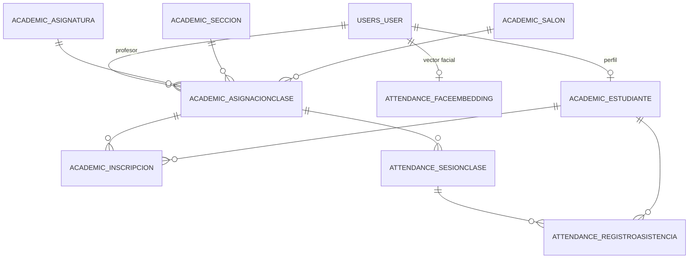

# Base de datos — CV College

**Motor:** PostgreSQL 16.15
**Base:** `cv_college_db` (host `localhost:5432`)
**Usuario:** `cv_college_user`
**Extensión vectorial:** pgvector 0.6.0 (`CREATE EXTENSION vector`)
**Tamaño actual:** 9.4 MB

Este documento describe qué guarda la base, cómo se relacionan las tablas y, en
particular, cómo se almacenan y consultan los rostros.

---

## 1. Resumen

La base cumple dos papeles:

1. **Identidad y biometría** — usuarios, perfiles de estudiante y el vector facial
   de cada persona (tabla `attendance_faceembedding`, con pgvector).
2. **Gestión académica y asistencia** — asignaturas, salones, secciones, clases,
   inscripciones, sesiones y registros de asistencia.

Estado actual: **10 usuarios** (9 estudiantes + 1 administrador), **9 vectores
faciales** y el resto de tablas académicas vacías (se borraron los datos de prueba).

---

## 2. Diagrama



---

## 3. Tablas

| Tabla | Qué guarda | Filas hoy |
|---|---|---|
| `users_user` | Usuarios con rol y datos personales | 10 |
| `academic_estudiante` | Perfil de estudiante (matrícula) | 9 |
| `attendance_faceembedding` | **Vector facial de 512 d por usuario** | 9 |
| `academic_asignatura` | Asignaturas | 0 |
| `academic_salon` | Salones | 0 |
| `academic_seccion` | Secciones/grupos | 0 |
| `academic_asignacionclase` | Clase = profesor + asignatura + sección + salón + horario | 0 |
| `academic_inscripcion` | Estudiante inscrito en una clase | 0 |
| `attendance_sesionclase` | Sesión de una clase (fecha y estado) | 0 |
| `attendance_registroasistencia` | Asistencia, fraudes y auditoría por sesión | 0 |

Además existen las tablas estándar de Django (`auth_*`, `django_*`, `admin_*`,
`django_session`), que no se documentan aquí.

### 3.1 `users_user`

Modelo propio `apps.users.User` (extiende `AbstractUser`).

| Campo | Tipo | Nota |
|---|---|---|
| `username` | varchar único | `unc_<nombre>` para los estudiantes |
| `first_name`, `last_name` | varchar | Nombre y apellido |
| `email` | varchar | |
| `role` | varchar(20) | `DEVELOPER`, `DIRECTOR`, `COORDINATOR`, `PROFESSOR`, `STUDENT` |
| `password` | varchar | Hash de Django (los estudiantes biométricos no inician sesión) |
| `is_staff`, `is_superuser` | bool | Se ajustan solos según el rol en `User.save()`: `DEVELOPER` → superusuario |

### 3.2 `academic_estudiante`

Perfil uno-a-uno con un usuario de rol `STUDENT`.

| Campo | Tipo | Nota |
|---|---|---|
| `user_id` | FK única | `ON DELETE CASCADE` |
| `matricula` | varchar(30) único | `UNC-2026-001` … `UNC-2026-009` |
| `activo` | bool | |

### 3.3 `academic_asignacionclase`

Une profesor, asignatura, sección, salón y horario. Es la base para programar clases.

| Campo | Tipo |
|---|---|
| `profesor_id` | FK a `users_user` |
| `asignatura_id`, `seccion_id`, `salon_id` | FK |
| `dia_semana` | varchar (choices) |
| `horario_inicio`, `horario_fin` | time |

### 3.4 `attendance_sesionclase` y `attendance_registroasistencia`

- **Sesión:** una fecha concreta de una clase, con estado `EN_CURSO`/`FINALIZADA`.
- **Registro:** una fila por estudiante y sesión, con `hora_entrada`, `hora_salida`,
  `similitud_ia`, `es_fraude`, `tipo_evento` (`ASISTENCIA_NORMAL`, `INTRUSO`,
  `OTRA_SECCION`, `SPOOFING`), captura del fraude, alerta revisada e historial de
  intervalos (JSON).

> **Flujos que escriben estas tablas:** el procesamiento por lotes de imágenes
> (`core/procesador_batch.py`) y la captura en vivo (`core/servicio_en_vivo.py`),
> ambos con el motor calibrado. Reglas:
> - **En vivo:** 3 votos consecutivos sobre los frames de la cámara/video.
> - **Lote:** cada imagen es una observación independiente; se exige confirmación
>   en al menos 3 imágenes (o en todas, si el lote tiene menos de 3).
> - **Desconocido** → `INTRUSO` con `es_fraude=False` (no es fraude, es alguien no
>   registrado). **Anti-spoofing positivo** → `SPOOFING` con `es_fraude=True`.
> - **Intrusos:** no todo `DESCONOCIDO` es intruso. `core/intrusos.py` exige que el
>   mejor score de la pista sea < 0.18, 15 frames consecutivos y que no sea un
>   conflicto de identidad; si la pista mejora, la fila se borra. La nota guarda la
>   mejor coincidencia. En `/sesiones/<id>/` se puede marcar como revisada.
>
> El motor de consola escribe en `RegistroAsistencia` cuando recibe `--sesion ID`
> (`python scripts/asistencia_unificada_optimizada.py --sesion ID --fuente <video|0>`),
> con estas mismas reglas. Sin `--sesion` escribe `data/asistencia.csv` para los
> experimentos y no toca la base.

---

## 4. La tabla vectorial: `attendance_faceembedding`

### 4.1 Columnas

| Columna | Tipo | Descripción |
|---|---|---|
| `id` | bigint PK | |
| `user_id` | bigint **único** | FK a `users_user`, `ON DELETE CASCADE` |
| `embedding` | `vector(512)` | Centroide facial normalizado (norma 1) |
| `modelo` | varchar(50) | Modelo que generó el vector (`arcface`) |
| `n_muestras` | int | Frames usados para el centroide (50 en los 9 actuales) |
| `fuente` | varchar(20) | `VIDEO`, `IMPORTADO` o `WEB` |
| `fecha` | timestamptz | Cuándo se registró el rostro |
| `created_at`, `updated_at` | timestamptz | Auditoría |

### 4.2 Índice

```sql
CREATE INDEX faceembedding_hnsw
ON attendance_faceembedding
USING hnsw (embedding vector_cosine_ops)
WITH (m = 16, ef_construction = 64);
```

- **HNSW** (Hierarchical Navigable Small World): índice de vecinos más cercanos
  aproximado.
- **`vector_cosine_ops`**: la distancia del índice es **coseno**.
- Con 9 filas el índice no aporta velocidad (un recorrido secuencial es
  instantáneo), pero deja la base lista para crecer.

### 4.3 Cómo se genera el vector

1. Se detecta el rostro con RetinaFace y se alinea con sus 5 puntos.
2. ArcFace produce un embedding de 512 dimensiones por frame.
3. Se promedian los embeddings de los frames válidos (hoy 50 por estudiante).
4. Se normaliza el promedio a norma 1.
5. Se guarda ese **centroide** — un vector por persona, no uno por foto.

La decisión de usar un centroide por persona está documentada en
`docs/analisis/unc/02_resultados_registro.md`.

### 4.4 Cómo se compara

El motor (`MotorAsistencia`) lee todos los centroides y arma un índice
`faiss.IndexFlatIP(512)` **en memoria** al arrancar. Como los vectores tienen norma 1,
el producto interno es exactamente la similitud coseno:

```
similitud = v · c       (ambos normalizados)
```

Se piden los **2** vecinos más cercanos: el primero decide la identidad y el segundo
alimenta el margen top-2 (hoy solo se registra, no decide).

La consulta equivalente en SQL es:

```sql
SELECT u.username, 1 - (e.embedding <=> %s::vector) AS similitud
FROM attendance_faceembedding e
JOIN users_user u ON u.id = e.user_id
ORDER BY e.embedding <=> %s::vector
LIMIT 5;
```

`<=>` es el operador de **distancia coseno** de pgvector; por eso la similitud es
`1 - distancia`.

---

## 5. Estado actual de los datos

| Tabla | Filas |
|---|---|
| `users_user` | 10 (9 estudiantes + `admin`) |
| `academic_estudiante` | 9 |
| `attendance_faceembedding` | 9 |
| `academic_asignatura` | 0 |
| `academic_salon` | 0 |
| `academic_seccion` | 0 |
| `academic_asignacionclase` | 0 |
| `academic_inscripcion` | 0 |
| `attendance_sesionclase` | 0 |
| `attendance_registroasistencia` | 0 |

### 5.1 Estudiantes registrados

| Usuario | Nombre | Matrícula | Muestras | Fuente |
|---|---|---|---|---|
| `unc_alexa` | Alexa Ramírez | UNC-2026-001 | 50 | IMPORTADO |
| `unc_bob` | Roberto Díaz | UNC-2026-002 | 50 | IMPORTADO |
| `unc_carlos` | Carlos Mendoza | UNC-2026-003 | 50 | IMPORTADO |
| `unc_dani` | Daniela Torres | UNC-2026-004 | 50 | IMPORTADO |
| `unc_fran` | Francisco Rojas | UNC-2026-005 | 50 | IMPORTADO |
| `unc_jesus` | Jesús Herrera | UNC-2026-006 | 50 | IMPORTADO |
| `unc_jose` | José Cabrera | UNC-2026-007 | 50 | IMPORTADO |
| `unc_kate` | Katerine Vega | UNC-2026-008 | 50 | IMPORTADO |
| `unc_kevin` | Kevin Navarro | UNC-2026-009 | 50 | IMPORTADO |

Los apellidos y matrículas son **provisionales** (se inventaron para poblar la base);
se pueden editar en el admin de Django.

Administrador: `admin` (rol `DEVELOPER`, superusuario). Contraseña inicial
`admin123`, **cambiar en producción**.

---

## 6. Cómo se llena y se actualiza

| Flujo | Qué hace | Dónde |
|---|---|---|
| Importación inicial | Lee `data/database_embeddings.pkl`, crea usuarios/estudiantes y guarda los 9 centroides | `python manage.py importar_centroides` |
| Registro desde video (CLI) | Calcula el centroide y hace upsert en la base | `scripts/registro_video.py` |
| Registro desde la web | El motor calcula el embedding y la API guarda `FaceEmbedding` con metadatos | `apps/academic/views.py`, `apps/attendance/api.py` |
| Lectura para inferencia | Carga los centroides y arma FAISS en memoria | `core/db_config.py` → `MotorAsistencia` |
| Asistencia por lotes | Procesa una carpeta de imágenes y escribe `RegistroAsistencia` | `ProcesarDatasetView` → `core/procesador_batch.py` |
| Asistencia en vivo | Cámara o video → motor → `RegistroAsistencia` y frame anotado | `/en-vivo/` → `core/servicio_en_vivo.py` |

Reglas de oro:

- **Un vector por usuario** (restricción única en `user_id`).
- Si cambia el rostro, se **reemplaza** el vector (`update_or_create`), no se acumula.
- Si la extracción falla, **no se guarda nada**: no hay vectores aleatorios.

---

## 7. Operación

### 7.1 Requisitos de la base

```bash
# Extensión vectorial (una vez por servidor)
sudo apt install postgresql-16-pgvector
sudo -u postgres psql -d cv_college_db -c "CREATE EXTENSION vector;"

# Para que `manage.py test` pueda crear su base
sudo -u postgres psql -c "ALTER ROLE cv_college_user CREATEDB;"
sudo -u postgres psql -d template1 -c "CREATE EXTENSION IF NOT EXISTS vector;"
```

### 7.2 Migraciones

```bash
python manage.py migrate
python manage.py makemigrations --check --dry-run   # no debe haber cambios
```

La migración `attendance.0010` es la que introdujo el tipo vectorial. Borra los
embeddings existentes y reemplaza la columna: PostgreSQL no puede castear `jsonb` a
`vector` directamente.

### 7.3 Respaldo y restauración

```bash
# Respaldo completo
pg_dump -h localhost -U cv_college_user -d cv_college_db -Fc -f respaldo.dump

# Restauración
pg_restore -h localhost -U cv_college_user -d cv_college_db respaldo.dump
```

El respaldo incluye los vectores (son datos normales de una tabla). El archivo
`data/database_embeddings.pkl` ya **no** es la fuente de verdad; solo sirve para
reimportar los centroides iniciales.

### 7.4 Consultar desde el admin

`http://localhost:8000/admin/` → **Embeddings faciales**. Muestra usuario, modelo,
número de muestras, fuente y fechas. El vector se muestra en solo lectura para evitar
ediciones accidentales.

### 7.5 Ver el flujo paso a paso

```bash
# Solo visualiza (no escribe en la base)
python manage.py ver_flujo --desde 0 --hasta 10 --detalle

# Crea una sesión de demo, escribe la asistencia y muestra el SQL
python manage.py ver_flujo --crear-sesion --detalle --sql --limpiar

# Usa una sesión real y abre ventana con el video anotado
python manage.py ver_flujo --sesion 12 --mostrar
```

El comando muestra: la consulta SQL a `attendance_faceembedding`, el índice FAISS
(9 vectores), la comparación de una misma cara en FAISS y en SQL (deben coincidir),
las decisiones por cara (top-1, top-2, margen, votos) y las filas escritas en
`attendance_registroasistencia`.

---

## 8. Riesgos y pendientes

1. **Credenciales por variables de entorno**: `cv_college/settings.py` y
   `core/db_config.py` leen `CV_DB_NAME`, `CV_DB_USER`, `CV_DB_PASSWORD`,
   `CV_DB_HOST` y `CV_DB_PORT` (con valores por defecto de desarrollo). En
   producción hay que definirlas; `DJANGO_SECRET_KEY`, `DJANGO_DEBUG` y
   `DJANGO_ALLOWED_HOSTS` también son configurables.
2. **Rendimiento en vivo:** en CPU el motor procesa ~6 fps a 720p. Alcanza para
   marcar asistencia, pero no para un video fluido; para eso haría falta GPU o
   bajar la resolución/frecuencia de análisis.
3. **Apellidos y matrículas provisionales** en los 9 estudiantes.
4. **Contraseña del admin** inicial (`admin123`) debe cambiarse.
5. **Un solo vector por persona**: si se quiere tolerar más variedad (accesorios,
   años distintos), habría que pasar a varias muestras por usuario.

---

## 9. Archivos de referencia

| Archivo | Contenido |
|---|---|
| `apps/attendance/models.py` | `FaceEmbedding`, `SesionClase`, `RegistroAsistencia` |
| `apps/academic/models.py` | `Asignatura`, `Salon`, `Seccion`, `Estudiante`, `AsignacionClase`, `Inscripcion` |
| `apps/users/models.py` | `User` con roles |
| `apps/attendance/migrations/0010_*.py` | Migración a pgvector |
| `apps/attendance/management/commands/importar_centroides.py` | Importación desde el pickle |
| `core/db_config.py` | Acceso a pgvector desde los scripts |
| `cv_college/settings.py` | Conexión y apps instaladas |
