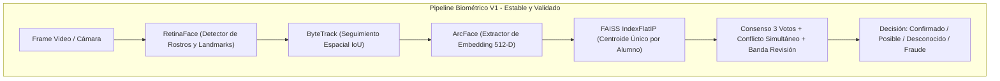
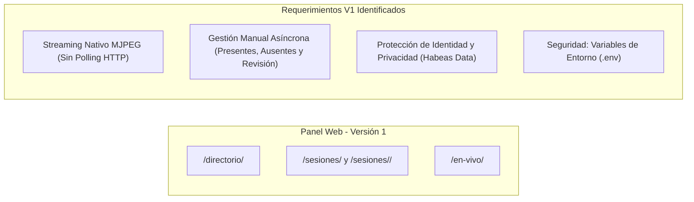

# Diagnóstico Integral del Sistema: Motor Biométrico y Panel Web (Versión 1)

Este documento establece el diagnóstico técnico y el alcance formal de la **Versión 1** de **CV College**, delimitado estrictamente a:
1. **Un centroide medio (vector de 512 dimensiones)** por estudiante, conforme a los términos y alcance del proyecto.
2. Un **motor biométrico fiel al diseño documental**: detección con **RetinaFace**, extracción con **ArcFace**, anti-spoofing y seguimiento espacial en **CPU**.
3. Un **panel web operativo y funcional** para la toma y gestión de asistencia, con estricta **protección de la privacidad e identidad del estudiante** y adaptado a la **verificación asíncrona del docente post-clase**.

> [!NOTE]
> Las propuestas de extensión arquitectónica y optimizaciones avanzadas (multi-prototipo k-NN, batching de embeddings, exportación a Excel/PDF, dashboards de métricas globales y Re-ID avanzado) han sido trasladadas a [roadmap_version_2.md](file:///home/valentina2/Desktop/Folds/VisionProjects/face-recognition-college/docs/roadmap_version_2.md) y se reservan para la Versión 2.
>
> La versión original previa de este diagnóstico se conserva íntegra en [diagnostico_motor_y_panel_original.md](file:///home/valentina2/Desktop/Folds/VisionProjects/face-recognition-college/docs/diagnostico_motor_y_panel_original.md).

---

## 1. Diagnóstico del Motor Biométrico (Versión 1)

El motor actual ([`MotorAsistencia`](file:///home/valentina2/Desktop/Folds/VisionProjects/face-recognition-college/scripts/asistencia_unificada_optimizada.py#L99)) opera mediante la secuencia establecida:
1. **Detección facial con RetinaFace:** Localiza la caja delimitadora del rostro y sus 5 puntos de referencia (*landmarks*). **RetinaFace no se quita ni se modifica en la Versión 1.**
2. **Seguimiento espacial de pistas con ByteTrack:** Mantiene la persistencia de las pistas entre frames contiguos mediante IoU.
3. **Extracción de embedding con ArcFace:** Procesa cada rostro alineado obteniendo el vector unitario de 512 dimensiones.
4. **Búsqueda vectorial con FAISS IndexFlatIP:** Búsqueda del vecino más cercano sobre los centroides almacenados en PostgreSQL/pgvector.
5. **Anti-spoofing con MiniFASNet:** Evalúa liveness en rostros con ancho $\ge 60\text{ px}$.
6. **Consenso temporal:** 3 votos consecutivos, ancla de 30 frames y resolución de conflictos entre pistas simultáneas.



### 1.1 El Centroide Promedio y el "Efecto Hub"
* **Fundamento del modelo en V1:** En esta versión, cada estudiante está representado por **un único vector de 512 dimensiones**, obtenido promediando los embeddings de 50 capturas durante el enrolamiento:
  $$\mathbf{c} = \frac{\sum_{i=1}^{50} \mathbf{v}_i}{\left\|\sum_{i=1}^{50} \mathbf{v}_i\right\|}$$
* **¿Qué es el "Efecto Hub" en alta dimensión y por qué ocurre?**
  - En un espacio de 512 dimensiones (hiperesfera unitaria $\mathbb{S}^{511}$), el volumen del espacio es inmenso y los datos son geométricamente dispersos.
  - Al calcular la media aritmética y normalizarla al vector unitario $\mathbf{c}$, ese punto central no corresponde a una cara física real; se ubica en el baricentro del cono de dispersión.
  - En espacios de representación profunda, este centroide promedio adquiere propiedades de **"hub" (concentrador)**: un vector que mantiene una similitud coseno moderada con una amplia variedad de rostros externos.
* **Manifestación medida en el proyecto:**
  - En el Video 3 (salón con 21 estudiantes no registrados), una estudiante externa obtuvo una similitud coseno de **0.336** contra el centroide de Dani.
  - Sin embargo, al comparar a esa misma estudiante contra **cada una de las 50 fotos individuales** de Dani, la similitud máxima fue de solo **0.303**, con una media top-3 de **0.291** y una mediana de **0.212**.
* **Solución y control en la Versión 1:**
  Dado que la Versión 1 mantiene la especificación del **centroide único**, el motor controla este fenómeno mediante **tres capas de defensa**:
  1. **Consenso temporal de 3 votos:** Una cara aislada transitoria no confirma asistencia; debe persistir con similitud $\ge 0.30$.
  2. **Resolución de conflictos simultáneos ([`_resolver_conflictos`](file:///home/valentina2/Desktop/Folds/VisionProjects/face-recognition-college/scripts/asistencia_unificada_optimizada.py#L354)):** Dos pistas en el mismo frame no pueden compartir identidad; la pista de menor similitud es degradada a `Desconocido` y vetada por 90 frames.
  3. **Registro Asíncrono de la Banda de Revisión (0.30 – 0.40):** 
     > [!IMPORTANT]
     > **Realidad operativa del docente:** Un profesor **no está mirando la pantalla en vivo** mientras dicta su clase; su atención está en la pizarra y en los alumnos. La verificación del profesor ocurre **al finalizar la clase o incluso horas después** desde [`sesion_detalle.html`](file:///home/valentina2/Desktop/Folds/VisionProjects/face-recognition-college/apps/attendance/templates/attendance/sesion_detalle.html).
     > Por ello, el motor no solo dibuja en amarillo en vivo: **registra la asistencia con una marca de auditoría de baja confianza** (`alerta_revision = True`). Al abrir el detalle de la sesión más tarde, el docente ve una sección destacada: *"Asistencias con similitud límite (0.30–0.40)"*, pudiendo confirmarlas o descartarlas en 5 segundos.

---

### 1.2 Pipeline de Cómputo: CPU Estable y Prueba Comparativa con GPU

#### A. Rendimiento actual en CPU (~7.2 FPS)
En la máquina (Intel Core i9-14900KF + 62 GB RAM), el pipeline corre en CPU (`onnxruntime` CPU build y `faiss-cpu`) por diseño de portabilidad:
- **Detección (RetinaFace):** ~47 ms/frame.
- **Embedding (ArcFace):** ~24 ms por rostro detectado.
- **Overhead y Tracking (ByteTrack):** ~5–10 ms.
- Con un promedio de 3 a 4 rostros simultáneos: $\approx 140\text{ ms} \longrightarrow \mathbf{7.2 \text{ FPS}}$.
- **Decisión para V1:** El motor se mantiene exactamente como está implementado y probado (66 pruebas unitarias, 25 tests Django y regresión de identidad en verde).

#### B. Comparativa y Prueba Programada: CPU vs. GPU
La máquina cuenta con una **NVIDIA GeForce RTX 4090** (24 GB VRAM) y controlador 595.99 / CUDA 13.2.
Podemos agendar y ejecutar un script de benchmark formal (`experiments/benchmark_cpu_gpu.py`) que procese el mismo video de aula bajo ambas configuraciones para incluirlo como evidencia empírica en la documentación/tesis:

| Parámetro | Opción A: CPU (i9-14900KF) | Opción B: GPU (RTX 4090 con ONNX-GPU) |
|---|---|---|
| **Librería** | `onnxruntime` (CPU) | `onnxruntime-gpu` (CUDA Provider) |
| **Rendimiento** | ~7.2 FPS (medido) | >60–80 FPS (estimado en Tensor Cores) |
| **Latencia por cara** | 24 ms | < 2 ms |
| **Portabilidad** | 100% (corre en cualquier laptop o servidor básico) | Requiere drivers NVIDIA propietarios y CUDA |
| **Estabilidad** | Fixture de regresión en verde (11 OK) | Requiere validar que redondeo flotante conserve regresión |

---

## 2. Diagnóstico del Panel Web (Versión 1)

El panel web actual consta de tres módulos visibles: **Directorio**, **Sesiones** y **Control en Vivo**.



### 2.1 Transmisión de Video en Vivo (Streaming Nativo MJPEG)
* **El problema actual con el Polling HTTP (300 ms):**
  - En [`live.html`](file:///home/valentina2/Desktop/Folds/VisionProjects/face-recognition-college/apps/attendance/templates/attendance/live.html#L168), un temporizador JavaScript pide `/api/en-vivo/frame/?t=...` cada 300 ms.
  - Esto genera 3.3 peticiones HTTP GET por segundo, cabeceras repetidas, parpadeo visual y sobrecarga innecesaria.
* **Solución nativa (`multipart/x-mixed-replace`):**
  - El navegador abre **una única conexión HTTP permanente** a `/api/en-vivo/stream/`.
  - Django responde con un `StreamingHttpResponse` que envía un flujo de frames JPEG.
  - En el HTML se inserta directamente:
    ```html
    
    ```
  - Cero JavaScript de intervalos, cero parpadeo y reproducción suave a los FPS reales del motor.

---

### 2.2 Gestión Integral y Asíncrona de la Asistencia (En la Sesión)
Dado que el docente revisa la clase cuando termina o más tarde, la vista [`sesion_detalle.html`](file:///home/valentina2/Desktop/Folds/VisionProjects/face-recognition-college/apps/attendance/templates/attendance/sesion_detalle.html) se convierte en el centro de operaciones:

1. **Panel de Alertas y Casos para Revisión:**
   - Estudiantes confirmados en la banda 0.30–0.40 ("posibles") agrupados para que el docente haga clic en **"Aceptar"** o **"Rechazar"** con un solo toque.
2. **Nómina Completa: Presentes vs. Ausentes:**
   - La vista cruza los alumnos matriculados ([`Inscripcion`](file:///home/valentina2/Desktop/Folds/VisionProjects/face-recognition-college/apps/academic/models.py)) contra las asistencias.
   - Muestra claramente la lista de **Ausentes**, permitiendo conocer de inmediato quién no asistió.
3. **Marcado Manual y Justificaciones:**
   - Si un alumno asistió pero no fue captado por la cámara (ej. sentado detrás de una columna o con tapabocas/vendaje), el docente puede pulsar **"Marcar Presente Manual"**.
   - Posibilidad de cambiar un registro a **Falta Justificada** o **Retardo** con nota explicativa.
4. **Descarte de Alertas de Seguridad:**
   - Botón para descartar falsos intrusos o alertas de spoofing.

---

### 2.3 Protección de la Identidad y Privacidad Estudiantil
* **El principio de Privacidad y Habeas Data en V1:**
  - Las fotografías de los estudiantes son datos personales sensibles.
  - La base de datos almacena vectores de 512 números flotantes (`VectorField`), no imágenes.
  - A partir del vector numérico no es posible reconstruir la imagen facial del alumno.
* **Operación segura en el Directorio (`/directorio/`):**
  - **Sin fotos públicas:** La tabla del directorio muestra únicamente Carnet (`username`), Nombre Completo, Estado de Biometría (`Activa` / `Pendiente`) y Fecha. No se exponen galerías ni fotos de los rostros.
  - **Re-enrolamiento y Revocación por Carnet:** El administrador puede actualizar o eliminar el vector biométrico por carnet institucional, garantizando el derecho del estudiante a la revocación o actualización de sus datos biométricos.

---

### 2.4 Seguridad y Desacoplamiento de Credenciales
* Centralizar las credenciales de PostgreSQL (`cv_college_user`, `cv_college_2026`) y la `SECRET_KEY` de Django en un archivo `.env` utilizando `python-dotenv`.

---

## 3. Matriz de Prioridades y Alcance para la Versión 1

| Componente | Tarea / Módulo | Alcance en V1 | Prioridad |
|---|---|---|---|
| **Panel Web** | **Streaming Nativo MJPEG** | Reemplazar polling HTTP de 300 ms por `StreamingHttpResponse` nativo | **P1 (Crítica)** |
| **Panel Web** | **Gestión Asíncrona en Sesión** | Ver ausentes matriculados, sección de "revisión 0.30-0.40" y marcado manual en `/sesiones/<id>/` | **P1 (Crítica)** |
| **Motor** | **Benchmark Comparativo CPU vs. GPU** | Medir formalmente en video real CPU (7.2 FPS) vs. GPU RTX 4090 | **P2 (Documentación/Prueba)** |
| **Panel Web** | **Seguridad y `.env`** | Mover credenciales de BD y `SECRET_KEY` a variables de entorno | **P2 (Alta)** |
| **Panel Web** | **Gestión de Biometría Segura** | Acciones de re-enrolar y revocar biometría en `/directorio/` protegiendo fotos PII | **P2 (Alta)** |
| **Motor** | **Recarga en Caliente de FAISS** | Actualizar centroides en memoria tras un nuevo registro sin reiniciar el servidor | **P2 (Alta)** |
