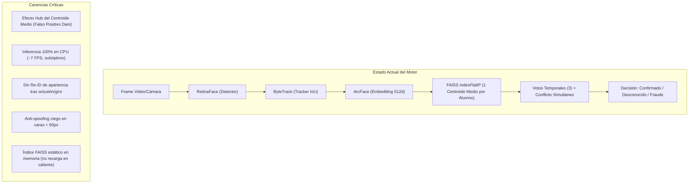
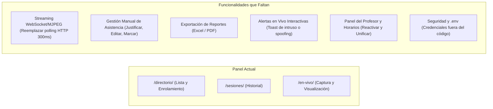

# Diagnóstico Integral del Sistema: Motor Biométrico y Panel Web

Este documento presenta una auditoría técnica profunda del estado actual de **CV College**, evaluando línea por línea la arquitectura, el rendimiento, la robustez biométrica y la experiencia de usuario del panel web.

---

## 1. ¿Qué le falta al Motor Biométrico?

El motor actual ([`MotorAsistencia`](file:///home/valentina2/Desktop/Folds/VisionProjects/face-recognition-college/scripts/asistencia_unificada_optimizada.py#L99)) ha alcanzado una calibración sólida para condiciones de aula (umbral `0.30`, 3 votos temporales, ancla de 30 frames, resolución de conflictos entre pistas simultáneas y banda de revisión en `0.30–0.40`). Sin embargo, presenta limitaciones técnicas y arquitectónicas claras:

### 1.1 Representación Biométrica: Del Centroide Promedio a Multi-Prototipo (Fase 4)
* **El Problema:** Cada estudiante se representa con **un único vector medio de 50 fotos**. En espacios de 512 dimensiones, el promedio de fotos con variabilidad geométrica crea un centroide que se desplaza hacia regiones densas (efecto *hub*). Esto causa que una persona no registrada quede a similitud `0.336` del centroide de Dani, mientras que sus fotos individuales nunca superan `0.303`.
* **Lo que falta:**
  - Implementar **multi-prototipo** (3 a 5 prototipos por persona usando k-Means sobre las 50 fotos de registro, representando poses: frontal, perfil izquierdo, perfil derecho, inclinación/lentes).
  - Algoritmo de comparación **Top-3 k-NN**: el score de una cara se calcula como el promedio de similitud con los 3 prototipos más cercanos de la persona. Esto elimina matemáticamente el falso positivo residual sin penalizar a alumnos difíciles como Jesús (`0.304`).
  - Actualizar el esquema de `FaceEmbedding` o crear `FacePrototype` en PostgreSQL con `pgvector` para alojar múltiples vectores normalizados por alumno.

### 1.2 Pipeline de Cómputo y Rendimiento (GPU vs CPU)
* **El Problema:** El motor procesa a **~7 FPS en 1080p en CPU**. La máquina dispone de una **NVIDIA RTX 4090**, pero el entorno ejecuta `onnxruntime` y `faiss-cpu`.
* **Lo que falta:**
  - Habilitar `onnxruntime-gpu` con `CUDAExecutionProvider` / `TensorRT`. Con la RTX 4090, el pipeline RetinaFace + ArcFace pasaría de 7 FPS a **>60–90 FPS**, permitiendo procesar múltiples cámaras o salones simultáneos en tiempo real sin saturar el procesador.
  - Inferencia por lotes (*batching*) de rostros detectados: actualmente, si se detectan 8 rostros en un frame, se hace un bucle secuencial de 8 llamadas de embedding y anti-spoofing en Python.

### 1.3 Rastreo Temporal y Re-Identificación (Re-ID)
* **El Problema:** `ByteTrack` asocia cajas delimitadoras basándose únicamente en solapamiento espacial (IoU). Cuando un estudiante se voltea, es tapado por otro o se aleja y vuelve, ByteTrack genera un `track_id` completamente nuevo. Esto provoca que el sistema tenga que acumular de nuevo 3 votos desde cero y en el camino genere pistas transitorias desconocidas.
* **Lo que falta:**
  - Un módulo ligero de **Re-ID de apariencia** o memoria de pistas recientes: asociar un track nuevo con una pista perdida hace menos de 3–5 segundos si la ubicación y el embedding preliminar coinciden.

### 1.4 Anti-Spoofing en Caras Pequeñas y Adaptativo
* **El Problema:** El anti-spoofing se apaga completamente para caras de ancho `< 60 px` porque el modelo genera falsas alarmas de fraude. Esto deja una vulnerabilidad: si alguien sostiene una foto pequeña o un móvil a media distancia, el sistema no evalúa liveness.
* **Lo que falta:**
  - Evaluar liveness en ráfagas o acumulación temporal (liveness por pista, no por frame aislado).
  - Un modelo de liveness más ligero y calibrado a rostros lejanos o análisis de micro-movimiento/parpadeo en pistas de alta persistencia.

### 1.5 Sincronización Dinámica con la Base de Datos
* **El Problema:** `MotorAsistencia` carga los centroides al instanciarse (`cargar_centroides()`) y construye el índice FAISS. Si un administrador enrola a un nuevo alumno en la web (`/directorio/`), el motor en vivo en ejecución **no se entera** hasta que el proceso se reinicia.
* **Lo que falta:**
  - Método `recargar_indices()` o invalidación por timestamp/señal de Django (`post_save` en `FaceEmbedding`) para actualizar el índice FAISS en caliente sin detener la captura.

---

## 2. ¿Qué le falta al Panel Web?

El panel web se redujo a tres vistas funcionales ([Directorio](file:///home/valentina2/Desktop/Folds/VisionProjects/face-recognition-college/apps/attendance/templates/attendance/directorio.html), [Sesiones](file:///home/valentina2/Desktop/Folds/VisionProjects/face-recognition-college/apps/attendance/templates/attendance/sesiones.html) y [Control de Asistencia en Vivo](file:///home/valentina2/Desktop/Folds/VisionProjects/face-recognition-college/apps/attendance/templates/attendance/live.html)). Si bien es limpio y rápido, carece de funcionalidades operativas críticas para una universidad real.

### 2.1 Transmisión de Video en Vivo (Streaming Eficiente)
* **El Problema:** En [`live.html`](file:///home/valentina2/Desktop/Folds/VisionProjects/face-recognition-college/apps/attendance/templates/attendance/live.html#L168), el navegador obtiene el video mediante **HTTP Polling cada 300 ms** (`frame.src = '/api/en-vivo/frame/?t=' + Date.now()`). Esto satura el servidor Django con ~3.3 peticiones GET por segundo por cliente, causa parpadeo visual (*flicker*) y añade latencia innecesaria.
* **Lo que falta:**
  - Endpoint de streaming **MJPEG nativo** (`multipart/x-mixed-replace`) o canal **WebSocket** para enviar frames comprimidos y eventos de reconocimiento de forma bidireccional y continua.

### 2.2 Operatividad y Acciones en Tiempo Real durante la Clase
* **El Problema:** La vista `/en-vivo/` es predominantemente de "sólo lectura": muestra el video y un contador de confirmados.
* **Lo que falta:**
  - **Panel lateral de presentes vs. ausentes en vivo:** Mostrar la lista de alumnos matriculados en la sección seleccionada, marcando con check verde a los que van entrando y en gris a los que faltan.
  - **Cierre formal de clase:** Botón para "Finalizar Sesión" directamente desde `/en-vivo/`, que detenga la cámara, consolide las inasistencias y redirija al resumen de la clase.
  - **Notificaciones *push/toast* en vivo:** Si aparece un `FRAUDE` o un `INTRUSO` persistente, mostrar una alerta sonora/visual en la interfaz con botón rápido de resolución.

### 2.3 Gestión Manual y Corrección de Asistencias (Sesión Detalle)
* **El Problema:** En [`sesion_detalle.html`](file:///home/valentina2/Desktop/Folds/VisionProjects/face-recognition-college/apps/attendance/templates/attendance/sesion_detalle.html), el profesor solo puede ver los registros y hacer clic en "Descartar" para intrusos.
* **Lo que falta:**
  - **Añadir asistencia manual:** Si un estudiante llegó pero la cámara no lo captó (o tenía vendaje/afección), el profesor no tiene cómo marcarlo presente desde la interfaz.
  - **Justificar inasistencia o cambiar estado:** Cambiar asistencia normal a retardo, falta justificada o eliminar un falso registro erróneo.
  - **Ver lista de alumnos que NO asistieron:** Actualmente la sesión solo lista los registros que existen en la BD; no muestra la lista de inasistentes de la materia.

### 2.4 Exportación y Analítica Académica
* **El Problema:** No existe forma de extraer la información para control administrativo o nómina docente.
* **Lo que falta:**
  - **Descarga de reportes:** Botón para exportar la sesión o el acumulado mensual a formato **Excel (XLSX) o PDF**.
  - **Métricas consolidadas:** Reactivar y conectar en el menú las vistas existentes pero ocultas de [MetricasAlumnoView](file:///home/valentina2/Desktop/Folds/VisionProjects/face-recognition-college/apps/academic/views.py) e [HistorialClasesView](file:///home/valentina2/Desktop/Folds/VisionProjects/face-recognition-college/apps/academic/views.py) con porcentaje de asistencia por estudiante.

### 2.5 Directorio y Gestión de Biometría
* **El Problema:** En `/directorio/`, una vez enrolado el estudiante, solo se muestra el badge "Activa".
* **Lo que falta:**
  - Visualizar la foto de referencia seleccionada del estudiante.
  - Botón para **re-enrolar** o **eliminar biometría** directamente (actualmente hay que entrar a Django Admin o ejecutar scripts).
  - Feedback visual de calidad previo a la subida (validar duración del video, que no esté oscuro ni borroso antes de procesar).

### 2.6 Configuración, Credenciales y Seguridad
* **El Problema:**
  - La contraseña de PostgreSQL (`cv_college_2026`) y la `SECRET_KEY` están escritas en código duro en `settings.py` y `core/db_config.py`.
  - La cuenta de superusuario sigue siendo `admin` / `admin123`.
* **Lo que falta:**
  - Centralizar la configuración con un archivo `.env` mediante `python-dotenv`.
  - Aislar el acceso a sesiones y directores por pertenencia académica (un profesor solo debe ver sus materias y sus alumnos matriculados).

---

## 3. Matriz de Prioridades y Hoja de Ruta

| Componente | Tarea / Funcionalidad | Impacto | Complejidad | Prioridad |
|---|---|---|---|---|
| **Motor** | Multi-prototipo (k-Means / Top-3 k-NN) para eliminar falso positivo de Dani | Alto (Biométrico) | Media | **P1 (Crítica)** |
| **Motor** | Recarga en caliente del índice FAISS tras nuevo registro | Alto (Operativo) | Baja | **P1 (Crítica)** |
| **Panel** | Endpoint MJPEG stream / Server-Sent Events (adiós polling 300ms) | Alto (UX / Rendimiento) | Baja | **P1 (Crítica)** |
| **Panel** | Lista en vivo de matriculados (Presentes vs Ausentes) en `/en-vivo/` | Alto (Funcional) | Media | **P1 (Crítica)** |
| **Panel** | Gestión manual de asistencias (marcar presente, justificar falta) | Alto (Académico) | Media | **P2 (Alta)** |
| **Panel** | Exportación de reportes a Excel / CSV en `/sesiones/<id>/` | Medio | Baja | **P2 (Alta)** |
| **Panel** | Variables de entorno `.env` para credenciales y DB | Alto (Seguridad) | Baja | **P2 (Alta)** |
| **Motor** | Aceleración ONNXRuntime GPU (RTX 4090) | Alto (Escalabilidad) | Media | **P3 (Deseable)** |
| **Panel** | Galería de fotos del enrolamiento y re-enrolamiento en Directorio | Medio | Media | **P3 (Deseable)** |
| **Motor** | Re-ID facial entre pistas perdidas para reducir tracks efímeros | Medio | Alta | **P3 (Investigación)** |

---

## 4. Próximos Pasos Recomendados

Para abordar estas mejoras de forma ordenada y sin romper la estabilidad actual (donde los 66 tests unitarios, 25 tests Django y la regresión de identidad están en verde):

1. **Paso 1 (Fundacional & UX Inmediata):**
   - Reemplazar el polling de `/en-vivo/frame/` por un generador de streaming `multipart/x-mixed-replace` nativo.
   - Añadir en `/en-vivo/` la tabla lateral de alumnos matriculados que se van marcando en tiempo real al ser reconocidos.
2. **Paso 2 (Precisión Biométrica Definitiva):**
   - Implementar la Fase 4 de multi-prototipo en el motor y la base vectorial para resolver el falso positivo residual de Dani.
3. **Paso 3 (Herramientas de Cierre de Sesión):**
   - Botón de cierre de sesión en vivo, cálculo de inasistencias y exportación a Excel en `/sesiones/<id>/`.
4. **Paso 4 (Seguridad):**
   - Migrar credenciales a `.env`.
