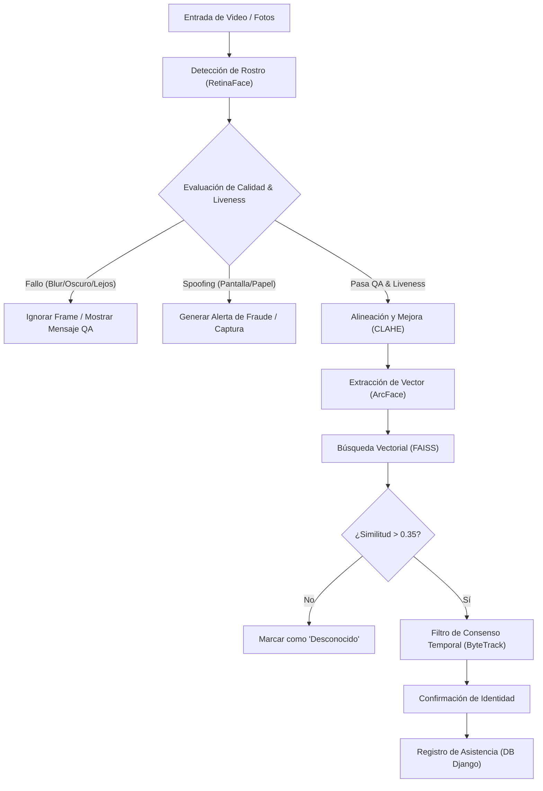

# Resumen General del Proyecto: Sistema de Asistencia por Reconocimiento Facial (CV College v2)

Este proyecto es un sistema avanzado de **control de asistencia universitaria basado en reconocimiento facial**. Su objetivo es automatizar la toma de asistencia en salones de clase y detectar intentos de fraude (suplantación) o intrusos mediante técnicas modernas de visión por computadora (Computer Vision) integradas en una aplicación web en tiempo real.

El sistema se compone de dos partes principales:
1. **Aplicación Web (Django 5.2 + DRF)**: Gestiona el catálogo académico (profesores, estudiantes, materias, salones y horarios), las sesiones de clase, y los reportes/métricas de asistencia.
2. **Pipeline de Inteligencia Artificial (RetinaFace + ArcFace + Anti-Spoofing)**: Procesa videos de enrolamiento en la web, flujos de cámaras en tiempo real en los salones y procesamiento por lotes (batch) de fotos grupales del salón de clase.

---

## 1. Flujo de Inteligencia Artificial & Computer Vision

El pipeline de visión artificial está encapsulado en la librería vendoreada `uniface` e integrado en los scripts principales del proyecto, donde destacan los scripts estables de producción: **[`asistencia_unificada_optimizada.py`](file:///home/valentina2/Desktop/Folds/VisionProjects/face-recognition-college/scripts/asistencia_unificada_optimizada.py)** para el reconocimiento en vivo, y **[`registro_video.py`](file:///home/valentina2/Desktop/Folds/VisionProjects/face-recognition-college/scripts/registro_video.py)** para el enrolamiento offline.

El flujo consta de 5 fases críticas con importantes optimizaciones de rendimiento:

### Detalle de las Etapas:

1. **Detección de Rostros**: Se utiliza **RetinaFace** (o la variante ligera **SCRFD** en el script de comparación [`probar_scrfd.py`](file:///home/valentina2/Desktop/Folds/VisionProjects/face-recognition-college/probar_scrfd.py)) para localizar las caras en la imagen y extraer sus 5 puntos clave (landmarks) faciales (ojos, nariz y esquinas de la boca).
2. **Control de Calidad (QA) & Liveness**:
   - **Tamaño Mínimo**: El rostro debe ser de al menos $60 \times 60$ píxeles para garantizar que no sea basura de fondo.
   - **Borrosidad**: Se calcula la varianza del Laplaciano sobre el rostro alineado (debe superar un umbral de 60 para evitar imágenes movidas).
   - **Brillo**: Se evalúa la media de grises del rostro (debe ser mayor a 20 para evitar salones demasiado oscuros).
   - **Anti-Spoofing (Liveness)**: Un modelo de clasificación binaria analiza si el rostro es real o si proviene de un ataque de presentación (foto impresa, video en tablet/celular). Si la confianza de que es real es menor al 90% (`0.90`), se descarta y se reporta un intento de **Spoofing**.
3. **Alineación y Normalización**: A partir de los landmarks faciales, se rota y escala el rostro ([`alinear_rostro`](file:///home/valentina2/Desktop/Folds/VisionProjects/face-recognition-college/core/utils_facial.py)) para alinear los ojos horizontalmente. Posteriormente, se aplica **CLAHE** (Ecualización de Histograma Adaptativa Limitada por Contraste) para normalizar las condiciones de iluminación del aula.
4. **Reconocimiento Facial (ArcFace + FAISS)**:
   - Se alimenta la imagen limpia al extractor **ArcFace**, obteniendo un vector de características (embedding) de **512 dimensiones** normalizado.
   - Para la búsqueda ultrarrápida ($O(\log N)$), se compila un índice de búsqueda **FAISS IndexFlatIP** (Inner Product / Similitud de Coseno) con los vectores de los estudiantes inscritos. Si la similitud con el mejor candidato supera el umbral establecido (`0.35`), se asocia la identidad del estudiante.
5. **Seguimiento Temporal y Consenso (ByteTrack + Votación)**:
   - En flujos de video en vivo (cámaras de salón), se utiliza **ByteTrack** para asignar y mantener un ID numérico persistente a cada persona detectada, incluso bajo oclusiones o multitudes.
   - Para evitar fluctuaciones de identidad por malas posturas o parpadeos de detección, se aplica una **Votación Temporal**. Se requiere que un ID de tracking reciba la misma predicción de identidad al menos **3 veces** consecutivas antes de fijar su nombre y registrar la asistencia en la base de datos.

---

## 2. Arquitectura de Base de Datos y Modelos

El sistema almacena el estado académico e historial biométrico mediante los siguientes modelos clave de Django localizados en:

* **[`apps/users/models.py`](file:///home/valentina2/Desktop/Folds/VisionProjects/face-recognition-college/apps/users/models.py)**:
  - `User`: Modelo de usuario personalizado que extiende `AbstractUser`. Define roles específicos: `DEVELOPER` (Administrador/Superuser), `DIRECTOR`, `COORDINATOR`, `PROFESSOR` y `STUDENT`.
* **[`apps/academic/models.py`](file:///home/valentina2/Desktop/Folds/VisionProjects/face-recognition-college/apps/academic/models.py)**:
  - `Asignatura`: Código y nombre de la materia.
  - `Salon`: Nombre, ubicación y capacidad física.
  - `Seccion`: Grupo académico (ej. "Sección A").
  - `Estudiante`: Perfil vinculado a `User` que contiene su matrícula/carnet escolar y estado de actividad.
  - `AsignacionClase`: Asocia un Profesor, Asignatura, Sección, Salón, un día de la semana y un bloque de horas (inicio/fin). Incluye validaciones robustas para evitar que el mismo profesor o sección se traslapen en horarios paralelos.
  - `Inscripcion`: Relación de estudiantes matriculados en una clase determinada.
* **[`apps/attendance/models.py`](file:///home/valentina2/Desktop/Folds/VisionProjects/face-recognition-college/apps/attendance/models.py)**:
  - `FaceEmbedding`: Vincula al usuario con su embedding facial promedio (lista de 512 números flotantes serializados en JSON).
  - `SesionClase`: Representa la clase dictada en una fecha específica, su estado (`EN_CURSO` o `FINALIZADA`), y las notas académicas ingresadas por el docente.
  - `RegistroAsistencia`: Registro individualizado de asistencia de un estudiante o un evento de seguridad. Contiene:
    - `hora_entrada`, `hora_salida` y `ultima_vez_visto`.
    - `similitud_ia`: El porcentaje de coincidencia reportado por la red neuronal.
    - `es_fraude` y `captura_fraude`: Bandera de alerta y foto guardada del rostro que cometió spoofing o intrusión.
    - `tipo_evento`: Clasifica el registro en `ASISTENCIA_NORMAL`, `INTRUSO` (desconocido en el salón), `OTRA_SECCION` (estudiante registrado pero que no pertenece a esa clase) o `SPOOFING` (intento de suplantación física detectado).
    - `historial_intervalos`: Un JSON que registra marcas de tiempo consecutivas del alumno en el aula. Si el alumno desaparece de la cámara y vuelve, se crean bloques de intervalo. Esto permite calcular el `porcentaje_permanencia` real en la clase (minutos detectado / minutos de duración de clase).

---

## 3. ¿Cómo se plasma la información en el Aplicativo Web?

La interfaz de usuario está diseñada con **Tailwind CSS** y se distribuye según los roles de acceso:

### A. Interfaz del Profesor (Panel de Control de Aula)
* **Mi Horario y Materias**: Permite al docente ver las clases asignadas en el día actual y acceder a sus paneles.
* **Monitor de Clase en Vivo (Monitor de Aula)**:
  - Muestra un grid visual con todos los alumnos inscritos en la materia.
  - **Presentes**: Tienen una tarjeta en color verde indicando su hora de entrada, su última vez visto y su porcentaje de permanencia real (calculado mediante los pings de detección).
  - **Ausentes**: Aparecen atenuados o con tarjetas en gris.
  - **Alertas de Seguridad**: Si la cámara detecta a alguien no inscrito (Intruso) o un intento de spoofing (Fraude), se genera inmediatamente una tarjeta roja de alerta con un recorte facial de la persona en cuestión.
  - **Resolución de Alertas**: El profesor cuenta con botones interactivos para auditar estas alertas en tiempo real, marcándolas como "Confirmar Fraude" o "Falsa Alarma" (lo que reclasifica el evento y limpia la alerta).
  - **Procesamiento Batch**: Cuenta con un botón para procesar una secuencia de imágenes del salón tomadas de manera externa (útil si no hay transmisión de video directa). Muestra una barra de carga dinámica leyendo de [`status.json`](file:///home/valentina2/Desktop/Folds/VisionProjects/face-recognition-college/core/procesador_batch.py#L54) y renderizando el canvas actualizado con recuadros sobre el aula [`latest.jpg`](file:///home/valentina2/Desktop/Folds/VisionProjects/face-recognition-college/core/procesador_batch.py#L323).
  - **Cierre de Clase**: El profesor finaliza la sesión, lo que automáticamente guarda las horas de salida de todos los estudiantes presentes.
* **Historial & Métricas**: Muestra estadísticas globales del alumno (número de faltas acumuladas, salidas tempranas, e historial de fraudes) para auditoría académica rápida.

### B. Interfaz de Coordinadores y Directivos (Administración)
* **Panel de Enrolamiento**:
  - Permite matricular nuevos rostros. Se puede hacer cargando un video pregrabado (`.mp4`) o tomando fotos con la cámara en vivo.
  - El backend de enrolamiento (`RegistroBiometricoView`) procesa el video en segundo plano mediante `enrolar_usuario_headless`, valida que cumpla con los estándares de liveness y calidad, y genera el embedding final vinculándolo al usuario en la base de datos de Django sin requerir scripts manuales en la terminal.
* **Auditoría de Seguridad**:
  - Consola centralizada donde se listan todas las alertas de fraude confirmadas e intrusiones registradas en la universidad.
  - Permite ver la foto de la persona capturada por la IA, la materia, la fecha y hora del incidente, y notas de auditoría.
* **Reportes de Asistencia**:
  - Filtros interactivos por nombre de estudiante, matrícula, materia y fecha específica para exportar o revisar la asistencia global a nivel institucional.

---

## 4. Archivos Clave del Código Fuente

* **[`scripts/registro_video.py`](file:///home/valentina2/Desktop/Folds/VisionProjects/face-recognition-college/scripts/registro_video.py)**: Script estable de producción para el enrolamiento offline. Extrae frames de calidad y liveness válidos de un archivo de video y computa el centroide del embedding.
* **[`scripts/asistencia_unificada_optimizada.py`](file:///home/valentina2/Desktop/Folds/VisionProjects/face-recognition-college/scripts/asistencia_unificada_optimizada.py)**: Motor de inferencia estable y optimizado en tiempo real. Implementa filtros inteligentes para ahorrar CPU (liveness condicional por tamaño de rostro, cooldown para rostros desconocidos, y lazy evaluation de CLAHE).
* **[`scripts/registro_unificado.py`](file:///home/valentina2/Desktop/Folds/VisionProjects/face-recognition-college/scripts/registro_unificado.py)**: Lógica base de enrolamiento, utilizada por los endpoints headless de Django.
* **[`scripts/asistencia_unificada.py`](file:///home/valentina2/Desktop/Folds/VisionProjects/face-recognition-college/scripts/asistencia_unificada.py)**: Motor base de inferencia en tiempo real.
* **[`core/procesador_batch.py`](file:///home/valentina2/Desktop/Folds/VisionProjects/face-recognition-college/core/procesador_batch.py)**: Script encargado del procesamiento por lotes en segundo plano de fotos del salón de clases.
* **[`apps/attendance/api.py`](file:///home/valentina2/Desktop/Folds/VisionProjects/face-recognition-college/apps/attendance/api.py)**: Endpoints REST para el enrolamiento headless desde la interfaz web.
* **[`apps/attendance/views.py`](file:///home/valentina2/Desktop/Folds/VisionProjects/face-recognition-college/apps/attendance/views.py)**: Vistas del monitor en vivo, auditorías de seguridad, y gestión de estados de las sesiones.
* **[`apps/attendance/models.py`](file:///home/valentina2/Desktop/Folds/VisionProjects/face-recognition-college/apps/attendance/models.py)**: Estructura de persistencia para embeddings faciales y registros detallados de intervalos de asistencia.
