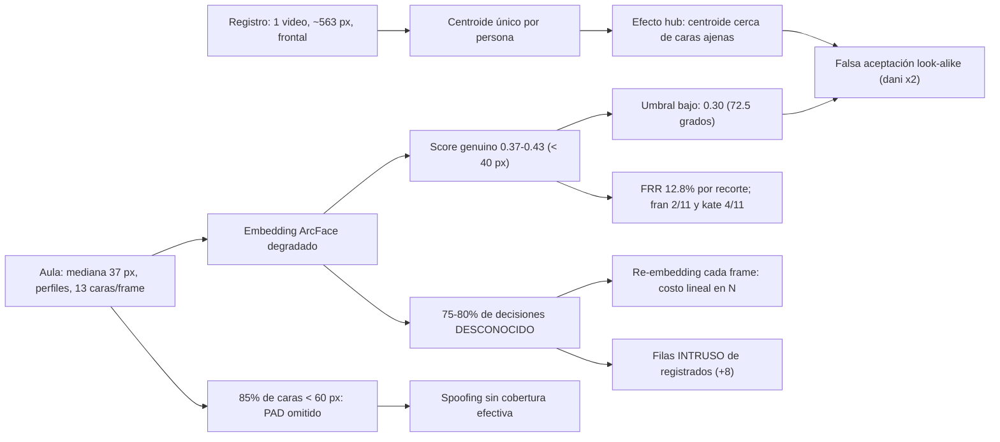

# Reporte de auditoría de resultados — Sistema biométrico de asistencia

**Fecha:** 2026-11-06
**Alcance:** todos los CSV de `experiments/unc/metricas/salida/` (identidad, detección, asistencia, rendimiento), cruzados con `salida/resumen.md`, `experiments/unc/metricas/README.md`, `docs/analisis/unc/01, 03, 04, 06, 08, 09, 10, 11`, `docs/computo.md`, `docs/base_datos.md` y el código del motor (`scripts/asistencia_unificada_optimizada.py`, `core/intrusos.py`, `core/registro_asistencia.py`).
**Criterio:** reglas de `CLAUDE.md` (falla ruidosa, honestidad estadística, contextualización con la arquitectura).
**Pipeline auditado:** RetinaFace (detección + 5 landmarks) → alineación + CLAHE → ArcFace (embedding de 512 d, norma 1) → **un centroide por estudiante** guardado en pgvector (`VectorField(512)`, índice HNSW `vector_cosine_ops`) → FAISS `IndexFlatIP` en memoria → umbral coseno 0.30 + 3 votos consecutivos + ancla de 30 frames → anti-spoofing (MiniFASNet de `uniface`, umbral 0.90, omitido bajo 60 px) → ByteTrack → `RegistroAsistencia`.

> [!CAUTION]
> **Falla ruidosa: hay anomalías de datos que invalidan o debilitan parte de las cifras publicadas.** Se enumeran completas en la sección 0 antes de cualquier métrica. Las más graves: (A1) el video 1 se declara "sin desconocidos" para calibrar intrusos, pero el mismo video tiene 157 recortes `desconocido` y una estudiante no registrada documentada en el incidente `dani`; (A5) la tabla de umbral a nivel de pista del video 3 tiene sesgo de selección (78/78 registradas "pasan" 0.30 porque se eligieron entre las que ya habían pasado 0.30); (A7) la cobertura del anti-spoofing en el aula es de aproximadamente **15 %** de las caras.

---

## 0. Alertas de integridad de datos (falla ruidosa)

Cada fila es una inconsistencia comprobada entre archivos. No se corrigió ningún CSV: este reporte solo las documenta.

| # | Anomalía | Evidencia | Impacto |
|---|---|---|---|
| **A1** | **Contradicción en la verdad de terreno del video 1.** `11_intrusos.md` §4.1 y `asistencia/intrusiones.csv` declaran el tramo 36–80 s del video 1 como "9 registrados, **0 desconocidos** → todo intruso es falso". | (a) `identidad/dataset.csv`: 157 recortes `desconocido` del **mismo video**; (b) `deteccion/tamanos_cara.csv`: mediana de **13 caras por frame** con 9 registrados; (c) `09_incidente_identidad_dani.md`: una estudiante **no registrada** aparece en 57–64 s, dentro del tramo. | Las "7 filas INTRUSO falsas" y la tasa de 0.159 falsos/s **no están validadas**: alguna fila puede corresponder a una persona no registrada real. La calibración del umbral de intrusos (0.22/0.24/40 px) se eligió minimizando una cifra cuya etiqueta es dudosa. |
| **A2** | **Desajuste de etiquetas entre archivos.** Identidad usa 86 etiquetados + 157 desconocidos. | `deteccion/iou_emparejamiento.csv` y `estres_iou.csv`: **83** etiquetados + **160** desconocidos (mismo total, 243). | 3 recortes cambiaron de clase entre versiones del etiquetado. No altera mucho las tasas, pero demuestra que los CSV no salen de una sola versión de etiquetas. |
| **A3** | **Frames útiles mayores que frames totales** (imposible por definición: útiles = tasa útil × frames totales ≤ totales). | `deteccion/resumen_deteccion.csv`: bob 115→117, dani 125→126, fran 154→156, jose 116→117, kate 163→165, kevin 100→102. | Error de cálculo (probablemente se multiplica por `muestreados × 3` y no por los frames reales). Es menor, pero invalida la columna. |
| **A4** | **bob con dos tamaños de video.** | `01_diagnostico_dataset_unc.md`: 229 frames / 77 muestreados; CSV: 115 / 39. | Una de las dos fuentes está desactualizada. |
| **A5** | **Sesgo de selección en el umbral a nivel de pista (video 3).** `08_resultados_video3.md` §5.2 reporta "registradas que pasan 0.30: **78/78**". | Las 78 pistas son, por construcción, las que el motor **ya confirmó** con 0.30. | El FRR a nivel de pista **no está medido**: 78/78 es una tautología. Los negativos (74 pistas ≥ 40 px) además están contaminados con registrados en pose difícil (lo dice el propio §5.1). |
| **A6** | **Spoofing sin procedencia reconciliable.** | `asistencia/spoofing.csv`: 8 alarmas en 8 pistas, de 6.2 s a 105.54 s (compatible con el video 1, 106.8 s). `08` §7: 12 decisiones `FRAUDE` en el video 3. `07` §Fase 5: "de 39 a 3" en el video 1. `presencia_por_parte.csv`: suma 12. | Tres cifras distintas (3, 8, 12) sin el video ni la configuración identificados en el CSV. |
| **A7** | **`FRAUDE` en caras de 30 px con anti-spoofing omitido bajo 60 px.** | `08` §8: "12 filas FRAUDE sobre caras de 30 a 120 px". Código, línea 314: `if ancho < 60: return "omitido"`. | O el ancho reportado es otro (mediana de pista, no del frame), o la corrida no usaba el corte. Sin resolver. Además, el docstring del motor (línea 8) dice que el anti-spoofing "se evalúa en CADA decisión, sin importar el tamaño", lo que contradice al código. |
| **A8** | **Benchmark de rendimiento con una carga que no es la del aula.** | `docs/computo.md` §6: 200 frames con **3.4 caras/frame**. `tamanos_cara.csv`: **10.6** de media (mediana 13) en el mismo video; `iou_emparejamiento.csv`: 14.9. | Los 7.52 fps no son representativos del aula (sección 4.4). |
| **A9** | **Simulador de intrusos: dos márgenes distintos.** | `11` §4.1: "difiere en ±3 filas"; §4.3 y `resumen.md` §6: diferencia de **7** filas (4 contra 7 y 22 contra 29). Los scripts (`capturar_pistas.py`, `simular_intrusos.py`) están en `/tmp/opencode/`, fuera del repositorio. | La calibración de intrusos **no es reproducible** desde el repositorio. |
| **A10** | **Afirmaciones desmentidas por datos posteriores.** | `06` §6 (2026-10-20): "No confunde identidades… 0 errores en 1 127 recortes". Al día siguiente, `09` documentó 2 pistas falsas como `dani` en ese mismo video, y `08` otra en el video 3. El origen de "1 127" no aparece en ningún CSV. | El 0 % de error de identidad de la fase 6 **no debe citarse**. `cobertura_video1.csv` todavía dice `errores_identidad = 0` porque los recortes muestreados no cayeron en las pistas 117/167. |
| **A11** | **Dos denominadores de negativos.** | `scores.csv`: ROC/EER/AUC con **243** negativos (86 "máximo contra otra persona" + 157 desconocidos); FAR/precisión operativa con **157**. A 0.30: FPR 2/243 = 0.0082 en la ROC frente a 1/157 = 0.0064 en la tabla. | No son contradictorias, pero el EER y el FAR **no se calculan sobre la misma población** y no se deben mezclar en una misma frase. |

---

## 1. Resumen ejecutivo

### 1.1 Tabla consolidada

Intervalos de Wilson al 95 % calculados para este reporte cuando el CSV no los trae.

| Métrica | Valor | IC 95 % | Protocolo / fuente | Validez |
|---|---|---|---|---|
| **Precision** (umbral 0.30, 1 frame) | 0.987 (75/76) | [0.929, 0.998] | 300 recortes del video 1 · `intervalos_confianza.csv` | Media: un video, una fecha |
| **Recall / TPR** (0.30, 1 frame) | 0.872 (75/86) | [0.785, 0.927] | idem | Media |
| **F1** (0.30, 1 frame) | 0.926 | [0.881, 0.967] (bootstrap) | idem | Media |
| Precision / Recall / F1 (0.30, **3 frames**) | 1.000 / 0.849 / 0.918 | Recall [0.758, 0.910] | `multiframe.csv` (231/243 con 3 frames) | Media |
| Recall del motor real (recorte en su frame) | 0.733 (63/86) | [0.631, 0.815] | `cobertura_video1.csv` | Media |
| **EER** | 0.0798 (umbral 0.239) | — (no bootstrapeado) | ROC exacta, 86 positivos y 243 negativos | Media; población distinta del FAR (A11) |
| AUC (verificación) | 0.9616 | [0.928, 0.988] | `scores.csv` | Media |
| AP (PR-AUC, verificación) | 0.9535 | — | `pr_puntos.csv` | Media |
| **mAP** (detección) | **No medible** | — | No hay ground truth de cajas: el IoU = 1.000 de `iou_emparejamiento.csv` es tautológico (los recortes salen de las propias detecciones) | — |
| FAR a nivel de recorte (0.30) | 0.0064 (1/157) | [0.0011, 0.0352] | `open_set.csv` | Baja: negativos de etiqueta dudosa (A1) |
| FRR a nivel de recorte (0.30) | 0.128 (11/86) | [0.073, 0.215] | `open_set.csv` | Media |
| **FAR a nivel de persona no registrada** | **0.048 (1/21)** | **[0.009, 0.227]** | video 3, `08` §5.1 | La cifra más cercana al uso real |
| Precisión de identidad a nivel de pista | 37/39 = 0.949 (antes del fix) · 77/78 = 0.987 (video 3) | [0.831, 0.986] · [0.931, 0.998] | `09` §2, `08` §4 | Media |
| Precisión de filas INTRUSO (video 3) | 0.724 (21/29) | [0.543, 0.853] | `intrusiones.csv` | Baja (A1, A9) |
| Spoofing: APCER / BPCER | **No medibles** | — | No hay ataques etiquetados | — |
| Cobertura de asistencia (sesión) | 9/9 y 8/8 | [0.70, 1.00] y [0.68, 1.00] | `confusion_sesion.csv` | Baja: 0 y 1 negativos |
| **Latencia** de detección | 47 ms/frame | — | `fps_y_latencia.csv` | CPU, i9-14900KF |
| **Latencia** de embedding | 24 ms/cara | — | idem | CPU; escala con el número de caras |
| Búsqueda vectorial (FAISS) | 0.02 ms/cara | — | idem | 9 vectores |
| Throughput | 7.52 fps (rango 6.6–7.5) | — | idem | **No representativo** del aula (A8) |

### 1.2 Lectura honesta en cinco puntos

1. **Las cifras de identidad salen de una sola muestra: 86 recortes positivos de un video y una fecha.** El límite inferior del recall a 0.30 es 0.785. Cualquier precisión de 1.000 (3 frames, 0.35) descansa en 0 eventos sobre 157 negativos; por la regla de tres, el FAR real puede llegar a ~1.9 % (Wilson: 2.4 %).
2. **El FAR que importa es el de persona, no el de recorte**, y es ~7 veces mayor: 4.8 % frente a 0.64 %. Con 21 personas no registradas, el intervalo llega al 22.7 %.
3. **Las dos falsas aceptaciones del proyecto fueron sobre el mismo centroide (`dani`)**, en dos aulas y con dos personas distintas. Es un patrón (centroide *hub*), no ruido.
4. **El anti-spoofing nunca se probó contra un ataque**, y por diseño no actúa sobre ~85 % de las caras del aula.
5. **La matriz de asistencia por sesión (P = R = F1 = 1.000) no tiene poder estadístico:** 0 ausentes en el video 1 y 1 en el video 3. No se debe presentar como precisión del sistema.

---

## 2. Auditoría de umbrales vectoriales (coseno en pgvector / FAISS)

### 2.1 Qué métrica se usa realmente

- ArcFace entrega vectores de norma 1. El motor usa **FAISS `IndexFlatIP`**: el producto interno es la similitud coseno `s = v·c`. pgvector guarda los centroides y expone la misma comparación con `1 − (embedding <=> q)`, porque `<=>` es la **distancia coseno** `d = 1 − s`.
- Para vectores unitarios, la distancia euclidiana es una función monótona del coseno: `‖v − c‖² = 2(1 − s)`. El umbral `s > 0.30` equivale a `d_coseno < 0.70` y a `‖v − c‖ < 1.183`. **Elegir entre coseno y euclidiana no cambia ninguna decisión**; solo cambia la escala en que se lee el umbral.
- Para dimensionar: en ArcFace (margen angular), `s = 0.30` es un ángulo de **72.5°** entre el embedding y el centroide. Es un criterio de aceptación **muy permisivo** para estándares de verificación. Se justifica solo por la baja resolución de las sondas (sección 4.1), no por la calidad de la separación.

### 2.2 El índice pgvector no participa en la decisión

- `docs/base_datos.md` §4.2–4.4: HNSW (`m = 16`, `ef_construction = 64`) sobre **9 filas**. El planificador hace un recorrido secuencial y el índice no se usa. La inferencia se hace con FAISS exacto en memoria; pgvector es almacenamiento.
- **Riesgo al escalar:** si en el futuro se consulta pgvector con HNSW para cientos de estudiantes, la búsqueda pasa a ser **aproximada**: con el `ef_search` por defecto (40) puede devolver un top-1 que no es el máximo real. Con un umbral tan cercano al ruido de impostores (cola de negativos hasta 0.344 en el video 3), un error de recuperación se convierte en un error de identidad. Si se migra, hay que medir el recall@1 de HNSW frente a la búsqueda exacta.

### 2.3 Posición del umbral 0.30 respecto de los puntos característicos

| Punto | Umbral | TPR | FPR | Fuente |
|---|---|---|---|---|
| EER | 0.239 | 0.920 | 0.080 | `scores.csv` (243 negativos) |
| Youden | 0.281 | 0.919 | 0.021 | `scores.csv` |
| Mejor F1 | 0.280 | 0.919 | 0.019 (157 neg.) | `tabla_umbrales.csv` |
| **Operativo** | **0.300** | **0.872** | **0.0064** (157) / 0.0082 (243) | `open_set.csv`, `roc_puntos.csv` |
| Primer FPR = 0 | 0.315 | 0.849 | 0.000 | `tabla_umbrales.csv` |

**Observaciones críticas:**

1. **La meseta 0.245–0.28 es plana en TPR** (79/86): las 7 FN están por debajo de 0.24 y ninguna se recupera bajando el umbral sin admitir impostores. Esas 7 caras son **errores estructurales** (pose y tamaño, sección 4), no de calibración.
2. **El margen del umbral 0.30 es de un solo evento.** Entre 0.30 y 0.315 hay exactamente 1 negativo (score ≈ 0.312, `04` §3). Toda la diferencia entre "precisión 0.987" y "precisión 1.000" es **una cara**.
3. **El umbral se fijó y se evaluó sobre la misma muestra** (fase 4 elige 0.30 sobre los 300 recortes, y `resumen.md` reporta las métricas sobre esos mismos recortes). No hay partición de validación. **Es una fuga de información de selección de hiperparámetro:** las métricas a 0.30 son optimistas por construcción. La única validación externa es el video 3 (sin etiquetas por recorte), donde el FAR por persona sube a 4.8 %.
4. **La cola de impostores llega más arriba en el video 3** (p95 0.306, p99/máximo 0.344, `08` §5.1) que en el video 1 (máximo ≈ 0.312). Con 0.30, el 5 % de las pistas no registradas de tamaño usable supera el umbral **en al menos un frame**; las 3 votaciones las reducen de 4/74 a 1/74.
5. **La banda de revisión 0.30–0.40 reconoce el problema, pero no lo corrige.** Las caras de esa banda se marcan como `posible <nombre>`, pero **la asistencia se escribe igual** (`_registrar_asistencia` se llama en la confirmación, línea 391). En el video 3, cuatro de los ocho estudiantes tienen similitud media dentro de la banda (alexa 0.370, jesus 0.385, kate 0.362, fran 0.328; `08` §3). Para la mitad de la clase, el sistema confirma asistencias que el propio diseño declara "no afirmables".

### 2.4 Dependencia del tamaño de la galería (riesgo de escalado)

El FAR de identificación abierta **no es constante**: es el máximo de *N* comparaciones. Si se toma la tasa medida (1/157 con *N* = 9) y se supone independencia entre centroides, la tasa por centroide es `p = 1 − (1 − 1/157)^(1/9) ≈ 7.1·10⁻⁴`, y:

| Estudiantes en la galería | FAR por recorte estimado |
|---|---|
| 9 (actual) | 0.6 % |
| 50 | 3.5 % |
| 100 | 6.9 % |
| 300 | 19 % |
| 500 | 30 % |

> [!WARNING]
> Es una extrapolación de **orden de magnitud**: parte de un solo evento (IC de la tasa base [0.11 %, 3.5 %]) y supone independencia, cuando el *hubness* observado en `dani` la viola en contra del sistema. Aun así, muestra que **el umbral 0.30 calibrado con 9 personas no es transferible** a una facultad completa sin recalibrar.

---

## 3. Análisis biométrico y anti-spoofing

### 3.1 Balance FAR/FRR

| Umbral | FAR (157) | FRR (86) | FAR:FRR | Lectura |
|---|---|---|---|---|
| 0.25 | 5.1 % | 8.1 % | 1:1.6 | Cercano al EER |
| 0.28 | 1.9 % | 8.1 % | 1:4.3 | Mejor F1 |
| **0.30** | **0.64 %** | **12.8 %** | **1:20** | Operativo |
| 0.35 | 0 % (≤ 2.4 %) | 17.4 % | — | Umbral anterior |
| 0.40 | 0 % | 29.1 % | — | Rechazado (pierde a jesus) |

- **El sistema opera de forma deliberadamente asimétrica:** acepta perder ~1 de cada 8 caras genuinas para casi no aceptar impostores. Es coherente con el costo del error (una asistencia falsa es peor que una perdida). El FRR alto se compensa en la sesión con la redundancia temporal: una persona solo necesita una pista con 3 votos en toda la clase.
- **Esa compensación oculta el FRR, pero no lo elimina.** En el video 3, `fran` se confirma en 2 de 11 partes (similitud media 0.328, máximo 0.341) y `kate` en 4 de 11 (máximo 0.431). Su asistencia depende de pocos segundos favorables. En una clase con más oclusión, ellos serían los primeros falsos ausentes.
- **El FAR a nivel de recorte subestima el riesgo real**, porque la decisión del motor es por pista y por persona:

| Unidad | FAR medido | IC 95 % |
|---|---|---|
| Recorte (video 1, 1 frame) | 1/157 = 0.64 % | [0.11, 3.5] % |
| Pista ≥ 40 px (video 3, 3 votos) | 1/74 = 1.4 % | [0.24, 7.3] % |
| **Persona no registrada (video 3)** | **1/21 = 4.8 %** | **[0.85, 22.7] %** |

### 3.2 Vulnerabilidad biométrica principal: suplantación pasiva por parecido (*look-alike*)

**Hechos medidos:**

- Video 1 (`09`): una no registrada se confirmó como `dani` en 2 pistas (similitudes 0.325 y 0.301, margen top-2 de 0.118–0.153).
- Video 3 (`08` §4.1): otra no registrada, en otra aula, se confirmó como `dani` (0.336, 30 px, 30 frames).
- `10` §3b: la desconocida está a **0.336 del centroide** de `dani` pero a **0.303 de la foto individual** más parecida. **El promedio acerca a las caras ajenas** (efecto *hub*). La media podada no lo corrige (0.301–0.310).

**Mecanismo en el pipeline:**

1. El **centroide único** (media de 50 embeddings de un solo video, `base_datos.md` §4.3) es un punto en el interior del casquete de la identidad. En 512 d, ese punto queda más cerca de un vecindario amplio de caras con rasgos genéricos (gafas, pelo, tono) que cualquier muestra real.
2. El **margen top-2 no discrimina** (0.118 en el falso, mayor que en muchos aciertos), porque el problema no es la ambigüedad entre dos registrados, sino la falta de un modelo del "resto del mundo".
3. **`_resolver_conflictos` solo actúa si la persona verdadera está en el cuadro al mismo tiempo.** Corrigió el video 1 (2 → 0), pero no el video 3, y por diseño **no puede proteger a un estudiante ausente**.

> [!CAUTION]
> **Escenario de fraude de asistencia no mitigado:** si `dani` falta y una persona parecida (o un compañero con gafas y peinado similares) entra en el aula, el motor puede confirmar a `dani` con 3 votos y escribir su asistencia. No hay conflicto que resolver, la similitud cae en la banda amarilla (que **no** bloquea la escritura) y el anti-spoofing no se evalúa si la cara mide menos de 60 px. En los dos incidentes medidos no hubo daño solo porque la `dani` real ya estaba confirmada en la sesión. Es una circunstancia, no un control.

La única mitigación con evidencia (multi-prototipo, top-3 sobre las 50 fotos, `10` Fase 4) está fuera del alcance acordado. Mientras tanto, la única barrera es la revisión manual en `/sesiones/<id>/` (aceptar o rechazar las asistencias de la banda límite).

### 3.3 Anti-spoofing (PAD)

**Qué se sabe:**

| Hecho | Fuente |
|---|---|
| **0 ataques reales probados** (foto, pantalla, máscara) | `07` §5 punto 7 |
| La confianza del modelo cambia de 0.805 a 0.970 solo por redondear la caja a enteros | `07` §5.6 |
| Umbral `umbral_liveness = 0.90` | código, línea 118 |
| Omitido si el ancho es menor de 60 px, si la distancia interocular es menor que 0.15 × ancho (perfil) o si la nariz queda fuera del eje de los ojos | código, líneas 314–326 |
| **El resultado "omitido" se trata como válido** | código, línea 367 |
| Las alarmas bajaron de 39 a 3 al introducir el corte de 60 px | `07` §Fase 5 |
| 8 alarmas en 8 pistas, confianza media 0.760 | `spoofing.csv` |

**Cobertura efectiva:** según `tamanos_cara.csv`, solo el **15.3 %** de las caras del aula mide 60 px o más. **El ~85 % de las caras se acepta sin prueba de vida.** A eso se suman otras dos rutas *fail-open*:

- **Perfil:** los descartes por geometría de landmarks también devuelven "omitido" → válido.
- **Ancla:** durante los 30 frames de ancla, `_decidir_identidad` regresa en la línea 339 **sin embedding y sin anti-spoofing**. Una vez confirmada, una pista no vuelve a verificar su vitalidad hasta la siguiente revalidación.

**Impacto en la tasa de rechazo (BPCER):**

- No hay ataques en los videos, así que **toda alarma es, por definición, un rechazo de una presentación genuina**: 8 alarmas en `spoofing.csv` (o 12 decisiones `FRAUDE` en el video 3; ver A6). El BPCER a nivel de pista no se puede calcular sin el denominador de pistas evaluadas (≥ 60 px y frontales), que no se publica. Es un hueco de medición.
- El efecto sobre la asistencia es acotado porque `FRAUDE` no suma votos y el estado se reinicia. El corte de 60 px **compró una tasa de falsas alarmas baja a cambio de anular el PAD** en la mayoría de las caras.
- **APCER: desconocido.** Con un umbral de 0.90 inestable en ±0.17 por redondeo, ni siquiera sobre caras ≥ 60 px hay base para afirmar que una foto impresa sería rechazada.

> [!IMPORTANT]
> El anti-spoofing **no debe presentarse como una capa de seguridad** del sistema actual. Es un filtro experimental, sin validar contra ataques, que cubre ~15 % de las caras y se omite en perfil y durante el ancla. El ataque más simple (sostener una foto impresa a distancia de pupitre, donde la cara mide menos de 60 px) **no pasa por el PAD**.

### 3.4 Intrusos (identificación abierta de no registrados)

- **Video 3:** 29 filas, recall declarado 21/21 = 1.000 (IC [0.845, 1.000]) y precisión 0.724 (IC [0.543, 0.853]).
- **Validación débil del recall:** la afirmación "29 = 21 reales + 8 registrados" se infiere porque 8 coincide con el número de registrados presentes (`11` §4.3: "lo que confirma"). Una coincidencia numérica no es una verificación fila por fila. Además, el agrupamiento automático produjo **24** grupos, no 21 (`08` §5.1), y la deduplicación por asiento puede **fusionar** a dos personas (`11` §6).
- **Punto ciego por diseño:** `TAMANO_MINIMO_INTRUSO = 40` px excluye al **58.5 %** de las caras del aula. Un no registrado sentado al fondo **nunca** genera una fila de intruso.
- **Video 1:** ver A1. La cifra de "7 falsos" no tiene verdad de terreno fiable.

---

## 4. Análisis técnico de errores (cruce con RetinaFace + ArcFace)

### 4.1 Cuello de botella dominante: brecha de resolución entre registro y aula

| Dominio | Ancho de cara | Fuente |
|---|---|---|
| Registro (9 videos) | 448–684 px, media 563 px | `resumen_deteccion.csv` |
| Aula, video 1 | mediana **37 px**; p10 27 px; 58.5 % < 40 px; 15.3 % ≥ 60 px | `tamanos_cara.csv` |
| Aula, video 3 | 38.9 % entre 20 y 30 px | `08` §7 |

- **Ratio de escala ≈ 15×.** ArcFace recibe un recorte alineado de 112 × 112: las caras del registro se **reducen ~5×** (detalle de alta frecuencia que el modelo aprendió a usar) y las del aula se **amplían ~3×** (interpolación sin información nueva). El centroide representa un dominio que las sondas casi nunca alcanzan.
- **Efecto medido en el score genuino** (`por_ancho.csv`): la similitud media con el propio centroide sube de 0.37–0.43 (25–39 px) a **0.605** (≥ 80 px). Con < 40 px, el genuino medio queda a solo 0.07–0.13 del umbral 0.30.
- **Efecto en la tasa de reconocimiento por frame** (video 3, `08` §7): 9.6 % en 20–30 px, 20.0 % en 30–40 px y 31.0 % en 40–60 px. El **75 % de las decisiones termina en `DESCONOCIDO`**.
- **El filtro de tamaño es una palanca de recall de primer orden** (`efecto_filtro.csv`): con 40 px se reconoce el 39.5 % de los etiquetados; con 20 px, el 82.6 %. **Hay una divergencia de configuración:** el motor arranca con `tamano_minimo_rostro = 40` (línea 119) y solo baja a 20 con `--sesion` (línea 519) o en los flujos web. Una corrida de consola sin `--sesion` reconoce la **mitad** que la web.
- **Lectura no monótona en caras grandes** (video 3, 90+ px: 24.2 % < 31 % en 40–60 px): las caras grandes están cerca de la cámara, en el borde del cuadro (1 422 decisiones `CENTRATE`) y en perfil. El tamaño ya no es el factor limitante; lo son la pose y el recorte.

### 4.2 Pose: el factor que el tamaño enmascara

`fallos_por_causa.csv` (86 recortes, umbral 0.30, filtro 20 px):

| Resultado | n | Ancho mediano | Nitidez media | Pose media |
|---|---|---|---|---|
| Acierto | 71 | 38 px | 1 531 | **0.154** |
| Falso negativo | 15 | 34 px | **1 983** | **0.302** |

- **La pose casi duplica su valor en los fallos** (0.302 frente a 0.154). `08` §5.3 cita 4.1 % de fallo de frente frente a 42.9 % de perfil. La alineación por 5 landmarks de RetinaFace es una transformación de similitud 2D: **no corrige la rotación fuera del plano**, y el centroide de un video frontal no cubre los perfiles.
- **Anomalía de la nitidez:** los fallos son **más nítidos** que los aciertos. La varianza del Laplaciano sobre un recorte ampliado de 34 px mide sobre todo **ruido de interpolación y artefactos JPEG**, no detalle facial. **El criterio de nitidez del registro (≥ 60) no es válido como indicador de calidad en el aula**, y no se debe usar para filtrar sondas sin recalibrarlo por tamaño.
- **Accesorios** (`por_accesorio.csv`): la combinación de gorra y lentes da un score medio de **0.285, por debajo del umbral** (n = 4, todos de `jesus` y todos en perfil: efectos confundidos, `03` §4). Los lentes solos no tienen efecto medible (p = 0.512). Con n = 4, la exactitud de 0.5 tiene un IC de [0.15, 0.85]: **no es estimable**.

### 4.3 Detección (RetinaFace)

- **En el registro**, la detección es prácticamente perfecta (0.9974 micro). `jesus` es la excepción (0.977 de detección y 0.932 de tasa útil) y coincide con ser el caso más frágil en el reconocimiento.
- **En el aula**, la "tasa de detección 0.9307" solo indica que hay **al menos una cara** en el frame. **No es un recall de detección**: no existe ground truth de cajas, así que no se puede calcular cuántas caras reales se pierden. Lo mismo aplica a mAP.
- **El IoU = 1.000 es tautológico** (los recortes se extrajeron de las detecciones). La prueba de estrés (6 000 perturbaciones, 100 % de aciertos, IoU mediano 0.82) solo valida el **emparejamiento** recorte–detección, no la localización.
- **`confianza_minima_deteccion = 0.75`** elimina falsos positivos sobre brazos y ropa (0.55–0.73, `02` §24), pero también deja **22 de 157 desconocidos sin pista** (`06` §7). El FPR "real" del motor se mide sobre 135 casos, no 157: **los impostores más difíciles de detectar no entran al denominador**.

### 4.4 Rendimiento y su relación con la carga del aula

- **Modelo de costo por frame** (`computo.md` §6): `T ≈ 47 ms + 24 ms × N_embeddings + 3 ms`. El embedding (62 %) domina sobre la detección (35 %); FAISS es despreciable (0.02 ms). **pgvector no está en el camino crítico.**
- **El benchmark de 7.52 fps se tomó con 3.4 caras/frame** (A8). Con la carga medida en el mismo video (10.6 de media), el modelo lineal predice `47 + 24 × 10.6 + 3 ≈ 304 ms` → **~3.3 fps**.
- **El diseño amplifica el costo de los desconocidos:** una pista anclada evita el embedding durante 30 frames (línea 339), pero **una pista `DESCONOCIDO` se reembebe en cada frame** (no hay ancla negativa). En el video 3, 29 218 de 37 334 decisiones (78 %) son `DESCONOCIDO`. **El costo crece con el número de personas no reconocidas**, justo lo que más aumenta en aulas grandes y con caras pequeñas.
- **Inconsistencia sin resolver:** `computo.md` §7 reporta ~7 fps para el video 3 (3 720 frames en 8–9 min) con ~10 caras/frame, lo que no cuadra con 24 ms por cara. **O la latencia por cara no es constante (ejecución por lotes, caché), o una de las dos mediciones es incorrecta.** Hay que repetir el benchmark con el número real de embeddings por frame.
- **Latencia de confirmación en tiempo de video, no de reloj:** los 0.06–0.09 s (`cobertura_video1.csv`) son 3 frames a 30 fps procesando **todos** los frames offline. En vivo, a ~7 fps (o ~3 fps con aula llena), los 3 votos consecutivos tardan **≥ 0.43 s** de reloj. Además, la `ventana_votos = 5` está en frames procesados, y ByteTrack recibe saltos temporales 4–10 veces mayores, lo que **aumenta la fragmentación** de pistas (ya alta: alexa, bob y kevin con 13 pistas en 11 partes, `tracking.csv`) y con ella los intrusos duplicados.
- **Margen de memoria:** 2.7 GiB libres de 62 GiB en la medición (`computo.md` §1). No es un cuello de botella del motor, pero indica que el equipo de pruebas no estaba aislado: las latencias pueden estar contaminadas por otros procesos.
- **GPU:** no medida. La RTX 4090 está ociosa (sin `CUDAExecutionProvider`). Es la palanca obvia para el término `24 ms × N`.

### 4.5 Seguimiento y estado (ByteTrack + votos + ancla)

- **La fragmentación degrada tanto el recall como la precisión:** cada pista nueva exige 3 votos (`08` §6: re-confirmación mediana de 1.31 s, máxima de 13.2 s para jesus), y cada fragmento de un registrado que no supera 0.22 se convierte en un candidato a `INTRUSO`. El "+8 registrados" del video 3 sale de aquí.
- **El ancla de 30 frames agrava los falsos positivos** (`09` §6): una vez confirmada, la etiqueta errónea dura ~1 s **sin embedding ni anti-spoofing**. Además, el reanclaje actualizaba la similitud mostrada con la del frame actual (`10` Fase 2, punto 1), y eso inflaba la confianza visual.
- **Los 3 votos aportan casi toda la precisión a nivel de pista** (4 → 1 en el video 3), pero solo filtran ruido **transitorio**. Contra un impostor estable (el caso de `dani`), no aportan nada: "gana los 3 votos sin esfuerzo" (`09` §6).
- **El fixture de regresión es demasiado pequeño** (`regresion_pistas.csv`: 12 pistas, 1 baseline) y depende de **IDs de ByteTrack** concretos (por ejemplo, la pista 3 de la parte 7). Cualquier cambio en el detector o el tracker renumera las pistas y rompe la referencia sin que haya una regresión real de identidad.

### 4.6 Mapa causal de los errores

---

## 5. Recomendaciones derivadas (priorizadas por evidencia)

| Prioridad | Acción | Ataca | Evidencia |
|---|---|---|---|
| 1 | **Re-etiquetar la verdad de terreno del video 1 para intrusos** (resolver A1) antes de citar "7 falsos" | Validez | Sección 0 |
| 2 | **Separar la calibración de la evaluación:** etiquetar recortes del video 3 (u otra aula) y reportar ahí las métricas a 0.30 | Fuga de selección del umbral | §2.3.3 |
| 3 | Multi-prototipo (k-means 3–5 o top-3 sobre las 50 fotos) | *Look-alike*, *hubness* | `10` §3b; única vía medida |
| 4 | Bloquear la escritura automática de asistencia en la banda 0.30–0.40 cuando el candidato **no** tiene otra confirmación ≥ 0.40 en la sesión (pasar a revisión obligatoria) | Fraude de ausente | §3.2 |
| 5 | Registro con más de un video (distancia de aula, perfil, accesorios) o *augmentation* con reducción de escala a 30–40 px | Brecha de dominio | §4.1 |
| 6 | Protocolo PAD con ataques reales (foto, pantalla) por rango de tamaño; reportar APCER/BPCER según ISO/IEC 30107-3 | Spoofing no validado | §3.3 |
| 7 | Repetir el benchmark con N real de caras por frame y en vivo; habilitar CUDA | A8, §4.4 | — |
| 8 | Versionar `capturar_pistas.py` y `simular_intrusos.py` en `experiments/unc/` | Reproducibilidad (A9) | — |
| 9 | Corregir A3, A4 y el docstring del anti-spoofing (A7); unificar 83/86 (A2) | Integridad | — |

---

## 6. Limitaciones de esta auditoría

- No se re-ejecutó el pipeline ni `metricas.py`: la auditoría trabaja sobre los CSV y documentos existentes y sobre la lectura del código. Los intervalos de Wilson y la extrapolación por tamaño de galería (§2.4) se calcularon aquí.
- No se inspeccionaron visualmente los recortes ni las gráficas PNG.
- Las cifras de los documentos `08`–`11` sin CSV en `salida/` (pistas, zona gris, re-confirmaciones) se tomaron tal como están escritas.

## 7. Fuentes

| Archivo | Uso |
|---|---|
| `experiments/unc/metricas/salida/identidad/*.csv` | ROC, EER, umbrales, por estudiante, ancho, accesorios, multiframe |
| `experiments/unc/metricas/salida/deteccion/*.csv` | Detección, tamaños, filtro, causas, IoU |
| `experiments/unc/metricas/salida/asistencia/*.csv` | Cobertura, sesión, intrusos, spoofing, tracking |
| `experiments/unc/metricas/salida/rendimiento/*.csv` | Latencia y fps |
| `experiments/unc/metricas/salida/resumen.md`, `README.md` | Protocolo y definiciones |
| `docs/analisis/unc/01, 03, 04, 06, 07, 08, 09, 10, 11` | Contexto experimental e incidentes |
| `docs/computo.md`, `docs/base_datos.md` | Hardware, benchmark, pgvector/FAISS |
| `scripts/asistencia_unificada_optimizada.py` (l. 117–129, 299–394, 519) | Umbrales, votos, ancla, anti-spoofing |
| `core/intrusos.py`, `core/registro_asistencia.py` | Regla de intrusos y filtro de 40 px |
| `experiments/unc/regresion_pistas.csv` | Fixture de regresión |
