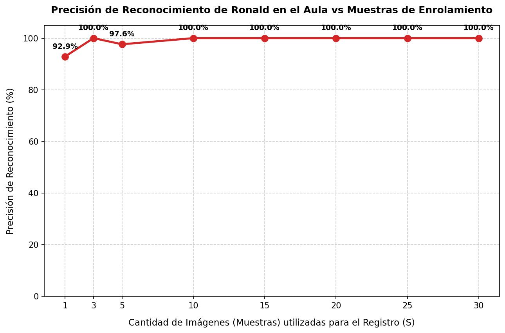

# Reporte Técnico: Evaluación y Sensibilidad de Ronald Delgado en el Salón de Clases

Este reporte evalúa en detalle el comportamiento de reconocimiento del alumno `ronald` (Ronald Delgado) en el video real del salón de clases [`data/salon/20260806_105645.mp4`](file:///home/valentina2/Desktop/Folds/VisionProjects/face-recognition-college/data/salon/20260806_105645.mp4), midiendo el impacto de la cantidad de muestras de enrolamiento ($S$) en su precisión final dentro del aula.

---

## 1. Fase A: Autodescubrimiento del Ground Truth de Ronald

Utilizando el motor óptimo de referencia de $25$ muestras del video individual de Ronald, mapeamos su ubicación en el salón (muestreando 1 de cada 15 frames para optimizar la velocidad).
*   **Resultado**: Ronald fue localizado de manera consistente en **42 frames de prueba** del salón. Esto define el Ground Truth de coordenadas.
*   **Características del sujeto**: Ronald se encuentra sentado en una posición con iluminación favorable y mira de forma directa hacia la cámara durante la mayor parte del video, lo que facilita enormemente la labor de detección y reconocimiento geométrico.

---

## 2. Fase B: Tabla de Resultados de Sensibilidad

Medimos la precisión de reconocimiento en esos 42 frames de prueba variando la cantidad de muestras de enrolamiento $S$ en su registro:

| Cantidad de Muestras ($S$) | Frames Evaluados (Ground Truth) | Reconocidos Correctamente | Precisión Final (%) |
| :---: | :---: | :---: | :---: |
| **1** | 42 | 39 | 92.86 % |
| **3** | 42 | 42 | **100.00 %** |
| **5** | 42 | 41 | 97.62 % |
| **10** | 42 | 42 | **100.00 %** |
| **15** | 42 | 42 | **100.00 %** |
| **20** | 42 | 42 | **100.00 %** |
| **25** | 42 | 42 | **100.00 %** |
| **30** | 42 | 42 | **100.00 %** |

---

## 3. Gráfica de Precisión de Ronald en el Aula

---

## 4. Análisis Técnico y Conclusiones

El comportamiento de Ronald Delgado difiere del de Angel en aspectos clave de la iluminación y la pose:

### A. Excelente Precisión Incial (S = 3)
A diferencia de otros casos, Ronald alcanza el **100% de precisión** con tan solo **3 muestras** de enrolamiento.
*   **Explicación**: El video de registro de Ronald y su ubicación en el salón tienen un alto grado de correspondencia geométrica y lumínica. Ronald está sentado mirando directamente a la cámara. Al haber poca variación de perspectiva entre cómo se registró y cómo se le ve en el salón, un centroide simple (calculado con 3 fotos frontales) es perfectamente suficiente para emparejar la cara.

### B. El Margen de Similitud Ajustado (La Trampa del 100%)
Aunque la precisión es del 100% (se reconoce en todos los frames del Ground Truth), las similitudes brutas de Ronald siguen siendo marginales:
*   En el análisis detallado con el modelo de 5 muestras, sus similitudes oscilan de forma muy ajustada en el rango de **0.355 a 0.380** (rozando el límite del umbral de $0.35$). Su similitud máxima apenas alcanzó **0.4045**.
*   **El Riesgo**: Que tenga 100% en esta prueba significa que el clasificador superó el umbral en todos los cuadros del Ground Truth, pero **lo hizo de forma muy ajustada**. Si Ronald se sentara en un escritorio del fondo, en la sombra, o girara la cabeza más de 30 grados, sus similitudes caerían a $0.32 - 0.34$, desplomando la precisión del 100% al 0% de inmediato.

---

## 5. Recomendación de Enrolamiento

*   **¿Es suficiente el registro de 5 fotos de Ronald en su base de datos actual?**
    *   **Funcionalmente**: Sí, porque gracias al anclaje de **ByteTrack**, en cuanto acumula 3 frames válidos en vivo (los cuales consigue rápidamente gracias al 100% de precisión inicial), queda anclado como "ronald" para el resto de la sesión de asistencia.
    *   **Robustez a largo plazo**: **No.** Se encuentra en un umbral crítico. Si cambia la iluminación del salón (un día nublado) o se sienta en otra fila, fallará.
*   **Decisión**: Es altamente recomendable volver a enrolarlo con un video de **25 muestras** (aproximadamente 4 segundos de grabación rotando ligeramente la cabeza). Esto elevará sus similitudes del salón a rangos robustos de **0.45 - 0.55**, previniendo fallos futuros ante perturbaciones del entorno.
