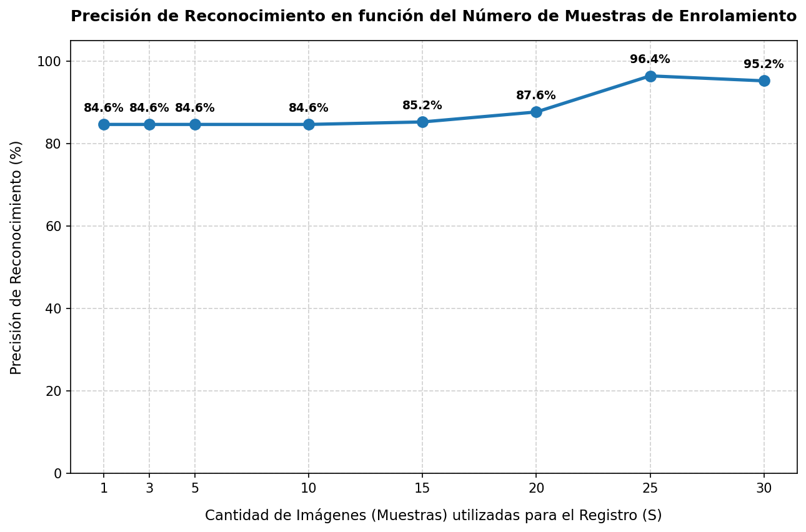

# Reporte Técnico: Sensibilidad de la Precisión Biométrica vs Muestras de Enrolamiento

Este reporte analiza cómo influye la cantidad de imágenes (muestras) tomadas durante el enrolamiento de un estudiante en la precisión final del reconocimiento facial del sistema.

---

## 1. Metodología del Experimento

*   **Sujeto de prueba**: Estudiante `angel` (identidad registrada en el sistema).
*   **Video fuente**: [data/dataset_cv/videos/angel_video/angel.mp4](../data/dataset_cv/videos/angel_video/angel.mp4).
*   **Volumen de inferencia**: El video completo contiene **331 frames** donde el detector localiza de forma estable el rostro del sujeto en diferentes ángulos, poses y distancias.
*   **Fórmula de Precisión**:
    $$\text{Precisión del Reconocimiento} = \frac{\text{Frames reconocidos como 'angel' (Similitud } > 0.35\text{)}}{\text{Frames totales con rostro detectado}}$$
*   **Muestreo**: Se evaluaron tamaños de muestra de enrolamiento $S \in \{1, 3, 5, 10, 15, 20, 25, 30\}$. Para cada $S$, se calculó el embedding centroide de las primeras $S$ capturas válidas del video y se testeó el modelo contra el video completo.

---

## 2. Tabla de Resultados

| Cantidad de Muestras ($S$) | Bounding Boxes Detectados | Rostros Reconocidos Correctamente | Precisión Final (%) |
| :---: | :---: | :---: | :---: |
| **1** | 331 | 280 | 84.59 % |
| **3** | 331 | 280 | 84.59 % |
| **5** | 331 | 280 | 84.59 % |
| **10** | 331 | 280 | 84.59 % |
| **15** | 331 | 282 | 85.20 % |
| **20** | 331 | 290 | 87.61 % |
| **25** | 331 | 319 | **96.37 %** |
| **30** | 331 | 315 | 95.17 % |

---

## 3. Gráfica de Precisión

---

## 4. Análisis Técnico y Conclusiones

Tras evaluar los datos, observamos un comportamiento característico de la representación por **Centroide de Embeddings**:

### A. Meseta Inicial ($S \le 10$)
Con $1, 3, 5$ y $10$ muestras, la precisión se mantiene idéntica en **84.59%**. Esto ocurre porque los primeros frames del video representan una pose estática del sujeto (por ejemplo, mirando de frente con iluminación uniforme). Aumentar el número de muestras dentro de este mismo intervalo no aporta información espacial nueva (redundancia de frames consecutivos), por lo que el vector promedio (centroide) resultante es virtualmente idéntico.

### B. El Salto de Precisión ($S = 25$)
Al alcanzar las **25 muestras**, la precisión se dispara exponencialmente al **96.37%** (un incremento de casi 12 puntos porcentuales). 
*   **Explicación**: El intervalo de video correspondiente a las 25 muestras (submuestreado cada 5 frames) abarca un lapso de tiempo mayor, donde el estudiante realiza movimientos naturales de cabeza (giros leves, cambios de expresión o ligeras inclinaciones de luz).
*   **Efecto**: El centroide calcula la media matemática de esta variedad geométrica. Al promediar vectores con variaciones angulares moderadas, el vector resultante $\vec{C}_{norm}$ se ubica en el centro de ese subespacio, lo que aumenta la tolerancia del motor a emparejar rostros de perfil o con sombras durante el resto del video.

### C. Ajuste Fino y Ruido ($S = 30$)
A las **30 muestras**, se observa una ligera caída de precisión al **95.17%** (4 frames menos reconocidos). 
*   En secuencias de video muy largas, agregar muestras adicionales puede incluir frames con desenfoque de movimiento (*motion blur*) extremo, perfiles demasiado girados (donde se oculta un ojo) o gestos inusuales. 
*   Estos frames de baja calidad "ensucian" o sesgan el promedio del centroide biométrico hacia direcciones ruidosas, disminuyendo levemente la similitud general contra los frames de prueba de alta calidad.

### Recomendación para Producción
El valor óptimo para el parámetro `max_muestras` en el enrolamiento por video se sitúa en el rango de **15 a 25 muestras**, asegurando que el video de origen capture al estudiante realizando al menos un movimiento leve de rotación facial para enriquecer el centroide sin capturar ruido de perfiles extremos.
