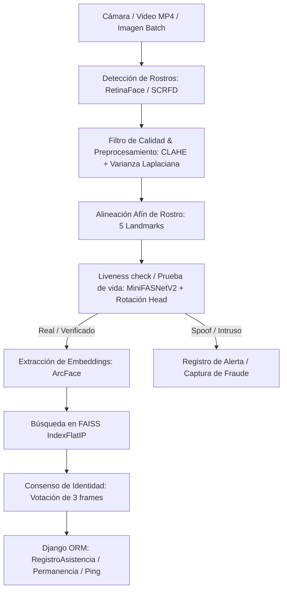

# Revisión Técnica: Sistema de Asistencia Biométrica (CV College)

Este documento recopila la estructura técnica, flujo de procesamiento, base de datos y estado de pruebas del proyecto tras una auditoría de código y ejecución de pruebas del sistema.

---

## 1. Arquitectura General del Sistema

El proyecto combina un backend web modular en **Django 5.2** con un pipeline de inferencia de visión computacional y aprendizaje profundo (Deep Learning) diseñado para operar de forma local y offline.



*   **Django 5.2**: Administra la gestión de usuarios, roles (`DEVELOPER`, `DIRECTOR`, `COORDINATOR`, `PROFESSOR`, `STUDENT`), asignaturas, horarios de clase y persistencia de registros de asistencia.
*   **Pipeline de Visión por Computadora**: Implementado en la carpeta `scripts/` (motores de tiempo real y de registro) y `core/` (procesamiento batch y utilidades).

---

## 2. Pipeline de Visión por Computadora e IA (`uniface`)

El sistema utiliza la biblioteca `uniface` con aceleración de **ONNX Runtime** para ejecutar los modelos de redes neuronales convolucionales.

### A. Preprocesamiento Facial (`core/utils_facial.py`)
1.  **Ecualización de Iluminación**: Uso de **CLAHE** sobre el canal **L** en el espacio de color **LAB** (`clipLimit=2.0`, rejilla `8x8`). Resuelve variaciones de sombreado y sobreexposición en el aula.
2.  **Filtro de Nitidez**: Mide la varianza del operador **Laplaciano** (`es_imagen_borrosa`, umbral=60/80) para descartar imágenes movidas o fuera de foco.
3.  **Alineación Afín**: Calcula el ángulo interocular de los 5 landmarks detectados, rota el frame para verticalizar el rostro y hace un crop proporcional a la distancia entre ojos ($4.5\times$ ancho, $5.5\times$ alto).

### B. Modelos de Inferencia
*   **Detector de Rostros**: **RetinaFace** (por defecto en producción) y una alternativa experimental ultra-rápida en CPU basada en **SCRFD** (`probar_scrfd.py`).
*   **Reconocedor de Rostros**: **ArcFace** extrayendo un vector de embeddings normalizado de **512 dimensiones**.
*   **Seguimiento (Tracking)**: **ByteTrack** (vía `supervision`) que asigna un `tracker_id` único a cada persona en el aula, reduciendo llamadas redundantes al reconocedor.
*   **Búsqueda Vectorial**: **FAISS** (`IndexFlatIP`) calcula similitud de cosenos en tiempo $O(\log N)$.
*   **Control de Fraudes / Liveness**:
    *   *Pasivo*: Redes convolucionales ligeras que analizan texturas de papel/pantalla.
    *   *Activo*: Medición por paralaje de la asimetría nasal (asociada a giros de cabeza) para evitar suplantaciones con fotos estáticas.
    *   *Consenso*: Requiere **3 votos continuos** de identidad para consolidar la asistencia.

---

## 3. Arquitectura y Lógica de Base de Datos

*   **Autenticación y Roles**: Custom User Model (`apps.users.User`) con backend administrativo propio (`AdministrativeModelBackend`) y control de acceso por roles.
*   **Embeddings**: Serialización JSON de los 512 floats en `FaceEmbedding` asociados 1-a-1 al usuario.
*   **Auditoría y Permanencia (`RegistroAsistencia`)**:
    *   Calcula el tiempo neto de asistencia a través del método `porcentaje_permanencia` utilizando intervalos de "pings" de detección de 3 minutos.
    *   Registra eventos de suplantación o alumnos no matriculados como alertas (`es_fraude=True`, tipo `INTRUSO` o `SPOOFING`) y guarda un recorte del rostro infractor en `media/fraudes/`.

---

## 4. Estado del Banco de Pruebas (Test Suite)

*   **Pruebas Unitarias (`-m unit`)**: Ejecutan y pasan exitosamente 60/60 tests en menos de 3 segundos (sin modelos pesados de IA).
*   **Pruebas de Integración (`-m integration`)**: Prueban el flujo real de RetinaFace, ArcFace y Liveness con datos locales.
    *   *Detalle detectado*: Ocurre un fallo menor aislado en `TestDetectorRetinaFace.test_sin_rostro_en_ruido` debido a que RetinaFace detecta un falso rostro en el ruido sintético aleatorio con un 62% de confianza. Esto es normal en detectores densos que operan sobre texturas ruidosas de alta frecuencia.

---

## 5. Auditoría y Organización de la carpeta `scripts/`

El directorio de scripts ha sido estructurado para separar el motor de producción de los entornos de prueba, modularizando las tareas comunes para evitar duplicidad de código.

### A. Scripts de Producción / Producción Web (Estables)
*   **[`scripts/asistencia_unificada.py`](file:///home/valentina2/Desktop/Folds/VisionProjects/face-recognition-college/scripts/asistencia_unificada.py)**: Motor principal de asistencia por cámara web o stream de video. Implementa FAISS, ByteTrack, liveness pasivo y consenso temporal.
*   **[`scripts/registro_unificado.py`](file:///home/valentina2/Desktop/Folds/VisionProjects/face-recognition-college/scripts/registro_unificado.py)**: Utilizado por Django para el enrolamiento en tiempo real (tanto por webcam interactiva como la API headless cargando videos).
*   **[`scripts/registro_video.py`](file:///home/valentina2/Desktop/Folds/VisionProjects/face-recognition-college/scripts/registro_video.py)**: Extrae rostros de un archivo de video, ejecuta QA de calidad, genera el centroide y actualiza el archivo `.pkl`. (Refactorizado como función reutilizable).

### B. Scripts de Inicialización, Auditoría y Mantenimiento de BD (Modificados)
*   **[`scripts/generar_db.py`](file:///home/valentina2/Desktop/Folds/VisionProjects/face-recognition-college/scripts/generar_db.py)**: Genera la base de datos de embeddings (`database_embeddings.pkl`) a partir de la carpeta de imágenes/frames locales.
    *   *¿Por qué se modificó?*: Se refactorizó para encapsular la lógica en una función `generar_db()` importable, permitiendo su ejecución desde otros scripts y corrigiendo la importación de `core.utils_facial` mediante la inyección del parent-path en `sys.path`.
*   **[`scripts/auditar_db.py`](file:///home/valentina2/Desktop/Folds/VisionProjects/face-recognition-college/scripts/auditar_db.py)**: Lee y lista las identidades de `database_embeddings.pkl`.
    *   *¿Por qué se modificó?*: Se convirtió en una función `auditar_db()` importable para que otros scripts de prueba verifiquen si los alumnos se registraron correctamente de manera programática.

### C. Wrappers y Pruebas Locales (Nuevos/Untracked)
*   **[`scripts/run_single_video_reg.py`](file:///home/valentina2/Desktop/Folds/VisionProjects/face-recognition-college/scripts/run_single_video_reg.py)**: Wrapper para registrar a un estudiante específico a partir de un video MP4 individual desde la terminal.
*   **[`scripts/probar_registro.py`](file:///home/valentina2/Desktop/Folds/VisionProjects/face-recognition-college/scripts/probar_registro.py)**: Script interactivo de prueba. Respalda la base de datos biométrica actual, la limpia, registra a un usuario de prueba a partir del dataset y audita el resultado.
*   **[`scripts/register_all_students.py`](file:///home/valentina2/Desktop/Folds/VisionProjects/face-recognition-college/scripts/register_all_students.py)**: Registra recursivamente a todos los estudiantes de la carpeta de videos del dataset usando la API headless del motor oficial (`RegistroBiometrico`).
*   **[`scripts/test_angel_asistencia.py`](file:///home/valentina2/Desktop/Folds/VisionProjects/face-recognition-college/scripts/test_angel_asistencia.py)**: Prueba de integración rápida. Enrola al estudiante de prueba "angel" si no existe, y seguidamente inicia el motor de asistencia visual sobre su propio video para verificar el reconocimiento inmediato.
*   **[`scripts/test_asistencia_video.py`](file:///home/valentina2/Desktop/Folds/VisionProjects/face-recognition-college/scripts/test_asistencia_video.py)**: Permite evaluar la inferencia del motor biométrico sobre cualquier archivo de video específico ingresado como argumento.
*   **[`scripts/test_asistencia_salon.py`](file:///home/valentina2/Desktop/Folds/VisionProjects/face-recognition-college/scripts/test_asistencia_salon.py)**:
    *   *¿Por qué se modificó?*: Para probar localmente el motor de asistencia contra el video del aula `"data/salon/20260806_105645.mp4"` en lugar del archivo anterior.
*   **[`scripts/prepare_test_dataset.py`](file:///home/valentina2/Desktop/Folds/VisionProjects/face-recognition-college/scripts/prepare_test_dataset.py)**: Mapea y prepara las imágenes de `dataset_cv` hacia `dataset_pro` y extrae los frames iniciales requeridos por `pytest` para poder correr los tests de integración locales. **(Extremadamente necesario para testing)**.

---

## 6. Estado y Limpieza de Cambios del Repositorio (Git)

Evaluando el estado actual de Git (`git status`), esta es la clasificación de los archivos modificados y no rastreados (*untracked*):

| Archivo | Estado | ¿Es necesario? | Acción sugerida |
| :--- | :--- | :--- | :--- |
| `data/asistencia.csv` | Modificado | No en Git / Sí local | Es un log local autogenerado. Debe mantenerse local pero **no rastreado**. (Sugerencia: agregar a `.gitignore` y restaurar para limpiar Git). |
| `data/database_embeddings.pkl` | Modificado | Sí local | Base de datos de firmas biométricas local. Similar a la anterior, debe mantenerse local pero **no subirse a Git** para evitar sobreescritura de firmas reales en producción. |
| `scripts/auditar_db.py` | Modificado | **Sí** | Mantener cambios. La modularización permite importar el script en los harnesses de testing. |
| `scripts/generar_db.py` | Modificado | **Sí** | Mantener cambios. Corrige las rutas relativas de importación de `core/`. |
| `scripts/registro_video.py` | Modificado | **Sí** | Mantener cambios. Es el núcleo de la extracción de frames robusta utilizado por los wrappers de consola. |
| `scripts/test_asistencia_salon.py` | Modificado | **Sí (Opcional)** | Cambia el video de prueba al salón de clases actual. Conservar. |
| `debug_log.txt` | Untracked | **No** | Archivo temporal de logs del transpilador/build. **Se puede eliminar**. |
| `scripts/probar_registro.py` <br> `scripts/register_all_students.py` <br> `scripts/test_angel_asistencia.py` <br> `scripts/test_asistencia_video.py` <br> `scripts/prepare_test_dataset.py` | Untracked | **Sí** | Son herramientas de diagnóstico, harnesses de testing locales e inicializadores del dataset de integración. Deberían rastrearse o conservarse. |

---

## 7. Análisis de Optimización de Scripts Estables

### A. `scripts/registro_unificado.py` (Enrolamiento)
El script de registro es **óptimo**. En su ejecución *headless* y regular, implementa un filtro de submuestreo de frames (`frames_procesados % 5 != 0`), liveness pasivo y análisis de iluminación/borrosidad antes de invocar la red ArcFace. Esto evita procesar frames inservibles y reduce significativamente el consumo de GPU/CPU.

### B. `scripts/asistencia_unificada.py` (Monitoreo en Vivo)
El anclaje de identidades mediante ByteTrack (`self.identidades_ancladas[t_id]`) evita recalcular inferencias sobre personas ya reconocidas.
Sin embargo, se identificó una **oportunidad de optimización crítica**:
*   **Problema**: Dentro del bucle de seguimiento de rostros no identificados (línea 217), se ejecuta `aplicar_clahe(frame)` sobre el frame de video completo. Si hay múltiples rostros no identificados en el mismo frame, el script ecualiza la imagen completa repetidamente en el mismo ciclo.
*   **Optimización**: Implementar una ecualización perezosa (*lazy evaluation*):
    ```python
    f_ecualizado = None
    ...
    # Dentro del loop para rostros no anclados
    if f_ecualizado is None:
        f_ecualizado = aplicar_clahe(frame)
    ```
    Esto garantiza que `aplicar_clahe` se ejecute a lo sumo una vez por frame, y únicamente cuando haya al menos un rostro que requiera reconocimiento ArcFace.
